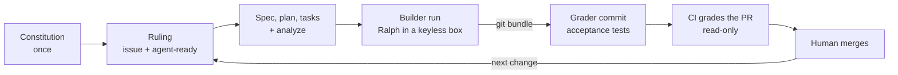

# PLAYBOOK: the Invoice Exception Desk pattern on one page

This is the wrap-up of the [Spec Kit Developer Guide](https://tosin2013.github.io/invoice-exception-desk/). It sums up the whole pattern and links every lesson, so a person or an AI can pull this one file and apply the pattern to its own project.

- Raw file, for agents: <https://raw.githubusercontent.com/tosin2013/invoice-exception-desk/main/PLAYBOOK.md>
- On the guide site: <https://tosin2013.github.io/invoice-exception-desk/PLAYBOOK.html>
- Guide index for agents: [`llms.txt`](https://tosin2013.github.io/invoice-exception-desk/llms.txt) (same content as [`llm.txt`](https://tosin2013.github.io/invoice-exception-desk/llm.txt))

Everything below comes from what the repo and its lessons actually show. Numbers are from our runs, not promises.

## 1. The pattern in a few sentences

Write down *what* to build and *why* before any code exists (a constitution once, then a spec per change), using [GitHub Spec Kit](https://github.com/github/spec-kit). A human (or a strong model) makes every decision **before** the run and writes it into one frozen ruling: a signed file in L5, a GitHub issue from L6 on. A cheap or free model then builds it unattended, inside a locked-down box with no keys, driven by the Spec Kit **Ralph Loop** extension. The result is graded by checks the builder never saw: a sealed answer key (L2 to L5), a hidden self-check (L6), then a read-only CI workflow (L7). A human merges every PR. Dependabot's PRs go through the same CI and the same human merge (L8).

> "Unattended" doesn't mean "unreviewed." Decide everything before the run, check everything after it. ([L5](https://tosin2013.github.io/invoice-exception-desk/L5-agent-loop.html))

**Should you use it at all?** Run the [decision gate on the Home page](https://tosin2013.github.io/invoice-exception-desk/) first. Short version: you need checkable "done" outcomes, work bigger than one sitting, someone other than the builder checking the result, quiet-wrongness risks, and one frozen example to specify against. Typos, config changes, dependency bumps and prototypes get a normal PR, not SDD.

## 2. Prerequisites

What our runs used (pin your own versions and trust your own `--help` over ours):

| Thing | What we used | First needed in |
|---|---|---|
| Git, Python 3.11+, [uv](https://github.github.io/spec-kit/install/uv.html), pytest | Python 3.12 in CI | L0 / L1 |
| Spec Kit CLI (`specify`) | 1.1.3 for L1 to L4, 1.2.3 from L4.5 on | L1 |
| An AI coding agent with a Spec Kit integration | OpenCode 1.19.3 (`--integration opencode`), free model `opencode/deepseek-v4.1-flash-free` | L1 |
| A reviewer who isn't the builder | a separate model or a human | L2 |
| [Ralph Loop](https://github.com/Rubiss-Projects/spec-kit-ralph) extension | v1.5.0 (`specify extension add ralph`) | L5 |
| Docker on a machine with **no keys, tokens or push access** | a separate Ubuntu host | L5 |
| GitHub Actions turned on | the [`ci.yml`](https://github.com/tosin2013/invoice-exception-desk/blob/l5-setup/.github/workflows/ci.yml) workflow on `l5-setup` | L7 |
| Push access to the default branch | for [`.github/dependabot.yml`](https://github.com/tosin2013/invoice-exception-desk/blob/main/.github/dependabot.yml) | L8 |

OpenCode note: the scripted `opencode run --command speckit.<command>` worked on 1.19.3; there is an open report that OpenCode v2 removed it ([spec-kit #4639](https://github.com/github/spec-kit/issues/4639)). When scripting OpenCode, add `< /dev/null` or it can hang waiting for input ([L0](https://tosin2013.github.io/invoice-exception-desk/L0-existing-repo.html)).

## 3. The end-to-end loop

1. **Constitution (once, then amended with a version bump).** Start with 3 to 5 plain rules your agents follow, each tied to the real code (ours grew to eight). Ours ([`.specify/memory/constitution.md`](https://github.com/tosin2013/invoice-exception-desk/blob/l5-setup/.specify/memory/constitution.md), v2.0.0) says, for example: money is integer cents; computation is pure and never reads the clock; standard library only; spec, tests and code land together; every behaviour change is graded against a key the builder never sees; builder-written tests alone never mean "done".
2. **Ruling.** Every choice the agent would otherwise guess goes in writing first: the rule, types, what other rows get, forbidden files, which existing test edits are allowed (exactly), given/when/then acceptance checks with exact inputs, the expected Spec Kit trail, a size limit, "stop and ask if anything conflicts", how it's graded, and any constitution exception for this change. From L6 on the ruling is a GitHub issue; a human adds the `agent-ready` label only when it's final. No label, no run.
3. **Spec, plan, tasks.** `/speckit.specify`, `/speckit.clarify`, `/speckit.plan`, `/speckit.tasks`, then `/speckit.analyze` **before** implement, fixing HIGH findings. A rule change edits the spec that owns the rule: a dated Clarification, the old requirement kept but marked superseded, a new ID ([L4](https://tosin2013.github.io/invoice-exception-desk/L4-maintenance.html)). In L1 to L4 a human or strong model wrote the spec and plan; in L5 to L7 the free-model builder wrote them inside the box from the frozen ruling (a phase-1 prompt), then Ralph implemented.
4. **Builder run in a sandbox.** OpenCode on a free model, driven by Ralph, in a locked-down container (non-root, read-only root, no capabilities, no credentials, no git remote) on a keyless host. Preflight probes must all pass first (18 in L5, 13 in L6). Scope is checked after every agent call. The work comes out as a [`git bundle`](https://git-scm.com/docs/git-bundle), with its SHA-256 in a receipt.
5. **Grader commit.** The acceptance tests were written from the issue and kept out of the builder's folder until the bundle was sealed. The bundle is pushed **unchanged**, and the acceptance tests are added as **one separate commit** under `acceptance/issue-<N>/` (example: [`f916383`](https://github.com/tosin2013/invoice-exception-desk/commit/f916383)). The PR then shows who wrote what.
6. **CI is the grader.** The read-only `ci` workflow runs on every PR: the full suite, the `acceptance/` tests when present, a check that every base test ID still exists, and a diff-size summary ([L7](https://tosin2013.github.io/invoice-exception-desk/L7-ci-grader.html)).
7. **Human merge.** A human merges on green, and closes the issue by hand when the PR targets a branch other than the default (`Closes #N` only auto-closes on the default branch).

Our L7 run, end to end: issue #22 → 3-minute run, 1 Ralph iteration → local self-check PASS → grader commit → CI green in 9 s (223 passed, acceptance 8/8, all 215 base tests present) → merged by [PR #23](https://github.com/tosin2013/invoice-exception-desk/pull/23).

## 4. Roles and trust boundaries

| Role | Does | Never does |
|---|---|---|
| **Human** | rules on every change, approves the issue, adds `agent-ready`, says go, merges every PR | lets anything merge without looking at the result |
| Operator / kit | builds the box, runs preflight and the run, verifies the bundle, adds the grader commit, opens the PR | edits the builder's commits |
| Builder (free model + Ralph) | writes the spec trail and the code inside the box | sees sealed keys or acceptance tests, touches `.github/`, `acceptance/`, `.specify/`, `.opencode/`, pushes, or reports sizes and counts |
| Grader (sealed key, self-check, or CI) | decides pass or fail with checks written outside the builder's reach | gets edited by the builder |
| Reviewer (optional from L7) | checks the PR against the issue, rerunning checks with the issue's exact inputs | reviews its own work |
| Dependabot | opens dependency PRs on a schedule | merges anything |

The boundaries that matter:

- **The builder never sees the answer.** Sealed keys live outside the repo and off the build machine; acceptance tests stay in the kit until the bundle is sealed. A builder that can edit its grader isn't being graded.
- **A human merges every PR.** No auto-merge, for agents or Dependabot.
- **CI is read-only with no secrets.** `permissions: contents: read`, no deploys. Dependabot-triggered workflows get a read-only token anyway.
- **Only what's committed crosses a handoff.** Agents don't share memory; a decision that isn't in the spec, plan, tasks or ruling doesn't exist for the next agent ([L3.5](https://tosin2013.github.io/invoice-exception-desk/L35-agent-handoff.html)).
- **Take numbers from the receipt or CI, not the agent.** In L6 the builder's notes said 167 diff lines; the real diff was 253.

## 5. The levels

Pages links are the published lesson; repo links are the Markdown source on `main`.

| Level | One-line lesson | Page | Source |
|---|---|---|---|
| Home | Decision gate, the Spec Kit loop, how much SDD to use, and a router by project stage | [Home](https://tosin2013.github.io/invoice-exception-desk/) | [`docs/index.md`](https://github.com/tosin2013/invoice-exception-desk/blob/main/docs/index.md) |
| L0 | Adopt Spec Kit in an existing repo: inventory first, constitution from the real code, record a test baseline, pilot one feature | [L0](https://tosin2013.github.io/invoice-exception-desk/L0-existing-repo.html) | [`docs/L0-existing-repo.md`](https://github.com/tosin2013/invoice-exception-desk/blob/main/docs/L0-existing-repo.md) |
| L1 | Install `specify`, `specify init --integration opencode`, write a constitution, build a tiny feature with the human / free-model split | [L1](https://tosin2013.github.io/invoice-exception-desk/L1-setup.html) | [`docs/L1-setup.md`](https://github.com/tosin2013/invoice-exception-desk/blob/main/docs/L1-setup.md) |
| L2 | One feature through specify, clarify, plan, tasks, analyze, implement; green tests aren't "correct" until a hidden answer key agrees | [L2](https://tosin2013.github.io/invoice-exception-desk/L2-first-feature.html) | [`docs/L2-first-feature.md`](https://github.com/tosin2013/invoice-exception-desk/blob/main/docs/L2-first-feature.md) |
| L3 | Same loop on a real project with frozen data and a sealed key, which caught a bug 119 green tests missed | [L3](https://tosin2013.github.io/invoice-exception-desk/L3-invoice-desk.html) | [`docs/L3-invoice-desk.md`](https://github.com/tosin2013/invoice-exception-desk/blob/main/docs/L3-invoice-desk.md) |
| L3.5 | Hand work between two agents: only what's committed (spec, plan, tasks, a frozen packet) crosses the handoff | [L3.5](https://tosin2013.github.io/invoice-exception-desk/L35-agent-handoff.html) | [`docs/L35-agent-handoff.md`](https://github.com/tosin2013/invoice-exception-desk/blob/main/docs/L35-agent-handoff.md) |
| L4 | Change a spec after code exists: dated Clarification, superseded-but-kept requirement, tests first, one commit, `drift.md` | [L4](https://tosin2013.github.io/invoice-exception-desk/L4-maintenance.html) | [`docs/L4-maintenance.md`](https://github.com/tosin2013/invoice-exception-desk/blob/main/docs/L4-maintenance.md) |
| L4.5 | Upgrade Spec Kit itself like a dependency bump: diff tags, dry run in a throwaway clone, no `--force`, own branch and PR | [L4.5](https://tosin2013.github.io/invoice-exception-desk/L45-speckit-upgrade.html) | [`docs/L45-speckit-upgrade.md`](https://github.com/tosin2013/invoice-exception-desk/blob/main/docs/L45-speckit-upgrade.md) |
| L5 | Let a free-model Ralph loop build a ruled change unattended in a keyless box, graded against a sealed key | [L5](https://tosin2013.github.io/invoice-exception-desk/L5-agent-loop.html) | [`docs/L5-agent-loop.md`](https://github.com/tosin2013/invoice-exception-desk/blob/main/docs/L5-agent-loop.md) |
| L6 | The issue is the ruling; a self-check the builder never sees grades it; a human merges | [L6](https://tosin2013.github.io/invoice-exception-desk/L6-issue-to-pr.html) | [`docs/L6-issue-to-pr.md`](https://github.com/tosin2013/invoice-exception-desk/blob/main/docs/L6-issue-to-pr.md) |
| L7 | CI is the grader: full suite, acceptance tests in a separate grader commit, base test IDs still present | [L7](https://tosin2013.github.io/invoice-exception-desk/L7-ci-grader.html) | [`docs/L7-ci-grader.md`](https://github.com/tosin2013/invoice-exception-desk/blob/main/docs/L7-ci-grader.md) |
| L8 | Dependabot is just another author: low-noise config, same CI, human merge | [L8](https://tosin2013.github.io/invoice-exception-desk/L8-dependabot.html) | [`docs/L8-dependabot.md`](https://github.com/tosin2013/invoice-exception-desk/blob/main/docs/L8-dependabot.md) |

Each level has real branches to check out; see the [README levels table](https://github.com/tosin2013/invoice-exception-desk/blob/main/README.md#the-levels). The latest code is on [`l5-setup`](https://github.com/tosin2013/invoice-exception-desk/tree/l5-setup).

## 6. Loop tuning (the Ralph / OpenCode builder loop)

Ralph starts a **fresh agent call per work unit**, reads `tasks.md` to see what's left, keeps compact memory in `ralph-memory.md` and an audit trail in `progress.md`, and commits each finished unit. That keeps context from piling up. Tune it like this.

**Caps (write them in the ruling before the run).** What L5 used ([`request-v1.md`](https://github.com/tosin2013/invoice-exception-desk/blob/l5-setup/specs/003-desk-import/request-v1.md), section 5):

| Knob | L5 value | Where it lives |
|---|---|---|
| Ralph iterations | 10 max | `max_iterations`, or `--max-iterations` / `SPECKIT_RALPH_MAX_ITERATIONS` |
| Fix tries | 3 | the ruling |
| Per agent call | 15 min | wrapper `timeout` |
| Per run | 90 min, plus a hard wall-clock timeout | wrapper |
| Empty-output retries | 5, 10 min apart (count against time, not fix tries) | wrapper |
| Diff size | 300 counted lines, tests included, Ralph's notes and `run.log` excluded | scope check |
| Spend | $0, free model only | the ruling |

Ralph's own stops: `max_iterations` reached, 3 consecutive failures (circuit breaker), and it refuses to call itself complete unless every task is checked off and `git status --short --untracked-files=all` is empty. All three exit non-zero. It's built to be interrupted and resumed: re-run it and it skips checked-off tasks.

**Override defaults from outside the tree.** The installed `ralph-config.yml` defaults to Copilot and a paid model. We left the file alone and set the agent and model with `--model` and `SPECKIT_RALPH_AGENT_CLI`, so the one setup commit stayed the only change under `.specify/`. Install the loop in its own commit, before anything is sealed.

**Self-check and scope checks.**

- After **every** agent call: hard stop on forbidden files (the issue's list, `.specify/`, `.opencode/`, `.github/`, `acceptance/`, `data/`, `pyproject.toml`, `uv.lock`, other test files) or a diff at or over the cap. Other unexpected files are flagged in the receipt, not stopped (L6).
- **Before** any agent call: run the baseline tests, then stop if the tree isn't clean. In L5 run r3, `uv run` quietly created a `uv.lock`, and a run that passed every sealed case was graded FAIL on scope. The fix was `UV_NO_PROJECT=1` plus this clean-tree check, not a looser rule. Neutralize lockfiles and caches before you seal.
- **After** the run: a self-check the builder never sees, in a throwaway container: verify the bundle, run the acceptance checks with the issue's exact inputs, the full suite, the base tests unchanged, and the base test IDs. When existing tests may change, compare the base tests byte by byte and allow only the approved edit (L7).
- Tell the builder to use the issue's exact rows in its tests and **not** to report sizes or counts. CI and the receipt do that.

**When to stop, retry or rerun.**

| Situation | Do |
|---|---|
| Empty output or a provider hiccup ("Connection reset", "Free usage limit reached") | retry after a wait; an empty run is not a clean result (L0, L4) |
| The agent hits a contract question or a conflict | stop and ask on the issue; don't let it guess. Answer by editing the ruling, then start again |
| Scope breach, even a harmless generated file | fail the run; fix the kit, not the rule; rerun from a fresh preflight (and a fresh seal if you use one) |
| Any config change after sealing | fresh preflight and a new seal; a seal never covers a different config |
| Iteration cap or circuit breaker hit | stop; a human reads `progress.md` and `ralph-memory.md` and decides: split the task, tighten the ruling, or rerun |
| Builder asked nothing and finished in one iteration | that's the goal; it means the ruling settled everything (L6, L7 both ran ~3 minutes, 1 iteration) |

Record the container image's **config digest**, not just its ID; the ID changed on every rebuild even with identical layers (L5).

## 7. Dependency hygiene (the L8 recipe)

1. **Make every dependency visible.** Dependabot reads manifest files, not CLI flags. We moved `--with pytest` into a one-line [`requirements-dev.txt`](https://github.com/tosin2013/invoice-exception-desk/blob/l5-setup/requirements-dev.txt) (`pytest==9.1.1`) and pointed CI at it with an absolute path (`--with-requirements "$GITHUB_WORKSPACE/requirements-dev.txt"`), because the base-test-ID step runs in a worktree of the older base commit.
2. **Put `.github/dependabot.yml` on the default branch.** If code lives elsewhere, set `target-branch` on each block. Ours: GitHub Actions weekly and grouped, plus `pip` with `allow: pytest` only, both targeting `l5-setup`; and a monthly grouped Actions block for the Pages workflow on `main`.
3. **Keep the noise low:** `groups` with `patterns: ["*"]`, `allow`, `ignore` majors, weekly or monthly. Start with Actions-only plus at most one more block.
4. **Grade bot PRs with the same CI.** Our L7 workflow graded Dependabot's PR #27 without a single change.
5. **A human merges every Dependabot PR on green.** No auto-merge. Don't leave them sitting, or Dependabot pauses.
6. **"No PR" can be correct.** Version updates have a 3-day default cooldown; read the update job's log before assuming something's broken.
7. **Alerts and security updates are a separate, deliberate choice.** Security updates always target the default branch. We left both off (no runtime dependencies); turn them on for real apps.

Branches without CI (our `main`) are ungraded; schedule their bumps less often. Recipes for other repo types (grouped minor/patch, Docker, security-only, `uv`) are in [L8](https://tosin2013.github.io/invoice-exception-desk/L8-dependabot.html#real-world-recipes).

## 8. Apply this to a new project: checklist for an AI

1. **Run the decision gate** ([Home](https://tosin2013.github.io/invoice-exception-desk/)). If the answer is "no SDD" or "light SDD", stop here and use a normal PR or a short spec.
2. **Set up Spec Kit.** New repo: `specify init --integration <key>` ([L1](https://tosin2013.github.io/invoice-exception-desk/L1-setup.html)). Existing repo: inventory first, change nothing, then `specify init --here --integration <key>` and record the test baseline ([L0](https://tosin2013.github.io/invoice-exception-desk/L0-existing-repo.html)). Pin the `specify` version.
3. **Have a human or strong model write the constitution,** 3 to 5 rules, each citing real code. Include "builder-written tests alone never mean done."
4. **Pick a small, already-decided first change,** ideally a known gap your specs already name, additive, and checkable by a script.
5. **Write the ruling as a GitHub issue** with everything in section 3, step 2. Have the human approve it and add `agent-ready`.
6. **Write the acceptance tests from the issue,** with its exact inputs, and keep them outside the builder's reach.
7. **Add a read-only CI workflow** (no secrets): full suite, `acceptance/` when present, base test IDs still present, diff-size summary. Merge it before the first run. Copy ours: [`ci.yml`](https://github.com/tosin2013/invoice-exception-desk/blob/l5-setup/.github/workflows/ci.yml).
8. **Build the box:** a container on a host with no keys, no tokens, no push remote; the issue snapshot hash-checked; preflight probes; scope checks after every call; clean-tree check after the baseline tests; output as a `git bundle`.
9. **Install Ralph in its own commit,** override its agent and model from outside the tree, and set the caps in section 6.
10. **Run.** The builder writes the spec trail (dated Clarification, spec, plan, tasks, analyze) and implements.
11. **Verify the bundle** (hash and head), run the local self-check once, push the bundle unchanged, add the grader commit, open the PR.
12. **Let CI grade it.** If the PR touches existing tests, also keep a byte-level compare or a review.
13. **A human merges** on green, and closes the issue if it targets a non-default branch.
14. **Add Dependabot** (section 7) once CI exists.
15. **When a rule changes later,** follow [L4](https://tosin2013.github.io/invoice-exception-desk/L4-maintenance.html); when Spec Kit itself updates, follow [L4.5](https://tosin2013.github.io/invoice-exception-desk/L45-speckit-upgrade.html).

## 9. Known gaps

Honest limits of what's here today:

- **CI checks that base test IDs exist, not what they contain.** A builder could weaken a test and keep its name, and every CI step would pass. The local byte-level self-check of the base tests covers that; CI alone doesn't. Keep the self-check (in the kit or as a CI step) or a review for any PR that touches existing tests.
- **Branch protection and required checks are off.** Turning on the `tests` check as required is the real-world next step from L7; until then "CI is the grader" is a habit, not a rule.
- **No automatic pickup of `agent-ready` issues,** no `needs-human` label after repeated failures, and no several issues at once. A human starts each run.
- **The L7 review was skipped** (merged on green CI); that was a judgment call for an additive change with one approved test edit.
- **`main` has no CI,** so Pages and Dependabot PRs into `main` are ungraded.
- **The run kits (container, preflight, self-check) aren't in the repo.** The lessons describe them; you build your own.
- **Results are from our own free-model runs,** graded against our keys, self-checks and CI. They aren't independently certified, and the R0 phase shows how self-graded tests can mislead ([R0 Results and Lessons](https://github.com/tosin2013/invoice-exception-desk/wiki/R0-Results-and-Lessons)).

## 10. Links

- Guide site: <https://tosin2013.github.io/invoice-exception-desk/>
- For agents: [`llms.txt`](https://tosin2013.github.io/invoice-exception-desk/llms.txt) and its copy [`llm.txt`](https://tosin2013.github.io/invoice-exception-desk/llm.txt)
- Repository: <https://github.com/tosin2013/invoice-exception-desk> ([README](https://github.com/tosin2013/invoice-exception-desk/blob/main/README.md), [GUIDE_OUTLINE](https://github.com/tosin2013/invoice-exception-desk/blob/main/GUIDE_OUTLINE.md))
- Spec Kit: <https://github.com/github/spec-kit>; Ralph Loop: <https://github.com/Rubiss-Projects/spec-kit-ralph>
