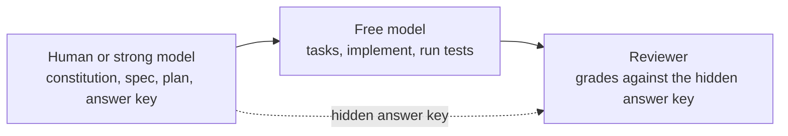
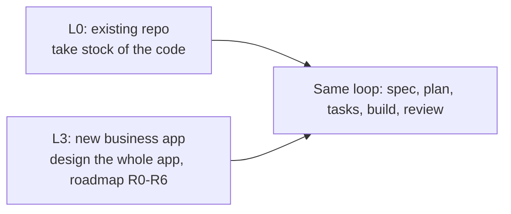

# L0: Start from an existing repo

[← Home](index.md)

- **You are here if** you have a real codebase with existing code and tests, and no Spec Kit yet.
- **You should already have** Git, Python 3.11+ with [uv](https://github.github.io/spec-kit/install/uv.html), the `specify` CLI (see [L1](L1-setup.md) step 1), an AI coding agent, and a passing (or at least known) test suite.
- **You leave with** Spec Kit installed in place, a constitution written from your real code, a recorded test baseline, and one pilot feature built by a free model and checked against an answer key it never saw.
- **Stuck on** install syntax → [L1: Setup](L1-setup.md). An agent hanging or failing → see "What went wrong" below.

> **Start the exercise**
>
> Work on your own branch, so the starter stays clean and you can compare with ours later:
>
> ```bash
> git clone https://github.com/tosin2013/invoice-exception-desk.git
> cd invoice-exception-desk
> git switch l0-start                 # python-slugify at upstream commit 35aca63, before Spec Kit
> git switch -c my-l0                 # your own working branch
> ```
>
> **Going on to L2 after this?** L0 ends with python-slugify, not the bill-split project that L2 builds on. So after L0, switch to the supplied bill-split starter, [`l2-start`](https://github.com/tosin2013/invoice-exception-desk/tree/l2-start), rather than carrying your L0 branch forward.

> **Inspect our solution** (after you've tried it, or if you get stuck)
>
> - [`l0-solution`](https://github.com/tosin2013/invoice-exception-desk/tree/l0-solution) has one commit per step (inventory → init → constitution → feature). See them with `git log --oneline l0-start..l0-solution`.
> - Compare everything: [`l0-start...l0-solution`](https://github.com/tosin2013/invoice-exception-desk/compare/l0-start...l0-solution).
>
> ```mermaid
> flowchart LR
>   brS["l0-start"]
>   brS --> brC0["inventory"]
>   brC0 --> brC1["specify init"]
>   brC1 --> brC2["constitution"]
>   brC2 --> brC3["feature: spec + plan + tasks + code"]
>   brC3 --> brE["l0-solution"]
> ```
>
> The example is [un33k/python-slugify](https://github.com/un33k/python-slugify) (MIT license). It's credited in the branch's `NOTICE` file, and nothing was pushed to the upstream project.

## The idea: who does what

Starting from an existing repo is the hardest way to begin, because the agent has to respect decisions made long before it arrived. The split that worked for us:

| Role | Does | Why |
|---|---|---|
| **Human or strong model** | Constitution, spec, plan | These are judgment calls: what matters, what must not change, and how to fit into existing code. |
| **Free model** (OpenCode with `opencode/deepseek-v4.1-flash-free`) | Inventory, tasks, implementation, running tests | This is mechanical work with clear instructions. It's cheap and fast. |
| **Reviewer** (not the builder) | Answer key before the build, grading after | Tests the builder writes for its own code only prove it agrees with itself. |




We tried both ways on the same repo, and the results are below. **These are results from one run of a free model, graded only against our own answer key and the project's tests. They are not independently certified beyond that.**

## Step by step (recommended path)

| Step | Who does this step | What |
|---|---|---|
| 0 Inventory | Free model | Read the repo and change nothing |
| 1 Install | Human | `specify init --here --integration opencode` |
| 2 Constitution | **Human or strong model** | Rules written from the code |
| 3 Baseline | Human or free model | Run the tests and record the numbers |
| 4 Adopt forward | Human | Spec only new work |
| 5a Answer key | **Reviewer** | Hidden expected results, written before the build |
| 5b Spec and plan | **Human or strong model** | What to build, and exactly how it fits |
| 5c Tasks and implement | **Free model** | `/speckit.tasks`, `/speckit.implement` |
| 6 Grade and commit check | **Reviewer** | Answer key, baseline rerun, one commit |

### Step 0: Take inventory (free model, change nothing)

```bash
opencode run -m opencode/deepseek-v4.1-flash-free \
  "Do NOT install or change anything. Write INVENTORY.md: conventions (cite files), how tests run, no-go areas, smallest scope for a new CLI feature." < /dev/null
```

The free model did this well. It found the frozen files (`slugify/_legacy.py`, `tests/test_legacy.py`), the "never push to `master`" rule, and the right scope.

### Step 1: Install in place (human)

```bash
specify init --here --integration opencode --force
```

`--force` is needed because the folder isn't empty. Add `--non-interactive` in scripts. In a monorepo, run this inside the service you'll change. It only added `.opencode/commands/` and `.specify/`.

> **Confusion point: dot or hyphen?** OpenCode's commands are **`/speckit.constitution`, `/speckit.tasks`** and so on, with a dot. Skills-based agents use `/speckit-<command>`. From a script, use `opencode run --command speckit.tasks`. That worked with OpenCode 1.19.3, the version used here; OpenCode v2 reportedly removed `run --command` ([spec-kit issue #4639](https://github.com/github/spec-kit/issues/4639)), so check your version.

### Step 2: Constitution (human or strong model)

The **constitution** is the project's ground rules. In an existing repo, it describes what *already* exists. The test for every rule is *can I point to a file that already follows it?* Our five rules were: legacy output is frozen; new behaviour is opt-in; the CLI argument shape is a contract (backed by an existing test); new tests go in new files; standard library first, with strict typing. Each rule names its evidence file. See it in [`.specify/memory/constitution.md`](https://github.com/tosin2013/invoice-exception-desk/blob/l0-solution/.specify/memory/constitution.md).

### Step 3: Baseline

```bash
python -m pytest -q
```

**Baseline:** 133 passed, 5 skipped, 136 subtests passed.

### Step 4: Adopt forward

Only spec new work. Don't backfill specs for existing behaviour, except in high-risk areas you're about to change.

### Step 5: Pilot feature

**Feature:** an opt-in `--json` flag. `slugify --json Hello World` prints `{"input": "Hello World", "slug": "hello-world"}`.

**5a. Answer key (reviewer).** Eight hidden cases, written before the build: exact output, options applied, stdin input, empty input, non-ASCII escaping, max length, unchanged output without the flag, and an unchanged argument shape. The builder never saw them.

**5b. Spec and plan (human or strong model).** We wrote [`spec.md`](https://github.com/tosin2013/invoice-exception-desk/blob/l0-solution/specs/001-cli-json/spec.md) and [`plan.md`](https://github.com/tosin2013/invoice-exception-desk/blob/l0-solution/specs/001-cli-json/plan.md) in Spec Kit format. The plan names the exact files (`slugify/__main__.py` and one new test file), says "nothing else", and spells out the one tricky detail: declare the flag with `default=argparse.SUPPRESS` so an existing frozen test keeps passing.

**5c. Tasks and implement (free model).**

```bash
opencode run -m opencode/deepseek-v4.1-flash-free --command speckit.tasks \
  "Generate tasks from the existing spec.md and plan.md. Do not change them." < /dev/null
opencode run -m opencode/deepseek-v4.1-flash-free --command speckit.implement \
  "Implement all tasks. Run the tests. Make exactly ONE commit with the spec folder and the code. Do not push." < /dev/null
```

Tasks produced 14 tasks in 52 seconds (after one connection-reset retry). Implement took 95 seconds and changed only the two planned files.

### Step 6: Grade, rerun the baseline, check the commit (reviewer)

| Check | Result |
|---|---|
| Answer key | **8/8 pass** (2/8 before the build) |
| Original tests after | 133 passed, 5 skipped (unchanged) |
| All tests after | 140 passed, 5 skipped (7 new) |
| Files changed | Only `slugify/__main__.py` and the new `tests/test_cli_json.py` (plus the spec folder) |
| Spec and code in one commit? | Yes ([commit](https://github.com/tosin2013/invoice-exception-desk/commit/dc992f00d1c29d654fa96a23fcbbda7c5dc5edf8)) |
| Frozen files touched? | No |

## Comparison: what happens if the free model plans too

In an earlier run, the free model wrote the constitution, spec, *and* plan itself, for a different pilot (a `--lines` option).

> **Read this as two examples, not a controlled experiment.** The two runs built different features (`--lines` and `--json`), and the human's planning time in Run 2 wasn't counted. So the table can't prove one setup is faster or better. What it does show is the kinds of drift we saw when the free model made the judgment calls itself.

| | Run 1: free model plans | Run 2: human/strong plans (recommended) |
|---|---|---|
| Answer key | 8/8 | 8/8 |
| Original tests | Unchanged (133 passed) | Unchanged (133 passed) |
| Plan bug | **Yes.** Its design would have broken a frozen test; the tasks step caught it. | None. The plan named the tricky detail up front. |
| False claims | **Yes.** It said it had created a git branch; it hadn't. | None found. |
| Extra edits | **Yes.** Edited the README, and installed lint and type tools unasked. | None. Only the planned files changed. |
| Free-model time (specify/plan through implement) | About 8 min (31 + 152 + 122 + 196 seconds) | About 2.5 min (52 + 95 seconds), plus the human's writing time |
| Odd output | An unrelated "Generated with Dojo" footer | None |

**Takeaway:** both runs passed. In these two examples, the free model drifted (a plan bug, a false claim, unasked edits) when it made the judgment calls itself, and we saw none of that when it was given a clear spec and plan.

## What went wrong (in both runs)

1. **`opencode run` hung for about 11 minutes** when run from a script, because it was waiting for input. **Fix:** always add `< /dev/null`.
2. **"Connection reset by server"** happened three times across the runs. These were provider hiccups, not token limits, and a plain retry worked.
3. **The builder went looking outside the repo.** In a related run (L1), the free model tried to list the parent folder where the answer key was kept. OpenCode's own permission check blocked it, so the key stayed unseen. **Lesson:** keep the answer key outside the repo, and ideally on another machine.
4. **Partial coverage.** Only one Python version and the default backend were tested, not the project's full tox matrix.

The free model never ran out of tokens and was never rate limited.

## What's next after L0

After L0 you have the setup done. From here, **every new change follows the same loop**:

**spec → plan → tasks → build → review**

Scope each loop to the area you're touching, not the whole repo.

- **Don't backfill.** Leave old code without specs unless an area is risky and you're about to change it.
- **Specs grow with the code.** Each feature adds its own `specs/NNN-name/` folder, so coverage builds up over time.
- **Keep them in step.** A behaviour change and its spec change land in the **same PR**.

To go deeper:
- [L2: First feature, end to end](L2-first-feature.md)
- L4: Maintenance and spec changes over time *(paused pending review)*




**How this differs from L3 (the Invoice Exception Desk).** The core loop is the same, but the starting point isn't. L0 starts by *taking stock* of code that already exists. L3 starts by *designing the whole app*: a constitution, a whole-app spec, and a phased roadmap (R0 to R6), where each phase gets its own plan and its own answer key.

## Checklist

- [ ] Inventory written, nothing changed
- [ ] `specify init --here --integration <key>` run inside the right scope
- [ ] Constitution written by a human or strong model, with each rule citing a file
- [ ] Baseline test numbers recorded
- [ ] Answer key written by the reviewer, before the build, kept outside the repo
- [ ] Spec and plan written by a human or strong model, naming exact files and "nothing else"
- [ ] Free model runs only `/speckit.tasks` and `/speckit.implement`
- [ ] Answer key and baseline rerun, with spec and code in one commit

L4 is paused pending review. Compare the start branch with the finished steps: [`l0-start...l0-solution`](https://github.com/tosin2013/invoice-exception-desk/compare/l0-start...l0-solution). Next: [L1: Setup](L1-setup.md), then [L2: First feature](L2-first-feature.md) and [L3: Invoice Exception Desk](L3-invoice-desk.md). Back to [Home](index.md).
