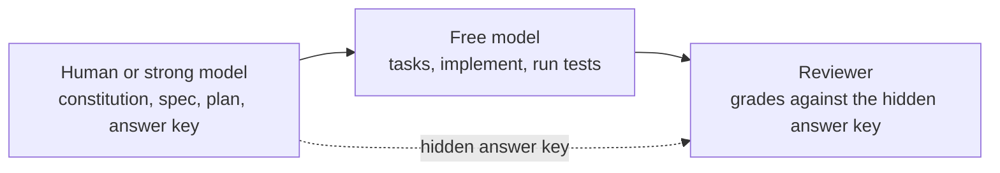

# L1: Setup

[← Home](index.md)

- **You are here if** you're starting a new project with Spec Kit.
- **You should already have** Python 3.11+, [uv](https://github.github.io/spec-kit/install/uv.html), Git, and an AI coding agent.
- **You leave with** a Spec Kit project connected to one agent, a constitution, and a tiny first feature built with the right split between you and a free model.
- **Existing code?** Do [L0: Start from an existing repo](L0-existing-repo.md) first.

> **Follow along**
> - Start: [`l1-start`](https://github.com/tosin2013/invoice-exception-desk/tree/l1-start), an empty folder with just a README.
> - Solution: [`l1-solution`](https://github.com/tosin2013/invoice-exception-desk/tree/l1-solution), the finished tiny feature, with one commit per step.
>
> ```bash
> git clone https://github.com/tosin2013/invoice-exception-desk.git
> cd invoice-exception-desk
> git switch l1-start        # starting point
> git switch l1-solution     # finished result; see each step with: git log --oneline
> ```
>
> ```mermaid
> flowchart LR
>   brS["l1-start"]
>   brS --> brC0["specify init"]
>   brC0 --> brC1["constitution"]
>   brC1 --> brC2["feature: spec + plan + tasks + code"]
>   brC2 --> brE["l1-solution"]
> ```

**Where L1 fits in the loop:** setup gets you to the start; section 5 takes you once around it.


> **Status: partly written.** Sections marked TODO aren't finished yet.

**Key terms**
- **Spec Kit**: GitHub's toolkit for Spec-Driven Development (SDD).
- **`specify` CLI**: the terminal tool that sets up a Spec Kit project.
- **Integration**: the connection between Spec Kit and a specific coding agent (Copilot, OpenCode, and so on).
- **Constitution**: a short list of project-wide principles that the agent follows in every feature.

## 1. Install the `specify` CLI

```bash
uv tool install specify-cli
specify version
```

This guide was checked against **specify-cli 1.1.3** and **OpenCode 1.19.3** (2026-10-18). If your versions are different, trust your own `specify init --help` over this page.

> **Heads-up for OpenCode v2:** the scripted form `opencode run --command speckit.<command>` used on this page worked with OpenCode 1.19.3. There's an open Spec Kit bug report that OpenCode v2 removed `run --command` ([spec-kit issue #4639](https://github.com/github/spec-kit/issues/4639)). If you're on v2, run the `/speckit.*` commands in OpenCode's chat instead, or install a 1.x version.

## 2. Create a project and pick your agent

Taken from `specify init --help` (v1.1.3):

```bash
specify init my-project --integration copilot     # new folder
specify init . --integration opencode             # current folder
specify init --here --integration opencode        # same thing, other syntax
specify init my-project --non-interactive         # no prompts (defaults to Copilot)
```

- Run `specify check` to see the available integrations and which agent tools it can find.
- `--here --force` skips the confirmation when the folder isn't empty.

> **Confusion point: `--ai` or `--integration`?** Some blog posts and older write-ups use `--ai <agent>`. The v1.1.3 help only lists **`--integration <key>`**, so this guide uses that. Also note that the *integration key* isn't always the same as the agent's product name (OpenCode's key is `opencode`). See the [integrations reference](https://github.github.io/spec-kit/reference/integrations.html).

- [ ] TODO: show the output of `specify init` and explain the files it creates.

## 3. Use the agent commands

`/speckit-*` commands are run **in your agent's chat**, not in the terminal. The exact syntax depends on the agent. Skills-based agents use `/speckit-<command>` (or `$speckit-<command>`), while OpenCode's command integration uses **`/speckit.<command>`** with a dot (for example `/speckit.constitution`). Check your agent's command folder.

- [ ] TODO: note the model used in this project's trial (an OpenCode free model).

## 4. Write a constitution

In the agent chat, for example (OpenCode syntax shown):

```text
/speckit.constitution Create principles focused on code quality, testing, and maintainability.
```

- [ ] TODO: draft the Invoice Exception Desk constitution (integer cents, deterministic data, no PII, and an independent answer key per phase).

## 5. Your first tiny feature

Let's build something small from scratch: a function that splits a bill (in cents) between people so every cent is accounted for. The key idea is **who does which step**:

| Step | Who does this step |
|---|---|
| Constitution, spec, plan | **You** (or a strong model) |
| Answer key | **A reviewer**, someone other than the builder |
| Tasks, implement, running tests | **OpenCode's free model** (`opencode/deepseek-v4.1-flash-free`) |
| Grading | **The reviewer** |




Judgment work goes to you; the mechanical work goes to the free model. See [Multi-Agent Workflow](https://github.com/tosin2013/invoice-exception-desk/wiki/Multi-Agent-Workflow) for why.

### 5.1 Start a project

```bash
mkdir bill-split && cd bill-split && git init
specify init --here --integration opencode --force
git add -A && git commit -m "specify init"
```

### 5.2 Write the constitution (you)

Edit `.specify/memory/constitution.md`. Keep it short. Ours has five rules: money is integer cents, functions are pure, use the standard library only, every public function has tests, and the spec and code land together. See [ours](https://github.com/tosin2013/invoice-exception-desk/blob/l1-solution/.specify/memory/constitution.md). Commit it.

### 5.3 Write the spec and plan (you)

Create `specs/001-split-bill/spec.md` (the *what* and *why*, with examples) and `plan.md` (the *how*: exact files, the function signature, and "nothing else"). You can copy the layout from `.specify/templates/`. Then point Spec Kit at the folder:

```bash
echo '{"feature_directory":"specs/001-split-bill"}' > .specify/feature.json
```

Ours: [spec.md](https://github.com/tosin2013/invoice-exception-desk/blob/l1-solution/specs/001-split-bill/spec.md) and [plan.md](https://github.com/tosin2013/invoice-exception-desk/blob/l1-solution/specs/001-split-bill/plan.md). For example, `split_bill(1000, 3)` must return `[334, 333, 333]`: the extra cent goes to the first person.

> **Tip:** you could run `/speckit.specify` and `/speckit.plan` with a strong model instead. In our [L0 trial](L0-existing-repo.md), letting the free model plan led to a plan bug, a false claim, and extra edits.

### 5.4 Write the answer key (reviewer)

Before anything gets built, the reviewer writes a few inputs and expected outputs, and keeps them **outside the repo** so the builder can't see them. Ours had 10 cases, including `split_bill(101, 4) == [26, 25, 25, 25]` and "`True` as a total raises `TypeError`".

### 5.5 Tasks and implement (free model)

```bash
opencode run -m opencode/deepseek-v4.1-flash-free --command speckit.tasks \
  "Generate tasks from the existing spec.md and plan.md. Do not change them." < /dev/null
opencode run -m opencode/deepseek-v4.1-flash-free --command speckit.implement \
  "Implement all tasks. Run the tests. Make exactly ONE commit with the spec folder and the code." < /dev/null
```

Always add `< /dev/null` when you run it from a script; otherwise it can hang waiting for input.

### 5.6 Check the result (reviewer)

Run the answer key and the tests, and look at the commit (`git show --stat HEAD`).

**Our real result:** tasks took 52 seconds (11 tasks) and implement took 95 seconds. The answer key passed **10/10**, the free model's own tests passed (9), and the spec and code landed in one commit. One honest note: on our first try, the free model tried to look in the parent folder, where the answer key was kept. OpenCode's permission check blocked it. That's why the key lives outside the repo. *(These are results from one free-model run, checked only against our own answer key.)*

**Stuck?** Check `specify version` and `specify check`, then the [Installation docs](https://github.github.io/spec-kit/installation.html).

L3 branches are coming. Next: L2 First feature *(coming soon)*. Back to [Home](index.md).
