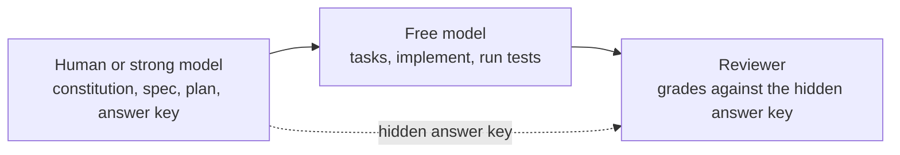

# L1: Setup

[← Home](index.md)

- **You are here if** you're starting a new project with Spec Kit.
- **You should already have** Python 3.11+, [uv](https://github.github.io/spec-kit/install/uv.html), Git, and an AI coding agent.
- **You leave with** a Spec Kit project connected to one agent, a constitution, and a tiny first feature built with the right split between you and a free model.
- **Existing code?** Do [L0: Start from an existing repo](L0-existing-repo.md) first.

> **Follow along**
> - Start: [`l1-start`](https://github.com/tosin2013/invoice-exception-desk/tree/l1-start), an empty folder with just a README.
> - Solution: [`l1-solution`](https://github.com/tosin2013/invoice-exception-desk/tree/l1-solution), the finished tiny feature, with one commit per step.
>
> ```bash
> git clone https://github.com/tosin2013/invoice-exception-desk.git
> cd invoice-exception-desk
> git switch l1-start        # starting point
> git switch l1-solution     # finished result; see each step with: git log --oneline
> ```
>
> ```mermaid
> flowchart LR
>   brS["l1-start"]
>   brS --> brC0["specify init"]
>   brC0 --> brC1["constitution"]
>   brC1 --> brC2["feature: spec + plan + tasks + code"]
>   brC2 --> brE["l1-solution"]
> ```

**Where L1 fits in the loop:** setup gets you to the start; section 5 takes you once around it.


> **Status:** the setup steps and the split-bill exercise on this page are written. [L2](L2-first-feature.md) continues from here. L3 and L4 are paused pending review.

**Key terms**
- **Spec Kit**: GitHub's toolkit for Spec-Driven Development (SDD).
- **`specify` CLI**: the terminal tool that sets up a Spec Kit project.
- **Integration**: the connection between Spec Kit and a specific coding agent (Copilot, OpenCode, and so on).
- **Constitution**: a short list of project-wide principles that the agent follows in every feature.

## 1. Install the `specify` CLI

```bash
uv tool install specify-cli
specify version
```

This guide was checked against **specify-cli 1.1.3** and **OpenCode 1.19.3** (2026-10-18). If your versions are different, trust your own `specify init --help` over this page.

> **Heads-up for OpenCode v2:** the scripted form `opencode run --command speckit.<command>` used on this page worked with OpenCode 1.19.3. There's an open Spec Kit bug report that OpenCode v2 removed `run --command` ([spec-kit issue #4639](https://github.com/github/spec-kit/issues/4639)). If you're on v2, run the `/speckit.*` commands in OpenCode's chat instead, or install a 1.x version.

## 2. Create a project and pick your agent

Taken from `specify init --help` (v1.1.3):

```bash
specify init my-project --integration copilot     # new folder
specify init . --integration opencode             # current folder
specify init --here --integration opencode        # same thing, other syntax
specify init my-project --non-interactive         # no prompts (defaults to Copilot)
```

- Run `specify check` to see the available integrations and which agent tools it can find.
- `--here --force` skips the confirmation when the folder isn't empty.

> **Confusion point: `--ai` or `--integration`?** Some blog posts and older write-ups use `--ai <agent>`. The v1.1.3 help only lists **`--integration <key>`**, so this guide uses that. Also note that the *integration key* isn't always the same as the agent's product name (OpenCode's key is `opencode`). See the [integrations reference](https://github.github.io/spec-kit/reference/integrations.html).

This is the new-folder command from the list above, using the OpenCode integration the rest of this page uses:

```bash
specify init my-project --integration opencode
```

The transcript below is from specify-cli 1.1.3. specify writes the project only when the `opencode` command is already on your `PATH`. That step is a PATH lookup. With no terminal, it skipped the script-type question and selected `sh`, which is what "Selected script type" shows below. Pass `--script sh`, `--script ps`, or `--script py` to choose one. `--non-interactive` skips the question too. The Spec Kit logo is left out. `Working Path` and `Target Path` are the directory this capture used.

```text
╭──────────────────────────────────────────────────────────────────────────────╮
│                                                                              │
│  Specify Project Setup                                                       │
│                                                                              │
│  Project         my-project                                                  │
│  Working Path    /tmp/speckit-init-capture                                   │
│  Target Path     /tmp/speckit-init-capture/my-project                        │
│                                                                              │
╰──────────────────────────────────────────────────────────────────────────────╯
Selected coding agent integration: opencode
Selected script type: sh
Initialize Specify Project
├── ● Check required tools (ok)
├── ● Select coding agent integration (opencode)
├── ● Select script type (sh)
├── ● Install integration (opencode)
├── ● Install shared infrastructure (scripts (sh) + templates)
├── ● Ensure scripts executable (6 updated)
├── ● Constitution setup (copied from template)
├── ● Install bundled workflow (speckit installed)
└── ● Finalize (project ready)

Project ready.

╭─────────────────────────── Agent Folder Security ────────────────────────────╮
│                                                                              │
│  Some agents may store credentials, auth tokens, or other identifying and    │
│  private artifacts in the agent folder within your project.                  │
│  Consider adding .opencode/ (or parts of it) to .gitignore to prevent        │
│  accidental credential leakage.                                              │
│                                                                              │
╰──────────────────────────────────────────────────────────────────────────────╯

╭───────────────────────────────── Next Steps ─────────────────────────────────╮
│                                                                              │
│  1. Go to the project folder: cd my-project                                  │
│  2. Start using slash commands with your coding agent:                       │
│     2.1 /speckit.constitution - Establish project principles                 │
│     2.2 /speckit.specify - Create baseline specification                     │
│     2.3 /speckit.plan - Create implementation plan                           │
│     2.4 /speckit.tasks - Generate actionable tasks                           │
│     2.5 /speckit.implement - Execute implementation                          │
│     2.6 /speckit.converge - Assess the codebase and append remaining work    │
│  as tasks                                                                    │
│                                                                              │
╰──────────────────────────────────────────────────────────────────────────────╯

╭──────────────────────────── Enhancement Commands ────────────────────────────╮
│                                                                              │
│  Optional commands that you can use for your specs (improve quality &        │
│  confidence)                                                                 │
│                                                                              │
│  ○ /speckit.clarify (optional) - Ask structured questions to de-risk         │
│  ambiguous areas before planning (run before /speckit.plan if used)          │
│  ○ /speckit.analyze (optional) - Cross-artifact consistency & alignment      │
│  report (after /speckit.tasks, before /speckit.implement)                    │
│  ○ /speckit.checklist (optional) - Generate quality checklists to validate   │
│  requirements completeness, clarity, and consistency (after /speckit.plan)   │
│                                                                              │
╰──────────────────────────────────────────────────────────────────────────────╯
```

`sh` is why the scripts land in `.specify/scripts/bash/`. The new folder has no application code and no `specs/` directory yet. Those appear when you add the first feature.

```text
my-project/
├── .opencode/
│   └── commands/
│       ├── speckit.analyze.md
│       ├── speckit.checklist.md
│       ├── speckit.clarify.md
│       ├── speckit.constitution.md
│       ├── speckit.converge.md
│       ├── speckit.implement.md
│       ├── speckit.plan.md
│       ├── speckit.specify.md
│       ├── speckit.tasks.md
│       └── speckit.taskstoissues.md
└── .specify/
    ├── .gitignore
    ├── init-options.json
    ├── integration.json
    ├── integrations/
    │   ├── opencode.manifest.json
    │   └── speckit.manifest.json
    ├── memory/
    │   ├── .constitution-template.json
    │   └── constitution.md
    ├── scripts/
    │   └── bash/
    │       ├── check-prerequisites.sh
    │       ├── common.sh
    │       ├── create-new-feature.sh
    │       ├── resolve-template.sh
    │       ├── setup-plan.sh
    │       └── setup-tasks.sh
    ├── templates/
    │   ├── checklist-template.md
    │   ├── constitution-template.md
    │   ├── plan-template.md
    │   ├── spec-template.md
    │   └── tasks-template.md
    └── workflows/
        ├── speckit/
        │   └── workflow.yml
        └── workflow-registry.json
```

**`.opencode/commands/`** — one markdown file per slash command. OpenCode runs them with a dot (`/speckit.constitution`). That dot is `"invoke_separator": "."` in `integration.json`.

- `speckit.constitution.md` — create or update the project constitution.
- `speckit.specify.md` — turn a description into the feature spec.
- `speckit.clarify.md` — ask up to five questions and write the answers back into the spec.
- `speckit.plan.md` — fill in the plan template.
- `speckit.checklist.md` — write a checklist that grades the requirements.
- `speckit.tasks.md` — break the spec and plan into `tasks.md`.
- `speckit.analyze.md` — non-destructive consistency report across spec, plan, and tasks.
- `speckit.implement.md` — carry out the tasks.
- `speckit.converge.md` — compare the code with the spec, plan, and tasks, and append any missing work to `tasks.md`.
- `speckit.taskstoissues.md` — deprecated. It used to open GitHub issues from the task list.

**`.specify/memory/`**

- `constitution.md` — the constitution the agent follows. Right after init it is an unfilled copy of the template, still full of placeholders such as `[PROJECT_NAME]`.
- `.constitution-template.json` — the sha256 of the template that was copied, and `"source": "core"`.

**`.specify/templates/`** — the blank forms those commands copy from.

- `constitution-template.md` — principle headings, with examples in HTML comments.
- `spec-template.md` — user stories, requirements, and success criteria. The comments say each story should be testable on its own.
- `plan-template.md` — summary, technical context, a constitution check, and project structure.
- `tasks-template.md` — tasks grouped by user story. `[P]` marks work that can run in parallel.
- `checklist-template.md` — sample checklist items. The checklist command replaces them with items for the feature.

**`.specify/scripts/bash/`** — present because the script type was `sh`.

- `common.sh` — shared helpers, including the one that walks upward until it finds `.specify` and treats that directory as the repo root.
- `check-prerequisites.sh` — prints the feature directory and which feature docs are already there. `--json` is the form agents call.
- `create-new-feature.sh` — takes a description, picks the next number, creates `specs/<number>-<name>/spec.md` from the template, and writes the local `feature.json` pointer.
- `resolve-template.sh` — prints one template by name, after overrides, presets, extensions, and the core copy.
- `setup-plan.sh` — creates the feature directory if needed and copies the plan template to `plan.md` when that file is absent.
- `setup-tasks.sh` — requires `spec.md` and `plan.md`, then resolves the tasks template.

**`.specify/workflows/`**

- `speckit/workflow.yml` — the bundled "Full SDD Cycle" workflow, version 1.0.1. Its steps are specify, a review gate, plan, a review gate, tasks, then implement.
- `workflow-registry.json` — records that workflow as installed, with `"source": "bundled"`.

**State files**

- `init-options.json` — the choices for this init: `"integration": "opencode"`, `"ai": "opencode"` (the older key, still written), `"script": "sh"`, `"here": false`, `"feature_numbering": "sequential"`, `"speckit_version": "1.1.3"`.
- `integration.json` — installed integrations and their settings, including OpenCode's invoke separator.
- `integrations/opencode.manifest.json` — CLI version, `installed_at`, and a sha256 for each command file.
- `integrations/speckit.manifest.json` — the same kind of record for the shared scripts, the templates, and `.specify/.gitignore`.
- `.gitignore` — lives inside `.specify/`. It ignores `feature.json`, `extensions/*/local-config.yml`, and `integrations/packages/`. The only gitignore this command writes is that file. `feature.json` itself appears later, when the first feature is created. The security panel in the output suggests adding `.opencode/` to a repository gitignore if that folder might pick up tokens.


## 3. Use the agent commands

`/speckit-*` commands are run **in your agent's chat**, not in the terminal. The exact syntax depends on the agent. Skills-based agents use `/speckit-<command>` (or `$speckit-<command>`), while OpenCode's command integration uses **`/speckit.<command>`** with a dot (for example `/speckit.constitution`). Check your agent's command folder.


## 4. Write a constitution

In the agent chat, for example (OpenCode syntax shown):

```text
/speckit.constitution Create principles focused on code quality, testing, and maintainability.
```

The Invoice Exception Desk constitution (integer cents, deterministic data, no PII, and an independent answer key per phase) belongs to the L3 walkthrough, which is paused pending review.

## 5. Your first tiny feature

Let's build something small from scratch: a function that splits a bill (in cents) between people so every cent is accounted for. The key idea is **who does which step**:

| Step | Who does this step |
|---|---|
| Constitution, spec, plan | **You** (or a strong model) |
| Answer key | **A reviewer**, someone other than the builder |
| Tasks, implement, running tests | **OpenCode's free model** (`opencode/deepseek-v4.1-flash-free`) |
| Grading | **The reviewer** |




Judgment work goes to you; the mechanical work goes to the free model. See [Multi-Agent Workflow](https://github.com/tosin2013/invoice-exception-desk/wiki/Multi-Agent-Workflow) for why.

### 5.1 Start a project

```bash
mkdir bill-split && cd bill-split && git init
specify init --here --integration opencode --force
git add -A && git commit -m "specify init"
```

### 5.2 Write the constitution (you)

Edit `.specify/memory/constitution.md`. Keep it short. Ours has five rules: money is integer cents, functions are pure, use the standard library only, every public function has tests, and the spec and code land together. See [ours](https://github.com/tosin2013/invoice-exception-desk/blob/l1-solution/.specify/memory/constitution.md). Commit it.

### 5.3 Write the spec and plan (you)

Create `specs/001-split-bill/spec.md` (the *what* and *why*, with examples) and `plan.md` (the *how*: exact files, the function signature, and "nothing else"). You can copy the layout from `.specify/templates/`. Then point Spec Kit at the folder:

```bash
echo '{"feature_directory":"specs/001-split-bill"}' > .specify/feature.json
```

Ours: [spec.md](https://github.com/tosin2013/invoice-exception-desk/blob/l1-solution/specs/001-split-bill/spec.md) and [plan.md](https://github.com/tosin2013/invoice-exception-desk/blob/l1-solution/specs/001-split-bill/plan.md). For example, `split_bill(1000, 3)` must return `[334, 333, 333]`: the extra cent goes to the first person.

> **Tip:** you could run `/speckit.specify` and `/speckit.plan` with a strong model instead. In our [L0 trial](L0-existing-repo.md), letting the free model plan led to a plan bug, a false claim, and extra edits.

### 5.4 Write the answer key (reviewer)

Before anything gets built, the reviewer writes a few inputs and expected outputs, and keeps them **outside the repo** so the builder can't see them. Ours had 10 cases, including `split_bill(101, 4) == [26, 25, 25, 25]` and "`True` as a total raises `TypeError`".

### 5.5 Tasks and implement (free model)

```bash
opencode run -m opencode/deepseek-v4.1-flash-free --command speckit.tasks \
  "Generate tasks from the existing spec.md and plan.md. Do not change them." < /dev/null
opencode run -m opencode/deepseek-v4.1-flash-free --command speckit.implement \
  "Implement all tasks. Run the tests. Make exactly ONE commit with the spec folder and the code." < /dev/null
```

Always add `< /dev/null` when you run it from a script; otherwise it can hang waiting for input.

### 5.6 Check the result (reviewer)

Run the answer key and the tests, and look at the commit (`git show --stat HEAD`).

**Our real result:** tasks took 51 seconds (11 tasks) and implement took 95 seconds (on the second try; a first try stopped after 17 seconds because our Python environment wasn't set up). The answer key passed **10/10**, the free model's own tests passed (9), and the spec and code landed in one commit. One honest note: on our first try, the free model tried to look in the parent folder, where the answer key was kept. OpenCode's permission check blocked it. That's why the key lives outside the repo. *(These are results from one free-model run, checked only against our own answer key.)*

**Stuck?** Check `specify version` and `specify check`, then the [Installation docs](https://github.github.io/spec-kit/installation.html).

L3 and L4 are paused pending review. Compare the start branch with the finished steps: [`l1-start...l1-solution`](https://github.com/tosin2013/invoice-exception-desk/compare/l1-start...l1-solution). Next: [L2: First feature, end to end](L2-first-feature.md). Back to [Home](index.md).
