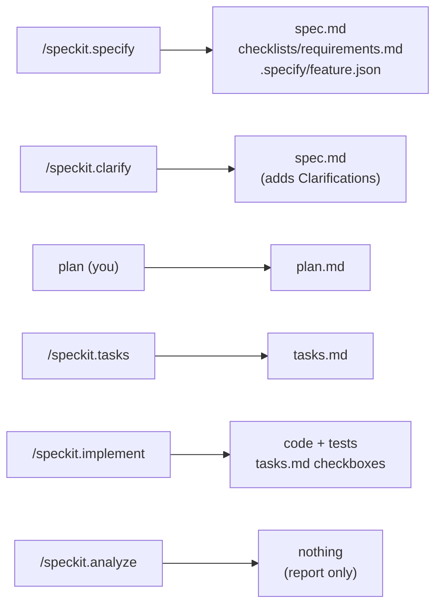
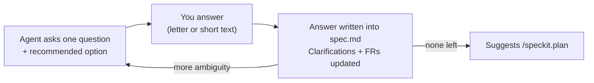
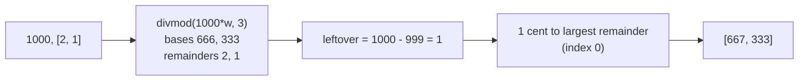

# L2: First feature, end to end

[← Home](index.md)

- **You are here if** you finished [L1](L1-setup.md) (or [L0](L0-existing-repo.md)) and want to see every Spec Kit phase once, slowly, on one small feature.
- **You should already have** the L1 project (`bill_split` with `split_bill`), specify-cli 1.1.3, OpenCode 1.19.3, and Python 3.11+ with pytest.
- **You leave with** a second feature, `split_weighted`, that went through specify → clarify → plan → tasks → implement → analyze, plus an independent answer key that graded it.
- **New in L2:** `/speckit.specify`, `/speckit.clarify`, and `/speckit.analyze`. In L1 you wrote the spec by hand and skipped clarify and analyze.

> **Follow along**
> - Start: [`l2-start`](https://github.com/tosin2013/invoice-exception-desk/tree/l2-start) is the finished L1 project plus an L2 README.
> - Solution: [`l2-solution`](https://github.com/tosin2013/invoice-exception-desk/tree/l2-solution) has one commit per phase.
>
> ```bash
> git clone https://github.com/tosin2013/invoice-exception-desk.git
> cd invoice-exception-desk
> git switch l2-start        # starting point
> git switch l2-solution     # finished result; see each step with: git log --oneline
> ```
>
> ```mermaid
> flowchart LR
>   brS["l2-start"]
>   brS --> brC0["specify"]
>   brC0 --> brC1["clarify"]
>   brC1 --> brC2["plan"]
>   brC2 --> brC3["tasks + implement"]
>   brC3 --> brC4["analyze + review fix"]
>   brC4 --> brE["l2-solution"]
> ```

## The feature

L1's `split_bill(1000, 3)` splits evenly. Real bills aren't even: if one person ordered twice as much, they should pay twice as much. So L2 adds:

```python
split_weighted(1000, [2, 1])   # -> [667, 333]
```

The hard part isn't the division. It's the **leftover cents**: 1000 × 2/3 is 666.67, and you can't pay 0.67 of a cent. Somebody has to decide who gets the extra cent. That decision is exactly what a spec is for.

## Who does which step

Same split as L1, with one addition: the free model now also drafts the spec and asks the clarify questions, while **you** answer them.

| Step | Who | Command |
|---|---|---|
| Constitution | Already done in L1; just re-read it | — |
| Spec draft | Free model | `/speckit.specify` |
| Clarify answers | **You** | `/speckit.clarify` (the model asks; you answer) |
| Plan | **You** (or a strong model) | edit `plan.md` |
| Answer key | **A reviewer**, outside the repo | — |
| Tasks, implement | Free model | `/speckit.tasks`, `/speckit.implement` |
| Analyze | Free model (read-only) | `/speckit.analyze` |
| Grading | **The reviewer** | run the answer key |

## Which files each command touches

This is the most common confusion, so here it is in one picture.



All of the files except the code go in `specs/002-weighted-split/`.

## 1. Check the constitution

Open `.specify/memory/constitution.md` from L1. Its five rules still apply: integer cents, pure functions, stdlib only, tests for every public function, and spec plus code in one commit. **Rule I matters most here:** no floats means no `round()`, so the leftover cents have to be handled with integer maths.

## 2. Specify: the *what* and *why*

```bash
opencode run -m opencode/deepseek-v4.1-flash-free --command speckit.specify \
  "Add split_weighted(total_cents, weights) to bill_split: split a bill in proportion to integer weights (for example one person ordered twice as much), so the shares add up exactly to the total. Keep the existing split_bill unchanged. Use the short name weighted-split." < /dev/null
```

**Our real run:** 42 seconds. It made `specs/002-weighted-split/spec.md` with three user stories, 12 functional requirements and 6 success criteria, plus a quality checklist, and it pointed `.specify/feature.json` at the new folder. It even picked a rounding rule by itself: leftover cents go to the largest fractional remainders, and ties go to the earlier person (FR-006). See [the spec](https://github.com/tosin2013/invoice-exception-desk/blob/l2-solution/specs/002-weighted-split/spec.md).

> **Confusion point: what goes in the spec, and what goes in the plan?** The spec says *what must be true*: "shares add up to the total; ties go to the earlier person". The plan says *how*: "use `divmod` and sort by remainder". If you see a function body or a library name in the spec, move it to the plan.

**Review it before moving on.** A model's spec can sound sure of itself and still be wrong. Check every example by hand. For instance, 1000 × [2, 1] → 666.67 and 333.33 → 666 + 333 = 999, and one leftover cent goes to the bigger remainder (0.67), so the answer is `[667, 333]`.

## 3. Clarify: let the agent ask

```bash
opencode run -m opencode/deepseek-v4.1-flash-free --command speckit.clarify "Ask your questions." < /dev/null
# it prints one question with options A/B/C; answer by continuing the session:
opencode run -m opencode/deepseek-v4.1-flash-free --continue "B" < /dev/null
opencode run -m opencode/deepseek-v4.1-flash-free --continue "A" < /dev/null
```

Clarify asks **one question at a time** (with a recommended answer) and writes each answer into a `## Clarifications` section of `spec.md`. It also updates the requirements that the answer affects. In our run it asked two questions, then said there were no high-impact ambiguities left:

1. *Which containers can `weights` be?* Options: list only, list or tuple, or any iterable. We answered **B (list or tuple)**.
2. *If an input is both the wrong type and out of range (like `-1.5`), which error wins?* We answered **A (`TypeError`, type checks first)**, the same as `split_bill`.

> **Confusion point: "the spec looked complete, so I skipped clarify."** Neither of those questions was visible in the spec, but each one changes the tests. Clarify is cheap (about a minute for us), so run it.



## 4. Plan: the *how* (you)

We wrote [`plan.md`](https://github.com/tosin2013/invoice-exception-desk/blob/l2-solution/specs/002-weighted-split/plan.md) by hand, following the L1 advice. It names the exact files ("edit `bill_split/__init__.py`, create `tests/test_split_weighted.py`, nothing else") and the algorithm:

1. Check types first, then values.
2. For each weight: `base, rem = divmod(total * weight, sum(weights))`.
3. `leftover = total - sum(bases)`. Give one cent each to the `leftover` people with the biggest `rem`, with ties going to the lower index.



Before the build, the reviewer wrote the answer key **outside the repo**: 11 value cases (for example `split_weighted(7, [1, 1, 0]) == [4, 3, 0]` and `split_weighted(5, [3, 3, 2]) == [2, 2, 1]`), 13 error cases (including `range(...)`, a generator, and `-1.5`), and 145 checks that equal weights match `split_bill`. That's 169 checks.

## 5. Tasks and implement (free model)

```bash
opencode run -m opencode/deepseek-v4.1-flash-free --command speckit.tasks \
  "Generate tasks from the existing spec.md and plan.md. Do not change them." < /dev/null
opencode run -m opencode/deepseek-v4.1-flash-free --command speckit.implement \
  "Implement all tasks. Run the tests with python -m pytest -q. Make exactly ONE commit with the spec folder and the code." < /dev/null
```

Make sure `python -m pytest` works in that shell first (we put our virtualenv on `PATH`). In L1, a missing environment made the first implement attempt stop early.

**Our real run:** tasks took 61 seconds (19 tasks across three user stories), and implement took 44 seconds. It added `split_weighted`, wrote 57 new tests (66 in total), left `split_bill` alone, and made one commit with the code, tests, and `tasks.md`.

## 6. Analyze, then grade (reviewer)

```bash
opencode run -m opencode/deepseek-v4.1-flash-free --command speckit.analyze \
  "Analyze spec.md, plan.md and tasks.md for consistency. Read-only." < /dev/null
```

`/speckit.analyze` changes nothing. It cross-checks spec, plan, and tasks and prints a findings table. Ours (92 seconds) reported 11 findings: 1 HIGH, 2 MEDIUM and 8 LOW, with 100% requirement coverage. The HIGH one was real: clarify's answer said "any sequence (list or tuple)", but the plan only accepts `list` and `tuple`, so what happens with `range(1, 3)` wasn't defined. We fixed the spec wording to "list or tuple only" and added a `range` test **in the same commit** (constitution rule V). The full report is saved as [`analysis.md`](https://github.com/tosin2013/invoice-exception-desk/blob/l2-solution/specs/002-weighted-split/analysis.md).

> **Tip: run analyze *before* implement.** Spec Kit intends `/speckit.analyze` to run after tasks and before implement. We ran it afterwards to show what it finds in finished work. On your own features, run it first and fix HIGH findings before any code exists.

Then the reviewer ran the answer key: **169/169 passed**, and the project's own tests passed (**67**). *(These are results from one free-model run, graded only against our own answer key. Green tests are not proof of correctness; the answer key matters because the builder never saw it.)*

> **Confusion point: green tests mean it's correct.** The free model wrote both the code and its tests, so of course they agree. Only the reviewer's answer key, which was written before the build and kept outside the repo, tests the code against what *you* meant.

## Checklist

- [ ] Constitution re-read; the rules that matter for this feature noted
- [ ] `/speckit.specify` run, and every example in the spec checked by hand
- [ ] `/speckit.clarify` run, with every question answered by you
- [ ] Plan written by a human or strong model, naming exact files and "nothing else"
- [ ] Answer key written by the reviewer, before the build, outside the repo
- [ ] `/speckit.tasks` and `/speckit.implement` run by the free model, in one commit
- [ ] `/speckit.analyze` run, and HIGH findings fixed with spec and code together
- [ ] Answer key and the full test suite rerun

L3 and L4 are paused pending review. Compare the start branch with the finished steps: [`l2-start...l2-solution`](https://github.com/tosin2013/invoice-exception-desk/compare/l2-start...l2-solution). Back: [L1: Setup](L1-setup.md). Back to [Home](index.md).
