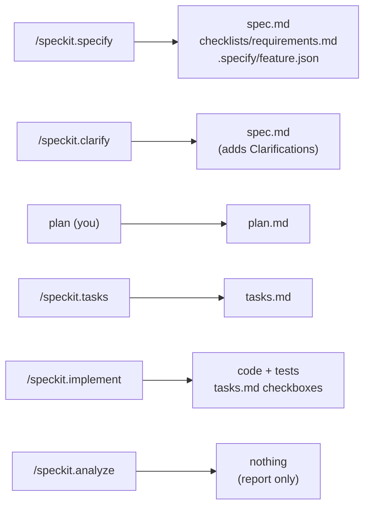
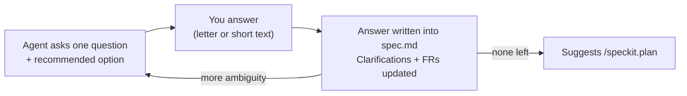
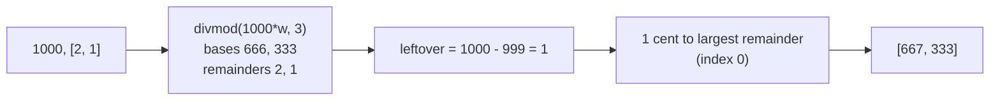

# L2: First feature, end to end

[← Home](index.md)

- **You are here if** you finished [L1](L1-setup.md) (or [L0](L0-existing-repo.md)) and want to take one small feature through the main Spec Kit phases once, slowly.
- **You should already have** the bill-split project, specify-cli 1.1.3, OpenCode 1.19.3, and Python 3.11+ with pytest. **Coming from L0?** Finishing L0 leaves you with python-slugify, not bill-split, so switch to the supplied starter branch `l2-start` below. It already contains the finished L1 code.
- **You leave with** a second feature, `split_weighted`, taken through specify → clarify → plan → tasks → analyze/fix → implement → reviewer checks.
- **Phases shown:** constitution (re-read only), specify, clarify, plan, tasks, analyze, implement, reviewer checks. **Left out:** `/speckit.checklist`, `/speckit.converge`, `/speckit.taskstoissues`, writing a constitution from scratch (that was L1), and extensions.
- **New in L2:** `/speckit.specify`, `/speckit.clarify`, and `/speckit.analyze`. In L1 you wrote the spec by hand and skipped clarify and analyze.

> **Start the exercise**
>
> Work on your own branch, so the starter stays clean and you can compare with ours later:
>
> ```bash
> git clone https://github.com/tosin2013/invoice-exception-desk.git
> cd invoice-exception-desk
> git switch l2-start                 # the starter: finished L1 code + an L2 README
> git switch -c my-l2                 # your own working branch
> ```

> **Inspect our solution** (after you've tried it, or if you get stuck)
>
> - [`l2-solution`](https://github.com/tosin2013/invoice-exception-desk/tree/l2-solution) has one commit per step. See them with `git log --oneline l2-start..l2-solution`.
> - [`run.log`](https://github.com/tosin2013/invoice-exception-desk/blob/l2-solution/run.log) is the raw OpenCode output of every free-model command on this page. Local paths are replaced with `<workdir>` and `<home>`.
> - Compare everything: [`l2-start...l2-solution`](https://github.com/tosin2013/invoice-exception-desk/compare/l2-start...l2-solution).
> - The commit order below is **what we actually did**. Analyze ran *after* implement, which is not the order this page recommends (see section 7).
>
> ```mermaid
> flowchart LR
>   brS["l2-start"]
>   brS --> brC0["specify"]
>   brC0 --> brC1["clarify"]
>   brC1 --> brC2["plan"]
>   brC2 --> brC3["tasks + implement"]
>   brC3 --> brC4["analyze + review fix"]
>   brC4 --> brE["l2-solution"]
> ```

**The runnable path on this page** (the order to follow on your own branch):


## The feature

L1's `split_bill(1000, 3)` splits evenly. Real bills aren't even: if one person ordered twice as much, they should pay twice as much. So L2 adds:

```python
split_weighted(1000, [2, 1])   # -> [667, 333]
```

The hard part isn't the division. It's the **leftover cents**: 1000 × 2/3 is 666.67, and you can't pay 0.67 of a cent. Somebody has to decide who gets the extra cent. That decision is exactly what a spec is for. The promise we want: every share is **strictly less than one cent** away from its exact proportional amount, and the shares add up exactly to the total.

## Who does which step

Same split as L1, with one addition: the free model now also drafts the spec and asks the clarify questions, while **you** answer them.

| Step | Who | Command |
|---|---|---|
| Constitution | Already done in L1; just re-read it | — |
| Spec draft | Free model | `/speckit.specify` |
| Clarify answers | **You** | `/speckit.clarify` (the model asks; you answer) |
| Plan | **You** (or a strong model) | edit `plan.md` |
| Answer key | **A reviewer**, outside the repo | — |
| Tasks | Free model | `/speckit.tasks` |
| Analyze | Free model (read-only); **you** fix the findings | `/speckit.analyze` |
| Implement | Free model | `/speckit.implement` |
| Reviewer checks | **The reviewer** | run the answer key and the tests |

## Which files each command touches

This is the most common confusion, so here it is in one picture.



All of the files except the code go in `specs/002-weighted-split/`. `.specify/feature.json` is the exception: it lives in `.specify/`, and it's **gitignored**, so it isn't on the solution branch.

> **Cloned the solution? Select the active feature yourself.** In specify-cli 1.1.3 the helper scripts find the feature folder from the `SPECIFY_FEATURE_DIRECTORY` environment variable first, then from `.specify/feature.json`. On a fresh clone neither exists, so a command like `/speckit.analyze` stops with "Feature directory not found". Fix it with either of these (we checked both against `check-prerequisites.sh` on a fresh checkout of `l2-solution`):
>
> ```bash
> echo '{"feature_directory":"specs/002-weighted-split"}' > .specify/feature.json
> # or, for one shell session:
> export SPECIFY_FEATURE_DIRECTORY=specs/002-weighted-split
> ```

## 1. Check the constitution

Open `.specify/memory/constitution.md` from L1. Its five rules still apply: integer cents, pure functions, stdlib only, tests for every public function, and spec plus code in one commit. **Rule I matters most here:** no floats means no `round()`, so the leftover cents have to be handled with integer maths.

## 2. Specify: the *what* and *why*

```bash
opencode run -m opencode/deepseek-v4.1-flash-free --command speckit.specify \
  "Add split_weighted(total_cents, weights) to bill_split: split a bill in proportion to integer weights (for example one person ordered twice as much), so the shares add up exactly to the total. Keep the existing split_bill unchanged. Use the short name weighted-split." < /dev/null
```

**Our real run:** 42 seconds. It made `specs/002-weighted-split/spec.md` with three user stories, 12 functional requirements and 6 success criteria, plus a quality checklist, and it pointed `.specify/feature.json` at the new folder. It even picked a rounding rule by itself: leftover cents go to the largest fractional remainders, and ties go to the earlier person (FR-006). See [the spec](https://github.com/tosin2013/invoice-exception-desk/blob/l2-solution/specs/002-weighted-split/spec.md).

> **Confusion point: what goes in the spec, and what goes in the plan?** The spec says *what must be true*: "shares add up to the total; ties go to the earlier person". The plan says *how*: "use `divmod` and sort by remainder". If you see a function body or a library name in the spec, move it to the plan.

**Review it before moving on.** A model's spec can sound sure of itself and still be wrong. Check every example by hand. For instance, 1000 × [2, 1] → 666.67 and 333.33 → 666 + 333 = 999, and one leftover cent goes to the bigger remainder (0.67), so the answer is `[667, 333]`.

## 3. Clarify: let the agent ask

```bash
opencode run -m opencode/deepseek-v4.1-flash-free --command speckit.clarify "Ask your questions." < /dev/null
# it prints one question with options; read it, then answer by continuing the session:
opencode run -m opencode/deepseek-v4.1-flash-free --continue "<your answer>" < /dev/null
```

> **Answer the question you actually get, not ours.** The questions, and the order of the options, can change from run to run, so a letter that was right for us may mean something else for you. Read each question and answer what it *means* (a short phrase is fine, like "list or tuple only").
>
> **More than one session?** `--continue` resumes the *most recent* session. If you've run anything else in between, target the clarify session explicitly: find its id with `opencode session list`, then use `opencode run --session <id> "<your answer>"`.

Clarify asks **one question at a time** (with a recommended answer) and writes each answer into a `## Clarifications` section of `spec.md`. It also updates the requirements that the answer affects. Here is our run, as a historical transcript. It asked two questions, then said there were no high-impact ambiguities left:

1. *Which containers can `weights` be?* Options: list only, list or tuple, or any iterable. We answered **B**, which in that run meant "list or tuple".
2. *If an input is both the wrong type and out of range (like `-1.5`), which error wins?* We answered **A**, which in that run meant "`TypeError`, type checks first", the same as `split_bill`.

> **Confusion point: "the spec looked complete, so I skipped clarify."** Neither of those questions was visible in the spec, but each one changes the tests. Clarify is cheap (about a minute for us), so run it.



## 4. Plan: the *how* (you)

We wrote [`plan.md`](https://github.com/tosin2013/invoice-exception-desk/blob/l2-solution/specs/002-weighted-split/plan.md) by hand, following the L1 advice. It names the exact files ("edit `bill_split/__init__.py`, create `tests/test_split_weighted.py`, nothing else") and the algorithm:

1. Check types first, then values.
2. For each weight: `base, rem = divmod(total * weight, sum(weights))`.
3. `leftover = total - sum(bases)`. Give one cent each to the `leftover` people with the biggest `rem`, with ties going to the lower index.



## 5. Answer key (reviewer, before any code)

Before the build, the reviewer writes the answer key: inputs and expected outputs that the builder never sees. Ours has 169 checks: 11 value cases, 13 error cases (including `range(...)`, a generator, and `-1.5`), and 145 checks that equal weights give the same result as `split_bill`. We wrote it at the same time as the plan commit (22 Oct 2026, 15:30 EDT), before tasks and implement ran.

> **Why we don't publish our answer key.** Once it's public it stops being an answer key. Anyone (or any model) building the exercise could read it, and the result would be graded against an answer the builder had already seen. So the key itself is withheld. Below, in section 8, is a **receipt** you can check instead. Write your own key for your own run; the two examples above show the style.

> **Outside the repo is not an access boundary by itself.** Putting the key in a different folder only helps if the agent can't read that folder. What decides that is the agent's permissions. OpenCode has a permission check for files outside the project folder. In our L1 run, that check is what stopped the free model reading the key. Our L2 `run.log` shows no attempt to read it. That's evidence there was no attempt, not proof of a boundary. Check your agent's permission settings, and keep the key on another machine if you need a real guarantee.

## 6. Tasks (free model)

```bash
opencode run -m opencode/deepseek-v4.1-flash-free --command speckit.tasks \
  "Generate tasks from the existing spec.md and plan.md. Do not change them." < /dev/null
```

**Our real run:** 61 seconds, 19 tasks across three user stories.

## 7. Analyze, then fix (before implement)

```bash
opencode run -m opencode/deepseek-v4.1-flash-free --command speckit.analyze \
  "Analyze spec.md, plan.md and tasks.md for consistency. Read-only." < /dev/null
```

`/speckit.analyze` changes nothing. It cross-checks the spec, plan, and tasks and prints a findings table. **Run it after tasks and before implement**, which is where Spec Kit intends it. Fix every HIGH finding in the spec or plan (and re-run tasks if the fix changes them) before any code exists.

> **Historical note: we ran analyze late.** In our run, analyze came *after* implement (92 seconds). It reported 11 findings: 1 HIGH, 2 MEDIUM and 8 LOW, with 100% requirement coverage. The HIGH one (A1) was real: clarify's answer said "any sequence (list or tuple)", but the plan only accepts `list` and `tuple`, so what happens with `range(1, 3)` wasn't defined. We fixed the spec wording to "list or tuple only" and added a `range` test in the same commit (`da53c28`).
>
> The saved [`analysis.md`](https://github.com/tosin2013/invoice-exception-desk/blob/l2-solution/specs/002-weighted-split/analysis.md) is the **pre-fix snapshot**. Since then, **A1 is fixed**. **G1** (no equal-weight parity test with weights other than 1) and **I2** (tasks.md says the stories are independent but also lists dependencies) are **still open**, and so are the LOW items.

## 8. Implement (free model)

```bash
opencode run -m opencode/deepseek-v4.1-flash-free --command speckit.implement \
  "Implement all tasks. Run the tests with python -m pytest -q. Make exactly ONE commit with the spec folder and the code." < /dev/null
```

Make sure `python -m pytest` works in that shell first (we put our virtualenv on `PATH`). In L1, a missing environment made the first implement attempt stop early.

**Our real run:** 44 seconds. It added `split_weighted`, wrote 57 new tests (66 in total), left `split_bill` alone, and made one commit (`21e7c20`).

> **Historical deviation from constitution rule V** ("a behaviour change and its spec change land in the same commit"). `21e7c20` changed only `bill_split/__init__.py`, `tasks.md`, and `tests/test_split_weighted.py`. The spec and plan had already been committed separately (`d0f6a5c`, `efe6234`, `76eae9a`), because we committed after each phase to show the steps. So rule V was **not** met by the implementation commit, even though the prompt asked for "ONE commit with the spec folder and the code". We've left the history as it is. On your own branch, either commit the spec, plan, tasks, and code together, or squash them into one commit before you merge.

## 9. Reviewer checks

The reviewer runs the answer key and the full test suite against the finished commit.

**Tests: 67 passed.** The jump from 66 to 67 is the `range` test from the analyze fix (section 7): 58 tests in `tests/test_split_weighted.py` plus the 9 L1 `split_bill` tests = 67. (Checked by collecting the tests at `21e7c20`, 57 + 9 = 66, and at `da53c28`, 58 + 9 = 67.)

**Reviewer receipt** (a new run of the withheld key):

| Field | Value |
|---|---|
| Tested commit | `9822512` on `l2-solution` (same code as `da53c28`; it only adds `run.log`) |
| Answer key | `check.py`, sha256 `a4958345e7750b61a3acadb4231f81499c615cb2d9cf190599016c5b7813631d` |
| Key timestamp | Written 22 Oct 2026 at about 15:30 EDT, before implement (from commit times, not from a saved record). **No hash was recorded on 22 Oct.** The file's modified time reads 23 Oct 2026 08:53 EDT because our workspace was restored then. The sha256 above, taken 23 Oct, is the **first recorded hash**, so the key's integrity can only be shown from that point on. |
| Command | `python check.py <checkout of 9822512>`, then `python -m pytest -q` |
| Result | **169/169** checks passed, 0 failures; **67 passed** |
| Run at | 23 Oct 2026, 09:24 EDT |
| Run by | Spec Kit bot |

The first result (169/169 on 22 Oct) is **as reported by the Spec Kit bot**. It has not been independently re-verified by the OpenAI reviewer.

> **Confusion point: green tests mean it's correct.** The risk is **correlated error**. The free model wrote the code *and* its tests from the same reading of the spec. If it misread something (say, which index gets a tied leftover cent), the code and the tests share that mistake, and the tests still pass. Passing tests only show the code agrees with the builder's understanding. An answer key helps only when it comes from a different source and is written before the build. Our key is weaker than that ideal: the same bot wrote the plan and the key, so a shared misreading between those two could still slip through. That is why the receipt says who ran it, and why an outside re-run is worth having.

## 10. Retrospective

> **Was Full SDD worth it for this feature?**
>
> - **What it cost.** Agent time was about 5 minutes: specify 42s, clarify about 70s over three calls, tasks 61s, implement 44s, and analyze 92s. On top of that came our own time for the plan, the clarify answers, the answer key, and the analyze fix, which we didn't time. A normal PR for a 40-line pure function with tests is one sitting: write it, test it, get one review. By file count, SDD added a 122-line spec, a plan, a 196-line `tasks.md`, and an analysis report for 40 lines of code.
> - **What clarify caught.** Two things: which containers `weights` may be, and which error wins when an input is both the wrong type and out of range. A careful reviewer would probably have caught both in a normal PR, since `split_bill` already set the type-checks-first precedent. Clarify's real value was that the decisions got written down before the code, not that it found something review couldn't. The analyze HIGH finding (`range`) was also already covered by the answer key.
> - **Verdict.** At this size, **Full SDD does not earn its cost**. This feature fails decision-gate question 2 on [Home](index.md): it's not bigger than one sitting. **Light SDD** (a short spec with the rounding rule, plus a brief plan) would have captured the important decision, which is who gets the leftover cent. We used Full SDD here as a rehearsal, so you know every step before L3, where features span many sessions and the cost pays back.

## Why this order, and how you'd choose

The steps above make five judgment calls. Here is what L2 decided, the reason where the page gives one, and how you'd make the same call on your own project. Where the page gives no reason, we say so.

- **The second feature.** L2 adds `split_weighted` because real bills aren't even, and deciding who gets the leftover cent "is exactly what a spec is for" ([The feature](#the-feature)). *How you'd choose:* once a first change has tested the loop, pick one that forces a real decision the spec has to record. If any two builders would write the same code, specify and clarify have nothing to do.
- **How to answer clarify.** For "which error wins?" we picked type checks first, "the same as `split_bill`". The page gives no reason for "list or tuple" over any iterable. *How you'd choose:* where existing code already sets a precedent, follow it unless you mean to change it, and say so. Where there's none, pick the narrowest answer you can test, because widening a rule later is easier than narrowing it.
- **Keeping the model's rounding rule.** The free model picked "largest remainder, ties to the earlier person" by itself (FR-006). The page checks it against the examples by hand, but doesn't say why we kept it over another rule. *How you'd choose:* test a model's rule against the promise you wrote first: here, every share is less than one cent from exact, and the shares add up to the total. Keep it if it meets the promise and you can explain it in one line. If not, change it in the spec, not in the code.
- **Which analyze findings to fix now.** The page's rule is to fix every HIGH before implement. After A1 was fixed, G1, I2 and the LOW items stayed open, and the page doesn't say why each one waited. *How you'd choose:* fix now anything that changes what a test should expect. Write the rest down with a reason, as section 7 does.
- **Full or Light SDD.** The [retrospective](#10-retrospective) says Full SDD didn't earn its cost here; we used it as a rehearsal. *How you'd choose:* if the feature fits in one sitting and has one real decision, write a short spec with that decision and a brief plan.

**Try it on your project.**

1. What's the one decision in your next feature that two careful builders would make differently?
2. For each clarify question you get, does existing code already answer it?
3. Is the feature bigger than one sitting? If not, what does a Light SDD spec need to say?

## Checklist

- [ ] Working on your own branch (`git switch -c my-l2`), not on `l2-start`
- [ ] Constitution re-read; the rules that matter for this feature noted
- [ ] `/speckit.specify` run, and every example in the spec checked by hand
- [ ] `/speckit.clarify` run; each actual question read and answered by meaning
- [ ] Plan written by a human or strong model, naming exact files and "nothing else"
- [ ] Answer key written by the reviewer before the build, and protected by the agent's permissions (not just a different folder)
- [ ] `/speckit.tasks` run by the free model
- [ ] `/speckit.analyze` run **before** implement, and HIGH findings fixed in the spec or plan
- [ ] `/speckit.implement` run by the free model; spec, plan, tasks, and code land together (rule V)
- [ ] Reviewer re-runs the answer key and the full suite, and records a receipt (commit, key hash, command, result, who)

Compare the start branch with the finished steps: [`l2-start...l2-solution`](https://github.com/tosin2013/invoice-exception-desk/compare/l2-start...l2-solution). Next: [L3: Invoice Exception Desk walkthrough](L3-invoice-desk.md). Back: [L1: Setup](L1-setup.md). Back to [Home](index.md).
