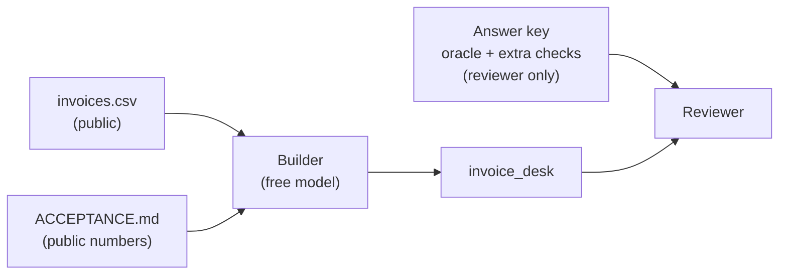

# L3: Invoice Exception Desk walkthrough

[← Home](index.md)

- **You are here if** you finished [L2](L2-first-feature.md) and want to use the same loop on a realistic project, with a frozen dataset, a roadmap, and a sealed answer key.
- **You should already have** specify-cli 1.1.3, OpenCode 1.19.3, and Python 3.11+ with pytest. The starter branch below has everything else, including the L2 code.
- **You leave with** the first slice of roadmap phase **R1**: a pure `invoice_desk.import_invoices(csv_text, as_of)` that classifies 30 invoice rows and computes balances, aging and totals for acceptance items AT-01 to AT-04, graded by an answer key that was withheld from the builder's checkout. There's no evidence the builder ever accessed its contents, but isolation was not proven.
- **Phases shown:** constitution amendment, specify, clarify, plan, answer key, tasks, analyze/fix **before** implement, tasks re-run, implement, reviewer checks, review fix. **Left out:** the rest of R1 (the follow-up queue, owners and notes in AT-05, plus AT-09 and AT-10), R2 to R6, `/speckit.checklist`, `/speckit.converge`, `/speckit.taskstoissues`, and extensions.

> **Start the exercise**
>
> Work on your own branch, so the starter stays clean and you can compare with ours later:
>
> ```bash
> git clone https://github.com/tosin2013/invoice-exception-desk.git
> cd invoice-exception-desk
> git switch l3-start                 # L2 code + the Desk's R0 kit (no oracle)
> git switch -c my-l3                 # your own working branch
> ```

> **Inspect our solution** (after you've tried it, or if you get stuck)
>
> - [`l3-solution`](https://github.com/tosin2013/invoice-exception-desk/tree/l3-solution) has one commit per step. See them with `git log --oneline l3-start..l3-solution`.
> - [`run.log`](https://github.com/tosin2013/invoice-exception-desk/blob/l3-solution/run.log) is the raw OpenCode output of every free-model command, including one failed attempt. Local paths are replaced with `<workdir>` and `<home>`.
> - Compare everything: [`l3-start...l3-solution`](https://github.com/tosin2013/invoice-exception-desk/compare/l3-start...l3-solution).
> - On a fresh clone, select the feature first: `echo '{"feature_directory":"specs/003-desk-import"}' > .specify/feature.json` (the file is gitignored; see [L2](L2-first-feature.md)).
>
> ```mermaid
> flowchart LR
>   brS["l3-start"] --> b1["constitution v1.1.0"] --> b2["specify"] --> b3["clarify"] --> b4["plan"]
>   b4 --> b5["tasks"] --> b6["analyze + fixes"] --> b7["tasks re-run"] --> b8["implement"] --> b9["review fix R1"] --> brE["l3-solution"]
> ```

## What the Desk does

The Invoice Exception Desk is a decision queue for a fictional commercial-cleaning company: *which unpaid invoices need attention, and what is truly outstanding?* It isn't invoicing or payments ([`NON_GOALS.md`](https://github.com/tosin2013/invoice-exception-desk/blob/l3-start/NON_GOALS.md)). The work is split into roadmap phases R0 to R6 ([`ROADMAP.md`](https://github.com/tosin2013/invoice-exception-desk/blob/l3-start/ROADMAP.md)).

**R0 (already done)** froze the inputs: a 30-row synthetic CSV with valid rows, identical and inconsistent duplicates, invalid amounts and dates, and empty rows; an acceptance list (AT-01 to AT-10); and an **oracle**. The [R0 Results and Lessons](https://github.com/tosin2013/invoice-exception-desk/wiki/R0-Results-and-Lessons) page records what went wrong there, mainly that the same model wrote the code, the oracle, and the tests.

> **Jargon: oracle vs answer key.** The **oracle** is the file of expected results for every row (`oracle.json`), computed by a separate script. The **answer key** is what the reviewer runs: the oracle plus extra checks. In L3 the oracle is part of the answer key, so it is **not** on `l3-start`. The public `ACCEPTANCE.md` quotes the headline numbers (14 accepted, 12 rejected, and so on), but not the row-by-row answers.



**How big should a feature be?** R1 has six acceptance items. We took **AT-01 to AT-04** (import, rejection reasons, cent totals, aging) as one feature, because they share one function and one dataset. AT-05 (queue, owners, notes) adds state and is a separate feature. A good size is "one function or one screen, graded by one answer key".

## Who does which step

| Step | Who | Command |
|---|---|---|
| Constitution amendment | **You** | edit `.specify/memory/constitution.md` |
| Spec draft | Free model | `/speckit.specify` |
| Clarify answers | **You** | `/speckit.clarify` |
| Plan | **You** (or a strong model) | edit `plan.md` |
| Answer key | **A reviewer**, before any code | — |
| Tasks | Free model | `/speckit.tasks` |
| Analyze | Free model (read-only); **you** fix the findings | `/speckit.analyze` |
| Implement | Free model | `/speckit.implement` |
| Reviewer checks and review fixes | **The reviewer** | run the answer key and the tests |

## 1. Amend the constitution (you)

The L1 constitution was written for `bill_split`. The Desk needs three more rules, so we bumped it to **v1.1.0** (a minor version, because we added rules and didn't change the old ones):

- **VI.** Synthetic data, offline only.
- **VII.** Explicit `as_of` date; never read the clock.
- **VIII.** A sealed answer key per roadmap phase.

## 2. Specify (free model)

```bash
opencode run -m opencode/deepseek-v4.1-flash-free --command speckit.specify \
  "Build the first slice of roadmap phase R1 for the Invoice Exception Desk: a pure Python package invoice_desk that imports invoice CSV text, classifies every row ... It must satisfy ACCEPTANCE.md AT-01 to AT-04 on data/invoices.csv ... Use the short name desk-import." < /dev/null
```

(The full prompt is in `run.log`.) **Our real run:** 214 seconds. It made `specs/003-desk-import/spec.md` with 29 functional requirements. Clarify (section 3) later added **FR-030** (trim whitespace) and **FR-031** (row width), so the final spec has **31**.

**Check it against the data by hand.** Two things in our spec were quietly risky:
- While drafting, the model counted the CSV itself and got **10 rejected rows out of 28**, not 12 out of 30. Its parser had silently skipped the two blank lines at the end. ACCEPTANCE says those are rows 29 and 30, `empty_row`. The spec it wrote was right, but its own check wasn't.
- FR-017 said "overdue only when the balance is positive", while FR-018 computed `days_overdue` from the due date alone. Those two contradict each other for a fully paid invoice. **Nobody caught this until the answer key did** (section 9).

## 3. Clarify (you answer)

```bash
opencode run -m opencode/deepseek-v4.1-flash-free --command speckit.clarify "Ask your questions." < /dev/null
opencode run -m opencode/deepseek-v4.1-flash-free --continue "<your answer>" < /dev/null
```

Read each question and answer what it *means*; the questions and option order change between runs. If you've run other sessions in between, use `opencode session list` and `--session <id>` instead of `--continue`.

Historical transcript (89, 104, 33 and 90 seconds):

1. *Re-importing a later CSV against a store?* Our answer, in our own words: **"No store; pure per-call function."** The spec had invented a store. We removed it: AT-01's idempotency becomes "the same input gives the same result".
2. *Trim whitespace in cells?* **"Trim all seven fields."**
3. *Rows with too few or too many cells?* **"Pad short rows, ignore extras."**

None of the three was in `ACCEPTANCE.md`, and the first one would have changed the whole design.

## 4. Plan (you)

[`plan.md`](https://github.com/tosin2013/invoice-exception-desk/blob/l3-solution/specs/003-desk-import/plan.md) fixes the exact interface (`import_invoices(csv_text: str, as_of: date) -> dict` with `rows` and `totals`), the files ("create `invoice_desk/__init__.py` and `tests/test_invoice_desk.py`, nothing else"), and one trap from step 2: **use `csv.reader`, not `DictReader`**, because `DictReader` skips blank lines, and blank lines are data rows here.

## 5. Answer key (reviewer, before any code)

The answer key has two kinds of files, and only some are public:

| Part | Published? | Where |
|---|---|---|
| R0 oracle (`oracle.json`) and its script (`compute_oracle.py`) | **Yes**, on `main` since R0; not on `l3-start` | [`data/`](https://github.com/tosin2013/invoice-exception-desk/tree/main/data) on `main` |
| Data generator (`generate_invoices.py`) and `invoices.csv` | **Yes** | `main` and `l3-start` |
| Checker script (`check.py`) | **No** | reviewer only |
| Eight-row probe CSV (inside `check.py`) | **No** | reviewer only |

The checker has two parts:

- **Core (295 checks):** every row's status, reason, balance, days overdue and bucket, and every total, on the fixture at `as_of` 2026-10-15; the same again at two other `as_of` dates (computed by the R0 oracle script); and "importing twice gives the same result".
- **Probes (35 checks):** an extra 8-row CSV of policy edge cases. These follow R0's oracle policy, **which isn't written in the public docs**, so they're reported separately and don't count towards pass/fail.

**You can't reproduce the 295 and 19/35 totals from this checkout**, because the checker and the probes aren't published. They are results reported by the Spec Kit bot (see the receipt in section 9). You *can* compare your own build with the published `oracle.json` for the 30 fixture rows.

We checked the key itself by running it against a stand-in built from the R0 oracle script: 295/295 and 35/35. Then we recorded the hashes **before** the build (23 Oct 2026, 10:07 EDT):

| File | sha256 |
|---|---|
| `check.py` | `a827b5132aece77e5ead1fa25e359f606dcb6a2a0398cbc1cc243c47c1d5558c` |
| `compute_oracle.py` | `72a3b11f3317998c0f2f58f5660ee19b484a785a46a85b76823305ad98a352e1` |
| `oracle.json` | `38560f6b13a77f38ac78ea49419a1b3a58e94ee72f1944f23722267219568eee` |

The checker isn't published, because a published key stops being a key.

> **Weaker than our own constitution.** Rule VIII says the oracle is kept *outside the repo* during the build. What we actually did is weaker: the oracle was left off the `l3-start` and `l3-solution` branches but stayed on `main` in the same repo, and the checker sat in a folder outside the checkout. Neither is an access boundary; the agent's permissions are. Our `run.log` shows the free model **tried to open `data/oracle.json` twice** (during clarify and analyze). It failed only because the file wasn't on the branch. Nothing in the log touched the checker's folder or `main`. That's no demonstrated access, not proven isolation.

## 6. Tasks (free model)

```bash
opencode run -m opencode/deepseek-v4.1-flash-free --command speckit.tasks \
  "Generate tasks from the existing spec.md and plan.md. Do not change them." < /dev/null
```

**Our real run:** 96 seconds, 20 tasks.

## 7. Analyze, then fix (before implement)

This time we ran analyze **in the right place**, before any code (217 seconds). It found 8 issues: 2 HIGH, 2 MEDIUM, 4 LOW. We fixed four of them in the spec and plan (commit `99b239c`):

- **A1 (HIGH):** "required fields" were never listed. Fix: only `issuer` and `invoice_id` are required; a blank date, amount or currency gets that field's own reason; a blank `paid_cents` means 0.
- **C1 (HIGH):** the result rows didn't include the invoice fields the tests needed. Fix: accepted rows also carry `issuer`, `invoice_id`, `amount_cents` and `paid_cents`.
- **A2 (MEDIUM):** empty input wasn't defined. Fix: zero rows, with all six buckets present.
- **A3 (MEDIUM):** `str.isdigit()` accepts characters like `²`. Fix: match ASCII `[0-9]+`, and reject `+100`.

Then we **re-ran `/speckit.tasks`** (62 seconds) so the tasks matched the fixed spec. [`analysis.md`](https://github.com/tosin2013/invoice-exception-desk/blob/l3-solution/specs/003-desk-import/analysis.md) is the pre-fix snapshot. Status of the four LOW findings now:

- **A4** (header contract) is **still open**: the spec puts malformed headers out of scope.
- **F1** (duplicate reason tokens `identical_duplicate` / `inconsistent_duplicate` vs the status names) is **still open**.
- **C2** (no tests for a zero amount, or the same invoice ID from a different issuer) was **addressed** by the build: `tests/test_invoice_desk.py` lines 277 to 303.
- **F2** (parallel setup tasks) was **addressed** by the tasks re-run: T001 and T002 are both marked `[P]` (`tasks.md` lines 33 to 34).

Analyze didn't spot the FR-017/FR-018 contradiction. It checks whether the documents agree with each other, and the two sentences each looked fine on their own.

## 8. Implement (free model)

```bash
opencode run -m opencode/deepseek-v4.1-flash-free --command speckit.implement \
  "Implement all tasks. Run the tests with python -m pytest -q. Make exactly ONE commit with the code, the tests and tasks.md." < /dev/null
```

**Our real run:** 376 seconds. One commit (`fe6139e`): `invoice_desk/__init__.py` (279 lines), 52 tests, and `tasks.md`. **119 passed** (52 new plus 67 from L2).

> **Constitution rule V, honestly.** The spec, plan and tasks were committed in earlier steps, so the implementation commit alone doesn't contain "spec and code together". On a real project, squash the branch when you merge. The review fix in section 9 did change the spec, code and tests in one commit.

## 9. Reviewer checks

**First run, on `fe6139e`** (23 Oct 2026, 10:31 EDT): **core 292/295**. The three failures were all the same bug. `INV-1011` is fully paid (balance 0) and due 61 days before `as_of`. The code said `days_overdue = 61`. The oracle and FR-017 say 0, because a paid invoice is never overdue.

This is **correlated error** in practice. The spec had two sentences that disagreed. The free model followed one of them in the code *and* in its tests. It even named a test `test_fully_paid_overdue_invoice_is_paid_not_overdue` and then asserted `days_overdue == 61`. Its 119 tests passed because they shared the code's misreading. Only a key from a different source caught it.

**Review fix R1** (commit `7010d31`, by the reviewer): FR-018 now says "0 when not overdue under FR-017", and the code and the two tests were changed in that same commit. Tests: **119 passed**.

**Reviewer receipt:**

| Field | Value |
|---|---|
| Tested commit | `7010d31` (later `l3-solution` commits add only `run.log` and a historical note on task T014) |
| Answer key | sha256 values in section 5; re-checked with `sha256sum -c` before each run, both OK |
| Command | `python check.py <checkout>`, then `python -m pytest -q` |
| Result | **Core 295/295.** Probes 19/35. **119 passed.** |
| Run at | 23 Oct 2026, 10:32 EDT |
| Run by | Spec Kit bot |

These results are as reported by the Spec Kit bot and have not been independently re-verified.

**The probe failures, left open on purpose.** They come down to three policy questions that the public docs never answer:

| Input | Our build | R0 oracle |
|---|---|---|
| `amount_cents` = `0` | accepted (spec FR-008 allows 0) | `invalid_amount` |
| currency `usd` (lower case) | `invalid_currency` | accepted |
| `amount_cents` = `0100` (leading zero) | accepted | `invalid_amount` |

The other probe failures follow from these (for example, a later duplicate of the `usd` row changes status). We didn't "fix" them by copying the oracle into the spec, because then the spec would be shaped by the answer key. They go to the product owner as questions. Once they're answered, the answers go into `ACCEPTANCE.md` and the spec.

> **Open policy questions (your call)**
>
> Three inputs where the build and the R0 oracle disagree, and nobody has decided who's right. You are the product owner now.
>
> | Case | Current build | R0 oracle |
> |---|---|---|
> | Amount of zero: `amount_cents` = `0` | accepted, lands in `paid` | rejected, `invalid_amount` |
> | Lower-case currency: `usd` | rejected, `invalid_currency` | accepted |
> | Leading zero: `amount_cents` = `0100` | accepted as 100 | rejected, `invalid_amount` |
>
> **Your mission:** for each case, decide. Is a zero-cent invoice a real invoice or a data-entry slip? Is `usd` a typo you forgive, or a sign the export is broken? Is `0100` a hundred cents or a corrupted cell? Write your ruling into `ACCEPTANCE.md` (a new line under AT-02) **and** into the spec's Clarifications, then change the tests to match, and only then the code. Bonus: run the decision past someone who'd have to explain it to an accountant.
>
> We've deliberately left all three open in our solution. There's no single right answer, only a recorded one.

> **Our key is weaker than ideal.** The same bot wrote the plan, the answer key, and the review fix, and it had read the R0 oracle script. We kept oracle details out of the plan, but a shared misreading between plan and key could still slip through. An outside re-run would make this stronger.

## 10. Retrospective

> **Did Full SDD earn its cost here?**
>
> - **What it cost.** About 21 minutes of agent time: specify 214s, clarify 316s over four calls, tasks 96s + 62s, analyze 217s, implement 376s. On top of that came our untimed time for the constitution, the clarify answers, the plan, the key, and the review fix. A normal PR for a 279-line import function would be a long sitting plus a careful review.
> - **What it caught.** Clarify removed an invented store before any code existed. Analyze, run in the right place, fixed two HIGH gaps before implement. The sealed key caught a real money-adjacent bug that 119 green tests had locked in, which is the "quiet wrongness" that decision-gate question 4 on [Home](index.md) warns about. A normal code review *might* have caught the paid-invoice bug. It wasn't caught by the spec, analyze, or the builder's own tests.
> - **Verdict.** Here, **yes**. Unlike L2, this feature passes the decision gate: the data has tricky edge cases, a later phase (R2 payments) builds on these balances, and the costly mistakes are quiet ones. The price is about 20 minutes of agent time plus the human review steps.

## Checklist

- [ ] Working on your own branch (`git switch -c my-l3`)
- [ ] Constitution amended with a version bump, and the rules for this project added
- [ ] `/speckit.specify` run, and the spec checked against the real data (row counts, blank lines)
- [ ] `/speckit.clarify` run; each actual question answered by meaning
- [ ] Plan fixes the exact interface and files
- [ ] Answer key written before the build, its hashes recorded, and protected by the agent's permissions
- [ ] `/speckit.tasks`, then `/speckit.analyze` **before** implement; HIGH findings fixed, tasks re-run
- [ ] `/speckit.implement` run by the free model
- [ ] Reviewer runs the key (hash check first), fixes failures in spec, code and tests together, and records a receipt
- [ ] Policy questions the key raised go to the product owner, not straight into the spec

Compare the start branch with the finished steps: [`l3-start...l3-solution`](https://github.com/tosin2013/invoice-exception-desk/compare/l3-start...l3-solution). Next: [L3.5: Handing work between coding agents](L35-agent-handoff.md). Back: [L2: First feature](L2-first-feature.md). Back to [Home](index.md).
