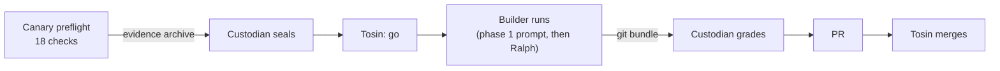

# L5: Letting an agent loop run unattended

[← Home](index.md)

- **You are here if** you finished [L4](L4-maintenance.md) (and ideally [L4.5](L45-speckit-upgrade.md)) and want a free model to take a small, already-ruled change from spec to commits **without you watching**, while you keep the big calls.
- **You should already have** Spec Kit 1.2.3, OpenCode 1.19.3, Docker on a machine that holds **no keys or tokens**, and a reviewer (the "custodian") who can hold a sealed answer key you never see.
- **You leave with** one real behaviour change, **FR-007 → FR-007a**: a due date must not be before the issue date. It was built end to end by OpenCode on a free model, driven by the Spec Kit **Ralph Loop** extension, inside a locked-down container, and graded **PASS** against a key sealed before the run.
- **Phases shown:** the ruling, the setup commit, the canary preflight, sealing, the go, the unattended run (spec, plan and tasks, then Ralph implements), handover by `git bundle`, grading, PR and merge. **Left out:** picking up GitHub issues automatically, Dependabot auto-merge, and running several agents at once. Those were in the original L5 outline, but we haven't tried them yet, so they aren't taught here.

> **Key idea:** "unattended" doesn't mean "unreviewed". You make every decision **before** the run (the rule, the limits, the allowed files, the sealed key) and check everything **after** it (the grade, the PR). During the run, the agent is on its own, in a box it can't get out of.

> **Start the exercise**
>
> ```bash
> git clone https://github.com/tosin2013/invoice-exception-desk.git
> cd invoice-exception-desk
> git switch --detach d6c7d7b          # l5-setup before the run: Spec Kit 1.2.3 + Ralph v1.5.0 installed
> git switch -c my-l5                  # your own working branch
> ```

> **Inspect our solution**
>
> - The builder's two commits were merged into [`l5-setup`](https://github.com/tosin2013/invoice-exception-desk/tree/l5-setup) by [PR #14](https://github.com/tosin2013/invoice-exception-desk/pull/14). That PR is the source for every result on this page.
> - The frozen ruling the run was built against: [`request-v1.md`](https://github.com/tosin2013/invoice-exception-desk/blob/l5-setup/specs/003-desk-import/request-v1.md).
> - What Ralph wrote down as it went: [`progress.md`](https://github.com/tosin2013/invoice-exception-desk/blob/l5-setup/specs/003-desk-import/progress.md) and [`ralph-memory.md`](https://github.com/tosin2013/invoice-exception-desk/blob/l5-setup/specs/003-desk-import/ralph-memory.md).
> - Compare everything: [`d6c7d7b...l5-setup`](https://github.com/tosin2013/invoice-exception-desk/compare/d6c7d7b...l5-setup).
>
> ```mermaid
> flowchart LR
>   b["l3h-handoff<br/>a130646<br/>Spec Kit 1.2.3"] --> s["Ralph v1.5.0 setup<br/>d6c7d7b"]
>   s --> r["request-v1.md ruling<br/>17ca4ec, a54734c"]
>   s --> c1["builder: spec, plan, tasks<br/>4a49d7c"] --> c2["builder: Ralph implements<br/>fa720f6"]
>   c2 --> g(["sealed key<br/>PASS"])
>   c2 --> m["PR #14 merged<br/>61c1403"]
> ```

## Who did what in our run

| Role | Who | Did |
|---|---|---|
| **You** (the human) | Tosin | made the rulings, signed `request-v1.md`, gave the go, chose the clean rerun after r3, merged PR #14 |
| Operator | the Spec Kit bot (strong-model side) | wrote the ruling draft and the run kit, made the setup commit, ran the preflight, relayed messages |
| Free model (builder) | OpenCode 1.19.3 with `opencode/deepseek-v4.1-flash-free`, driven by Ralph v1.5.0 | wrote the spec, plan and tasks, then implemented them, inside the container |
| Custodian (key holder and grader) | an isolated Codex session | wrote and sealed the L5 key, sealed each preflight, graded the bundle |

## The change we made

Before L5, an invoice issued on 2026-01-01 and "due" on 2025-10-15 was accepted: both dates were real dates, and nothing compared them. Tosin's ruling:

| Question | Ruling |
|---|---|
| Is a due date **strictly earlier** than the issue date valid? | **No.** `invalid_date`. |
| Are **equal** issue and due dates valid? | **Yes.** Only a strictly earlier due date is rejected. |
| Is a new rejection reason added? | **No.** `invalid_date` is reused; the error order (FR-011) and the acceptance table don't move. |

The rule is **FR-007a** in [`specs/003-desk-import/spec.md`](https://github.com/tosin2013/invoice-exception-desk/blob/l5-setup/specs/003-desk-import/spec.md). Like FR-008 in L4, the old **FR-007** is kept, struck through and marked superseded, not deleted.

**Why this is a good first unattended change.** It's small and clearly ruled, so the agent has no policy to invent. But it isn't trivial: one existing test (`test_aging_bucket_boundaries`) had a row that becomes invalid under the new rule. The right fix moves that row's issue date earlier so the 365-day aging case is **kept**. The lazy fix deletes the case. A sealed key can tell the difference.

## 1. Decide everything before the run

In L4 you could answer the model's questions as it asked them. In L5 nobody is there to answer, so every answer goes into one frozen document first: [`request-v1.md`](https://github.com/tosin2013/invoice-exception-desk/blob/l5-setup/specs/003-desk-import/request-v1.md). It holds the rule, the known impact (which test breaks and how to fix it), the files the builder may touch, the limits, and how the result is handed over. Tosin signed it on Oct 25, 2026 (10:51 AM EDT, commit `a54734c`).

The limits we used:

| Limit | Value |
|---|---|
| Ralph iterations | 10 at most |
| Per agent call | 15 minutes |
| Per run | 90 minutes |
| Diff size | 300 counted lines (tests included; Ralph's notes files and `run.log` excluded) |
| Budget | $0 (free model only) |
| Files | an allowlist; any change outside it stops the run. `.specify/` and `.opencode/` are off limits |

## 2. Install the loop in its own commit

[Ralph Loop](https://github.com/Rubiss-Projects/spec-kit-ralph) is a community Spec Kit extension. It starts a **fresh agent call for each unit of work**, reads `tasks.md` to see what's left, and checks tasks off as they're done, so context doesn't pile up across one long session.

```bash
specify extension add ralph          # we pinned v1.5.0
```

We installed it in **one operator commit** (`d6c7d7b`, 15 files added, 205 tests before and after) before anything was sealed. That keeps "tool setup" out of "builder work", so the grader can say exactly which commit is allowed to touch `.specify/`.

One gotcha: the installed `ralph-config.yml` defaults to Copilot and a paid model. We left the file alone and overrode the agent and the model from outside the tree.

## 3. Build the box

The builder ran in a **locked-down Docker container** on a **separate Ubuntu host that holds no keys**: no GitHub token, no SSH key, no push access. It can't reach the answer key, because the key isn't on that machine.

How does the work get out without push access? A [`git bundle`](https://git-scm.com/docs/git-bundle): one file holding the new commits. The container writes it, its SHA-256 goes in the receipt, and the custodian verifies the bundle before grading.

## 4. The flow



1. **Canary preflight.** 18 checks run on the real container with the real config, so a broken setup fails here and not halfway through a run. (The baseline test count is one of the things it records.) It produces an evidence archive.
2. **Seal.** The custodian checks the evidence and seals: the key and the exact config are hashed and recorded, so nobody can change either after the fact.
3. **Go.** Tosin says go. Not before.
4. **Build.** A **phase-1 prompt** has OpenCode write the spec change, the plan and the tasks. Then **Ralph** implements the tasks, one fresh call at a time.
5. **Grade.** The custodian verifies the bundle and grades it against the sealed key.
6. **PR and merge.** The bundle is pushed exactly as built, with no edits, a PR goes up, and Tosin merges it.

## Our results

These come from [PR #14](https://github.com/tosin2013/invoice-exception-desk/pull/14) (merged into [`l5-setup`](https://github.com/tosin2013/invoice-exception-desk/tree/l5-setup) on Oct 27, 2026, 3:56 PM EDT). It took two graded runs.

### Run r3 (Oct 26): every case passed, graded FAIL

- Finished in about **3.5 minutes**, with **209 tests passing** (205 at baseline).
- **Every sealed case passed.** It was graded **FAIL on scope only.**
- **Why:** the baseline test command, `uv run --with pytest python -m pytest -q`, quietly created an untracked **`uv.lock`**. The repo has a `pyproject.toml` and no lockfile, so `uv` made one. The sealed scope rules had no exception for generated files, so a file outside the allowlist counted as a scope breach. The custodian wouldn't waive a sealed rule after sealing, which is the point of a seal.
- Tosin chose a **clean rerun** over loosening the rule.

### The fix (kit v4)

- Set **`UV_NO_PROJECT=1`** in the container environment (and its allowlist), so `uv run` stops treating the repo as a project and writes no lockfile.
- **Stop the run if the baseline test run leaves any file in the tree.** This check costs seconds and runs before any agent call.
- The scope rule and the prompt were **not** changed.
- Changing the config changed its hash, so we needed a **fresh preflight and a new seal**. You can't reuse a seal for a different config.

### Run r4 (Oct 27): PASS

- **Preflight:** 18/18 passed. **Seal** issued at 11:58 UTC (7:58 AM EDT).
- **Build:** about **5 minutes**.
- **Tests:** 209 passed. **Scope:** OK, **142** counted lines of the 300 cap.
- **Diff:** 2 commits, 10 files, +208/-2. The code change is **3 lines** in `invoice_desk/__init__.py`; the tests grew by about 50 lines. Nothing changed in `.specify/` or `.opencode/`.

The whole code change:

```python
    if due_date < issue_date:
        return None, "invalid_date"
```

(plus one blank line), placed right after the existing "both dates parse" check, so the FR-011 error order is unchanged.

**Grade: PASS.** Like L4, the key reports its buckets separately:

| Bucket | What it checks | Result |
|---|---|---|
| L3 regression | old behaviour that must not move | **86/86** |
| L4 policy | the FR-008a amount rules | **38/38** |
| L5 date policy | the new FR-007a rules | **33/33** |
| Intentional divergence | where we knowingly differ from the older R0 policy (currency) | **1/1** confirmed |

The custodian also confirmed that FR-007 was kept as superseded, not deleted, and that the 365-day aging case is still covered.

| Item | Value |
|---|---|
| Bundle head | `fa720f607f6110175c0c5087abfaa35d7d3d44d7` |
| Bundle sha256 | `e687d1754715bec4132a13e57fe9745fa0391d93150e4e50f96fbfb4038ec7d2` |
| Result archive sha256 | `9ee9361423ca8f33eb45e6b576703679d5ce42bbc393529759cc61d2943e61d3` |
| Merged by | [PR #14](https://github.com/tosin2013/invoice-exception-desk/pull/14) into `l5-setup` (merge `61c1403`) |

You can't reproduce the key numbers yourself, because the key isn't published. You can check the bundle head and the diff.

## What we learned

- **Neutralize generated files before you seal.** Tools that write lockfiles or caches during the test command (`uv`, `npm`, `.pytest_cache`, `__pycache__`) must be switched off or explicitly allowlisted **before** sealing. A sealed rule can't be waived afterwards, so a harmless `uv.lock` can fail a perfect run.
- **Fail fast on the environment.** A cheap check (is the tree still clean after the baseline test run?) turns an environment mistake into a failure in seconds, before any agent call, instead of a FAIL after the whole run.
- **The code was the easy part.** The change was 3 lines. Nearly all the effort went into isolation and governance: the ruling, the container, the preflight, the seal and the grade. For later levels, keep custodian touchpoints to **two** (seal before, grade after) and reuse the container that's now proven.
- **Record the config digest, not just the image ID.** The Docker image ID changed on every rebuild because of attestation manifests, even when the layers and the config were identical. Record the image's **config digest** too, so you can show two builds are the same.

## What went wrong, and how we handled it

- **r3 failed on a file nobody wrote.** See above. We fixed the kit, not the rule, and reran from a fresh preflight and seal.
- **The default Ralph config pointed at a paid model.** We overrode it from outside the tree instead of editing the installed file, so the setup commit stayed the only change under `.specify/`.
- **Ralph makes several commits.** Rule V says spec, tests and code land in one commit. For this lesson only, `request-v1.md` allows Ralph's multi-commit history on one branch, graded as one bundle. That isn't a constitution change.

## Why this order, and how you'd choose

The steps above make four judgment calls. Here is what L5 decided, the reason where the page gives one, and how you'd make the same call on your own project. Where the page gives no reason, we say so.

- **Which change to run unattended.** FR-007a is small and clearly ruled, so the agent has no policy to invent. It isn't trivial either: one existing test breaks, and only the right fix keeps the 365-day case, which the sealed key can check. *How you'd choose:* pick a change with no open policy questions that still has one wrong but tempting fix. That's what shows whether your checks work.
- **What goes in the ruling.** Nobody is there to answer questions, so [`request-v1.md`](https://github.com/tosin2013/invoice-exception-desk/blob/l5-setup/specs/003-desk-import/request-v1.md) holds the rule, the known impact, the allowed files, the limits and the handover. *How you'd choose:* list every question you answered live in L4 and write the answer down first. Write the known breakage and its right fix in too, so the builder doesn't have to guess.
- **How big the limits are.** The page lists the limits (10 iterations, 15 minutes per call, 90 per run, 300 lines) but doesn't say how they were picked. Run r4 used about 5 minutes and 142 of the 300 lines. *How you'd choose:* estimate the change, then set the limits a few times larger, so a normal run finishes well inside them and a runaway one stops early. Write the limits down before you seal.
- **Rerun, or waive the rule.** Run r3 passed every case but failed on a stray `uv.lock`. The custodian wouldn't waive a sealed rule, "which is the point of a seal", and Tosin chose a clean rerun. *How you'd choose:* when a seal catches an environment mistake, fix the environment, re-seal and rerun. Loosening the rule after the fact turns every seal into a suggestion.

**Try it on your project.**

1. Could your next change run with nobody to answer a question? List what you'd have to decide first.
2. Which existing test does it break, and what's the right fix versus the lazy one?
3. Does your test command write any file into the tree?

## Checklist

- [ ] The human rules on the change first, in one frozen, signed document
- [ ] Limits written down: iterations, time per call and per run, diff size, budget, allowed files
- [ ] The loop tool installed in its own commit, before anything is sealed
- [ ] The builder runs on a machine with no keys and no push access; work comes out as a `git bundle`
- [ ] Generated files (lockfiles, caches) neutralized or allowlisted **before** sealing
- [ ] A clean-tree check right after the baseline test run, before any agent call
- [ ] Preflight passes, then the custodian seals, then the human says go
- [ ] Any config change means a fresh preflight and a new seal
- [ ] Record the image's config digest as well as its ID
- [ ] Grade on separate buckets: regression, each approved policy, intentional divergence
- [ ] Push the bundle exactly as built; the human merges

Compare the setup commit with the finished steps: [`d6c7d7b...l5-setup`](https://github.com/tosin2013/invoice-exception-desk/compare/d6c7d7b...l5-setup). Next: [L6: From an approved issue to a PR you can trust](L6-issue-to-pr.md). Back: [L4.5: Upgrading Spec Kit itself](L45-speckit-upgrade.md). Back to [Home](index.md).
