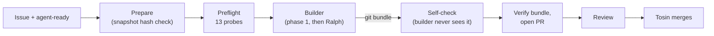

# L6: From an approved issue to a PR you can trust

[← Home](index.md)

- **You are here if** you finished [L5](L5-agent-loop.md) and want a **GitHub issue** to be the thing that starts an agent run, with a PR you can trust at the end, **without babysitting the agent**.
- **You should already have** what L5 used (Spec Kit 1.2.3, OpenCode 1.19.3 on a free model, the Ralph Loop extension, Docker on a machine that holds **no keys or tokens**), and someone other than the builder to review the PR. You **don't** need a custodian or a sealed answer key for this lesson.
- **You leave with** one real change, **FR-032**: accepted import rows now also expose `issue_date`, `due_date` and `currency`. It started as [issue #16](https://github.com/tosin2013/invoice-exception-desk/issues/16), was built by OpenCode with Ralph in the L5 container, checked by an independent self-check, reviewed, and merged by a human ([PR #17](https://github.com/tosin2013/invoice-exception-desk/pull/17)).
- **Phases shown:** picking the issue, writing it as the ruling, the `agent-ready` label, the run, the self-check, opening the PR from the bundle, review, merge. **Left out:** a GitHub Action or bot that picks up labelled issues by itself, CI on PRs, Dependabot, and several issues at once. We haven't tried those yet.

> **Key idea:** the issue **is** the ruling. Every decision the agent would otherwise guess at goes into the issue before you add the label. After the run, checks the builder never saw decide whether it's done, and a human still merges.

> **Start the exercise**
>
> ```bash
> git clone https://github.com/tosin2013/invoice-exception-desk.git
> cd invoice-exception-desk
> git switch --detach 61c1403          # l5-setup after L5 (FR-007a merged, 209 tests)
> git switch -c my-l6                  # your own working branch
> ```

> **Inspect our solution**
>
> - The ruling: [issue #16](https://github.com/tosin2013/invoice-exception-desk/issues/16), "003: accepted import rows expose issue_date, due_date and currency (FR-032, closes drift 003-U1)".
> - The builder's two commits, merged into [`l5-setup`](https://github.com/tosin2013/invoice-exception-desk/tree/l5-setup) by [PR #17](https://github.com/tosin2013/invoice-exception-desk/pull/17), and the [review](https://github.com/tosin2013/invoice-exception-desk/pull/17#pullrequestreview-5682740377).
> - The run branch as built: [`l6/016-accepted-row-dates-currency`](https://github.com/tosin2013/invoice-exception-desk/tree/l6/016-accepted-row-dates-currency).
> - Compare everything: [`61c1403...3e972cf`](https://github.com/tosin2013/invoice-exception-desk/compare/61c1403...3e972cf).
>
> ```mermaid
> flowchart LR
>   b["l5-setup<br/>61c1403<br/>209 tests"] --> c1["builder: spec, plan, tasks<br/>483098d"] --> c2["builder: implementation<br/>d2ae26d"]
>   i(["issue #16<br/>agent-ready"]) --> c1
>   c2 --> sc(["self-check<br/>PASS"])
>   c2 --> m["PR #17 merged<br/>3e972cf<br/>215 tests"]
> ```

## Who did what in our run

| Role | Who | Did |
|---|---|---|
| **You** (the human) | Tosin | approved the issue, added the `agent-ready` label, merged PR #17 |
| Operator | Claude Code, on the keyless Ubuntu host `openclaw` | built the image, prepared the run folder, ran the preflight and the run, reported back |
| Free model (builder) | OpenCode 1.19.3 with `opencode/deepseek-v4.1-flash-free`, driven by Ralph | wrote the spec, plan and tasks, then implemented them, inside the container |
| Kit and PR | the Spec Kit bot | drafted the issue, built the run kit, verified the bundle, opened the PR from it |
| Reviewer | Grok Bot | reviewed the PR and reran the acceptance checks |

Compared with L5, one role is gone: there is **no custodian, no sealed key and no seal step**. Tosin chose that on Oct 27 to keep L6 light.

## The change we made

The 003 spec already said an accepted invoice carries its dates and currency, but accepted rows only exposed `issuer`, `invoice_id`, `amount_cents` and `paid_cents`. The repo's own review trail already called this a gap: analyze finding C1 and drift item **003-U1**. The values were already parsed in the code; they just weren't put in the row.

### Why this issue, and not the others

We weighed three candidates:

| Candidate | Verdict |
|---|---|
| **C1: accepted rows expose dates and currency** | **Picked.** A known gap (analyze C1, drift 003-U1), purely additive (no total, status or queue order moves), and easy to check mechanically |
| C2: an `overdue` flag on accepted rows | Possibly redundant with `days_overdue > 0` |
| C3: reject a CSV whose header is missing a column | Needs a new policy decision and conflicts with FR-003 |

A good first issue for an unattended agent is one where **nothing is left to decide**. C3 is a useful fix, but it's a lesson where the human ruling is the point, not a hands-off run.

## 1. Write the issue as the ruling

In L5 the ruling was a signed file (`request-v1.md`). In L6 it's the issue. The agent can't ask you mid-run, so the issue answers every question up front:

| Question the agent would otherwise guess | Issue #16's answer |
|---|---|
| What type are the dates? | **`str`** in ISO `YYYY-MM-DD`, not `datetime.date` (constitution VII). The code's parsed value is a `date`, so without this line a careful agent could pick the wrong type. |
| What do rejected and duplicate rows get? | **Nothing new.** They must not carry these keys (FR-015, SC-008). |
| Which files are off limits? | `queue.py`, `annotations.py`, `contracts/public-api.md`, `ACCEPTANCE.md`. No other new fields or totals. |
| What counts as done? | Six given/when/then acceptance checks, the 209 existing tests unchanged, and a review. |
| What if something conflicts? | Stop and ask on the issue instead of guessing. |

It also lists the Spec Kit trail it expects in the PR (a dated Clarification and FR-032 in the 003 spec, a plan revision, an L6 tasks phase, drift 003-U1 closed, dated notes in the 004 spec) and a size limit (under 300 lines).

**State the exception in the issue.** The constitution says changes are graded against an answer key the builder never sees, and that builder-written tests alone never mean done (`.specify/memory/constitution.md`, lines 41 and 47). L6 has no hidden key, so issue #16 says, in writing, that for this issue only the acceptance checks plus the unchanged tests plus the review replace that requirement, the same way L5-Q2 did in `request-v1.md`. Without that line, a careful agent (or `/speckit.analyze`) would flag a constitution conflict and stop.

Then Tosin added the **`agent-ready`** label. No label, no run.

## 2. The course kit

The run used the **L6 course kit** (not in the repo, like L5's). It's the L5 kit v4 with the custodian, seal, canary and evidence cutoff taken out. What's left is small:

- **The issue snapshot is the ruling.** The kit carries `issue-16.md`, a copy of the issue body. It's hash-checked, and the prepare step **stops if the live issue has changed** since the snapshot. Editing the issue after approval can't quietly change the job.
- **The same box as L5.** Locked-down container, no credentials, no remote, a clean clone of `l5-setup` at `61c1403`. The work comes out as a `git bundle`.
- **13 preflight probes** in the real container (no host paths, no credentials, no sockets, non-root, no capabilities, read-only root, the snapshot's hash, no git remote, and so on). Must be 13/13.
- **Scope rules,** checked after every agent call: a **hard stop** on the issue's forbidden files, other test files, `.specify/`, `.opencode/`, `data/`, `pyproject.toml`, `uv.lock`, or a diff of 300 lines or more. Any **other** unexpected file is **flagged** in the receipt, not stopped.
- **A post-run self-check the builder never sees.** After the builder finishes, the kit clones the repo fresh, verifies the bundle and then, in a throwaway container, runs: the issue's 6 acceptance checks as its own tests, the full suite, the **209 base tests unchanged** against the new code, and a check that all 209 base test IDs still exist. It writes PASS or FAIL into the receipt.

That self-check is the lightweight stand-in for L5's sealed key. It's written from the issue, kept out of the builder's folder, and runs after the fact.

## 3. The flow



## Our results

The run was on **Oct 28, 2026, 8:26:32 to 8:29:11 AM EDT** (12:26 to 12:29 UTC): about **3 minutes**, **1 Ralph iteration**, **4 tasks** (T036 to T039), and `questions.md` stayed empty.

- **Preflight:** PASS, 13/13.
- **Branch:** `l6/016-accepted-row-dates-currency`, base `61c1403`, head `d2ae26d`. Two commits: `483098d` (spec, plan, tasks) and `d2ae26d` (implementation).
- **Diff:** 9 files, +251/-2. **229** counted lines without Ralph's notes, under the 300 cap.

The whole code change, in the accepted-row dict in `invoice_desk/__init__.py`:

```python
                "issue_date": normalized["issue_date"].isoformat(),  # type: ignore[union-attr]
                "due_date": normalized["due_date"].isoformat(),  # type: ignore[union-attr]
                "currency": normalized["currency"],
```

The tests grew by 150 lines. The spec trail was all there: a dated L6 Clarification and **FR-032** in the 003 spec, an L6 revision in the plan, tasks T036 to T039, drift 003-U1 closed, and dated L6 notes under FR-021 and SC-010 in the 004 spec.

**Self-check: PASS.**

| Check | Result |
|---|---|
| Bundle (head matches the receipt) | PASS |
| Scope | PASS, OK 229 |
| Acceptance checks 1 to 6 | PASS, all six |
| Full suite | PASS, 215 passed |
| Base tests unchanged | PASS, 209 passed |
| Base test IDs present | PASS, all 209 plus 6 new |

The Spec Kit bot re-verified the hashes, got 215 passed on a clean tree, and opened [PR #17](https://github.com/tosin2013/invoice-exception-desk/pull/17) into `l5-setup` from the bundle (8:40 AM EDT). Grok Bot reran the 6 checks with the issue's exact inputs and gave **APPROVE, no blocking issues** ([review](https://github.com/tosin2013/invoice-exception-desk/pull/17#pullrequestreview-5682740377)). It was posted as a comment review because GitHub doesn't let the PR's author account approve its own PR. Its non-blocking nits:

1. The tests for checks 2 and 4 used stand-in rows (`INV-L6-1`, `INV-L6-2`) instead of the issue's exact rows.
2. The check 6 test didn't assert the aging buckets.
3. The progress notes said the diff was 167 lines. It was 253 (229 without the notes).
4. There's no CI on the PR.

Tosin merged PR #17 at **8:46 AM EDT** (merge `3e972cf`). `l5-setup` now has 215 tests. Issue #16 was closed by hand, because "closes #16" only auto-closes on the default branch (`main`).

| Item | Value |
|---|---|
| Bundle head | `d2ae26d8cbc1e633f6c48588a218f477d0758136` |
| Bundle sha256 | `01b1c7bf0fd75321c7228a495816d73fb43e6e8c91db672063e87e9106af3573` |
| Result archive sha256 | `2e35199955a85cfb55b4882e787c3a98677578de77e607f9921aceeb2895585b` |
| Merged by | [PR #17](https://github.com/tosin2013/invoice-exception-desk/pull/17) into `l5-setup` (merge `3e972cf`) |

## What we learned

- **The issue must be the ruling.** The run took 3 minutes and asked nothing because the issue had already decided the date type, the forbidden files, and what non-accepted rows get. Leave one of those open and you get a guess or a stop.
- **Put the constitution exception in the issue.** If your rules say "hidden key required" and you aren't using one, say so for that issue, in writing. Don't make the agent decide whether the rules apply.
- **Checks the builder never sees catch what its own tests miss.** The builder's tests for checks 2 and 4 passed using rows it made up. The independent checks used the issue's **exact** rows. Here both passed, but only the independent run shows the issue was met as written.
- **Don't trust the builder's own numbers.** Its notes said 167 lines; the real diff was 253. Take sizes, counts and test results from the receipt and the self-check, not from the agent's summary.
- **A human still merges.** The checks and the review make the PR easy to trust. They don't replace the merge decision.
- **Keep it light.** One issue, one snapshot hash, one preflight, one self-check, one review. That was enough here, with no custodian or seal.

## How to run it yourself

1. **Pick a small, already-decided change.** Prefer a known gap your specs already name, additive, and checkable by a script.
2. **Write the issue as the ruling:** the rule, the types, what other rows or records get, the forbidden files, given/when/then acceptance checks, the expected Spec Kit trail, a size limit, "stop and ask if anything conflicts", and any constitution exception.
3. **Add the `agent-ready` label** once you're happy with it.
4. **Snapshot the issue into the kit,** with its hash. Write the self-check from the acceptance checks and keep it out of the builder's folder.
5. **Run the kit** on a keyless machine: prepare, preflight, run. The self-check runs at the end.
6. **Verify the bundle** (hash and head) and **open the PR** from it, exactly as built.
7. **Review** the PR against the issue, rerunning the checks with the issue's exact inputs.
8. **Merge** it yourself, and close the issue if it targets a branch other than the default.

## Checklist

- [ ] The issue settles every choice: types, other rows, forbidden files, size limit
- [ ] Acceptance checks are given/when/then, with exact inputs
- [ ] Any constitution exception is written in the issue
- [ ] `agent-ready` added only after the issue is final
- [ ] The kit runs from a hashed snapshot and stops if the live issue changed
- [ ] The builder runs with no keys and no push access; work comes out as a `git bundle`
- [ ] Preflight passes before the run
- [ ] A self-check the builder never sees runs the acceptance checks and the unchanged base tests
- [ ] Sizes and counts come from the receipt, not the builder's notes
- [ ] Someone other than the builder reviews; a human merges

Compare the starting point with the merged result: [`61c1403...3e972cf`](https://github.com/tosin2013/invoice-exception-desk/compare/61c1403...3e972cf). Back: [L5: Letting an agent loop run unattended](L5-agent-loop.md). Next: [L7: CI is the grader](L7-ci-grader.md). Back to [Home](index.md).
