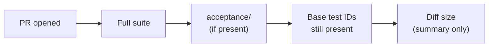
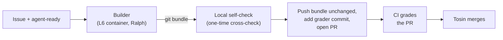

# L7: CI is the grader

[← Home](index.md)

- **You are here if** you finished [L6](L6-issue-to-pr.md) and want the grading to happen **on the PR, where everyone can see it**, instead of only in a private kit on one machine.
- **You should already have** what L6 used (Spec Kit 1.2.3, OpenCode 1.19.3 on a free model, the Ralph Loop extension, Docker on a machine that holds **no keys or tokens**, an issue written as the ruling), plus **GitHub Actions** turned on for your repo. You still **don't** need a custodian or a sealed answer key.
- **You leave with** a GitHub Actions workflow that grades every PR ([PR #21](https://github.com/tosin2013/invoice-exception-desk/pull/21)), and one real change graded by it, **FR-033**: accepted import rows now expose `overdue` as a `bool`, and rejected and duplicate rows carry `overdue: None`. It started as [issue #22](https://github.com/tosin2013/invoice-exception-desk/issues/22), was built by OpenCode with Ralph in the L6 container, graded by CI, and merged by a human ([PR #23](https://github.com/tosin2013/invoice-exception-desk/pull/23)).
- **Phases shown:** adding the workflow, writing the issue (including the one existing test it may change), the run, the grader commit, CI, merge. **Left out:** branch protection and required checks, a bot that picks up labelled issues by itself, Dependabot, and several issues at once. Dependabot is next, in L8.

> **Key idea:** put the grader where the PR is. CI runs the issue's acceptance tests, the full suite, and a check that no base test went missing, on every PR. The builder never sees or touches the grader, and the grader arrives as its own commit, so the PR shows who wrote what.

> **Start the exercise**
>
> ```bash
> git clone https://github.com/tosin2013/invoice-exception-desk.git
> cd invoice-exception-desk
> git switch --detach ed1fa8e          # l5-setup after L6 plus the CI workflow (PR #21, 215 tests)
> git switch -c my-l7                  # your own working branch
> ```

> **Inspect our solution**
>
> - The grader: [`.github/workflows/ci.yml`](https://github.com/tosin2013/invoice-exception-desk/blob/l5-setup/.github/workflows/ci.yml), added by [PR #21](https://github.com/tosin2013/invoice-exception-desk/pull/21) (merge [`ed1fa8e`](https://github.com/tosin2013/invoice-exception-desk/commit/ed1fa8e)), and its [first run](https://github.com/tosin2013/invoice-exception-desk/actions/runs/40696301921).
> - The ruling: [issue #22](https://github.com/tosin2013/invoice-exception-desk/issues/22), "003: accepted import rows expose overdue (bool) per FR-017 / AT-04 (FR-033)".
> - The builder's two commits and the separate [grader commit `f916383`](https://github.com/tosin2013/invoice-exception-desk/commit/f916383), merged into [`l5-setup`](https://github.com/tosin2013/invoice-exception-desk/tree/l5-setup) by [PR #23](https://github.com/tosin2013/invoice-exception-desk/pull/23), and the [CI run that graded it](https://github.com/tosin2013/invoice-exception-desk/actions/runs/40704646179).
> - The run branch as built, plus the grader commit: [`l7/022-accepted-row-overdue`](https://github.com/tosin2013/invoice-exception-desk/tree/l7/022-accepted-row-overdue).
> - Compare everything: [`ed1fa8e...211a728`](https://github.com/tosin2013/invoice-exception-desk/compare/ed1fa8e...211a728).
>
> ```mermaid
> flowchart LR
>   b["l5-setup<br/>ed1fa8e<br/>215 tests, ci.yml"] --> c1["builder: spec, plan, tasks<br/>010900a"] --> c2["builder: implementation<br/>8ca9a91"] --> g["Spec Kit: grader<br/>f916383"]
>   i(["issue #22<br/>agent-ready"]) --> c1
>   g --> ci(["CI<br/>green"])
>   g --> m["PR #23 merged<br/>211a728<br/>223 tests"]
> ```

## Who did what in our run

| Role | Who | Did |
|---|---|---|
| **You** (the human) | Tosin | merged the CI workflow, approved the issue and its one base-test edit, added the `agent-ready` label, merged PR #23 on green CI |
| Operator | Claude Code, on the keyless Ubuntu host `openclaw` | prepared the run folder, ran the preflight and the run, ran the local self-check, reported back |
| Free model (builder) | OpenCode 1.19.3 with `opencode/deepseek-v4.1-flash-free`, driven by Ralph | wrote the spec, plan and tasks, then implemented them, inside the container |
| Kit, grader and PR | the Spec Kit bot | drafted the issue, built the run kit, verified the bundle, added the grader commit, opened the PR |
| Grader | GitHub Actions, workflow `ci`, job `tests` | ran the full suite, the acceptance tests and the base-test check on the PR |
| Reviewer | *(skipped this time)* | see [Skipping the review](#skipping-the-review-a-judgment-call) |

Compared with L6, one role is new (CI as the grader) and one was skipped (the reviewer).

## 1. Add the workflow

[PR #21](https://github.com/tosin2013/invoice-exception-desk/pull/21) added [`.github/workflows/ci.yml`](https://github.com/tosin2013/invoice-exception-desk/blob/l5-setup/.github/workflows/ci.yml) to `l5-setup` (merged at 9:40 AM EDT, merge `ed1fa8e`). It's one job, `tests`, and it's deliberately boring:

- **Read-only.** `permissions: contents: read`, no secrets, no deploys. A PR from an agent can't use it to write anything.
- **Full suite:** `pytest -q` over the whole repo.
- **Acceptance tests,** when an `acceptance/` folder exists: `pytest acceptance --noconftest --import-mode=importlib`. The two flags run the grader on its own, without the repo's `conftest.py`.
- **Base tests still present** (PRs only): it collects test IDs on the PR's base and on the PR, and fails if any base ID is missing.
- **Diff size** (PRs only, report only): a one-line `git diff --shortstat` in the job summary, not counting `progress.md` and `ralph-memory.md`.

The [first run](https://github.com/tosin2013/invoice-exception-desk/actions/runs/40696301921), on PR #21 itself, passed: 215 passed, no `acceptance/` folder so that step skipped, and "Base has 215 tests, this PR has 215."



## 2. Write the issue, including the one test it may change

[Issue #22](https://github.com/tosin2013/invoice-exception-desk/issues/22) was written by the Spec Kit bot and approved by Tosin, who then added **`agent-ready`**. Like issue #16 in L6, it's the ruling: the key name (`overdue`, not `is_overdue`), the type (a real `bool`), what rejected and duplicate rows get (`overdue: None`, like their `days_overdue: None`), no new totals, the forbidden files (now including `.github/` and `acceptance/`), 9 given/when/then acceptance checks with exact rows, the expected Spec Kit trail, and a size limit.

Two things are new:

- **How it's graded.** The issue says CI is the grader for this issue, and that this replaces the constitution's hidden-key rule for this issue only, the same way L5-Q2 and L6 did.
- **One existing test may change.** A test pins the exact key sets of accepted and non-accepted rows. A new field has to change that test, so Tosin approved exactly one edit: add `"overdue"` to `ACCEPTED_KEYS` and to `NON_ACCEPTED_KEYS`, and nothing else. This is the part to remember: **a new field legitimately changes a contract test**, so "no existing test changed" isn't always the rule. The rule is "only the approved edit," and someone or something has to check that.

## 3. The course kit

The **L7 kit** is the L6 kit (not in the repo) with a few changes:

- **Base pinned at `ed1fa8e`,** so the run starts from the commit that has the workflow.
- **The builder can't touch `.github/` or `acceptance/`.** Both are hard stops in the scope rules. The builder can't edit its own grader, or the thing that runs it.
- **The acceptance tests stay hidden in the kit until the bundle is sealed.** The builder never sees them. They only join the work after its bundle and hash are fixed.
- **A one-time local self-check,** as a cross-check of CI: the full suite, the acceptance tests, a **byte-level compare of the base tests** (only the approved edit allowed), and the base test IDs.
- **The builder prompt** says to use the issue's exact rows in its tests, and **not to report sizes or counts**. CI does that now.

## 4. The flow



## Our results

The run was on **Oct 28, 2026, 10:01 to 10:04 AM EDT** (14:01 to 14:04 UTC): about **3 minutes**, **1 Ralph iteration**, and `questions.md` stayed empty. The local self-check: **PASS**.

- **Builder commits:** `010900a7` (spec, plan, tasks) and `8ca9a914` (implementation), on base `ed1fa8e`.
- **The code change** is 3 lines in `invoice_desk/__init__.py`: `"overdue": None` in the rejected and duplicate row dicts, and, in the accepted-row dict:

```python
                "overdue": days_overdue > 0,
```

- **The base-test edit** was exactly the approved one: `"overdue"` added to the two key sets, nothing else changed in existing tests, and 8 new tests appended.

The Spec Kit bot pushed the bundle **unchanged**, added the grader as a **separate commit**, [`f916383`](https://github.com/tosin2013/invoice-exception-desk/commit/f916383) (`acceptance/issue-22/test_acceptance.py`, 8 tests, one per acceptance check 1 to 8), and opened [PR #23](https://github.com/tosin2013/invoice-exception-desk/pull/23) into `l5-setup` at 10:18 AM EDT.

**CI: green, in 9 seconds** ([run](https://github.com/tosin2013/invoice-exception-desk/actions/runs/40704646179)).

| Step | Result |
|---|---|
| Full test suite | PASS, 223 passed |
| Acceptance tests | PASS, 8/8 |
| Base tests still present | PASS, "Base has 215 tests, this PR has 223. All base tests are still present." |
| Diff size (report only) | 8 files, +405/-1 (including the 158-line grader file; not counting `progress.md` and `ralph-memory.md`) |

Tosin merged PR #23 at **10:22 AM EDT** (merge `211a728`). `l5-setup` now has 223 tests. The Spec Kit bot closed issue #22 by hand, because "Closes #22" only auto-closes on the default branch (`main`).

| Item | Value |
|---|---|
| Bundle head | `8ca9a914ba2d2b8c8bb88ec92a5d842363af64ae` |
| Bundle sha256 | `8479848b2dcc9f83f5be9ec9c863146ab5205f73b3987d550a1000fc5b909eaf` |
| Grader file sha256 | `58c47aaf566c3c5bffdbf8819e3df0eee7a290e6a53a1128b82e64e9a2726639` |
| Graded by | [CI run 40704646179](https://github.com/tosin2013/invoice-exception-desk/actions/runs/40704646179) |
| Merged by | [PR #23](https://github.com/tosin2013/invoice-exception-desk/pull/23) into `l5-setup` (merge `211a728`) |

### What L7 fixed from the L6 review

Grok Bot's [L6 review](https://github.com/tosin2013/invoice-exception-desk/pull/17#pullrequestreview-5682740377) had four non-blocking nits. Here's where each one went:

| L6 nit | L7 fix |
|---|---|
| Tests used stand-in rows, not the issue's exact rows | The builder prompt now requires the issue's exact rows, and the grader uses them too |
| The check 6 test didn't assert the aging buckets | Acceptance check 8 pins totals, the aging table and the queue order exactly |
| The builder's notes reported a wrong diff size | The builder no longer reports sizes; CI does, in the job summary |
| No CI on the PR | Fixed: `ci.yml`, on every PR |

### Skipping the review: a judgment call

Issue #22 said Grok Bot would review the PR. This time **the review was skipped**, and Tosin merged on green CI. That was a judgment call, and it's worth being plain about what it gave up.

**CI checks test IDs, not test bodies.** If the builder had quietly weakened an existing test (say, deleted an assert but kept the name), every CI step would still pass. What caught that risk this time was the **local self-check**, which compares the base tests byte by byte and allows only the approved edit. CI alone wouldn't have.

So for any PR that **touches existing tests**, keep at least one of these:

- the byte-level self-check (in the kit, or as a CI step), or
- a review, by a human or a different agent, that checks the only test edits are the approved ones.

For a purely additive PR that leaves every existing test alone, green CI is a much stronger signal on its own.

## What we learned

- **Put the grader in CI, not in a private kit.** In L6 only the operator saw the self-check. In L7 anyone can open the PR and see what passed, and rerun it.
- **Keep the grader out of the builder's reach.** `.github/` and `acceptance/` are hard stops, and the acceptance tests stay in the kit until the bundle is sealed. A builder that can edit its grader isn't being graded.
- **Commit the grader separately.** The builder's commits arrive unchanged from the bundle, and the grader is its own commit by Spec Kit. The diff shows who wrote what.
- **A new field can legitimately change a contract test.** Say in the issue exactly which edit is allowed, then check that nothing else changed.
- **Green CI isn't a full review.** It checks that tests pass and that IDs still exist, not that the tests still test the same thing.
- **Stop counting for the agent.** Sizes and counts come from CI now, so there's nothing for the builder to get wrong.

## How to run it yourself

1. **Add a read-only CI workflow** that runs the full suite, an `acceptance/` folder when present, a base-test-IDs check on PRs, and a diff-size summary. Merge it before the run, and pin the kit's base to that commit.
2. **Write the issue as the ruling** (as in L6), and add: how it's graded (CI), which existing test edits are allowed, exactly, and that `.github/` and `acceptance/` are off limits.
3. **Add the `agent-ready` label** once you're happy with it.
4. **Keep the acceptance tests in the kit,** out of the builder's folder, until the bundle is sealed.
5. **Run the kit** on a keyless machine. Run the local self-check once, including a byte-level compare of the base tests.
6. **Push the bundle unchanged,** add the acceptance tests as **one separate commit** under `acceptance/issue-<N>/`, and open the PR.
7. **Let CI grade it.** If the PR touches existing tests, also keep the self-check result or a review.
8. **Merge** it yourself, and close the issue if it targets a branch other than the default.

**Real-world next step (not done here):** turn on **branch protection** with the `tests` check **required**, so nobody can merge on red. We left that off to keep the lesson light, but on a team repo it's what makes "CI is the grader" a rule rather than a habit.

## Why this order, and how you'd choose

The steps above make four judgment calls. Here is what L7 decided, the reason where the page gives one, and how you'd make the same call on your own project. Where the page gives no reason, we say so.

- **Which existing test edits to allow.** Exactly one: add `"overdue"` to the two key sets. The page's reason: a new field legitimately changes a contract test, so the rule is "only the approved edit", not "no test changed". *How you'd choose:* before the run, find the tests that pin shapes or key sets, and write the exact allowed edit into the issue.
- **Keeping the grader out of reach.** `.github/` and `acceptance/` are hard stops, and the grader arrives as its own commit. The page gives the reasons: a builder that can edit its grader isn't being graded, and a separate commit shows who wrote what. *How you'd choose:* list everything that grades the work, and make each one off limits to the builder.
- **Skipping the review.** That's covered in [Skipping the review: a judgment call](#skipping-the-review-a-judgment-call). *How you'd choose:* its rule is that a PR that touches existing tests needs a byte-level check or a review. Green CI is enough on its own only when no existing test changed.
- **CI's limits: report-only diff size, no branch protection.** Branch protection was left off "to keep the lesson light", and the page says to turn it on for a team repo. It doesn't say why diff size is a report rather than a failing step. *How you'd choose:* make a check blocking once you trust it and a failure means the same thing every time. Until then, report it where the reviewer will see it.

**Try it on your project.**

1. Which existing tests would your next change legitimately have to touch?
2. Can your builder reach anything that grades it?
3. In your repo today, would anything stop a merge on red CI?

## Checklist

- [ ] CI is read-only, uses no secrets, and runs on every PR
- [ ] CI runs the full suite, the acceptance tests, and a base-test-IDs check
- [ ] The issue says which existing test edits are allowed, exactly
- [ ] The builder can't touch `.github/` or `acceptance/`
- [ ] The acceptance tests stay hidden until the bundle is sealed
- [ ] The grader is its own commit, separate from the builder's
- [ ] Sizes and counts come from CI, not the builder's notes
- [ ] PRs that touch existing tests get a byte-level check or a review
- [ ] A human merges, and only on green

Compare the starting point with the merged result: [`ed1fa8e...211a728`](https://github.com/tosin2013/invoice-exception-desk/compare/ed1fa8e...211a728). Back: [L6: From an approved issue to a PR you can trust](L6-issue-to-pr.md). Next: [L8: Dependabot, graded like everyone else](L8-dependabot.md). Back to [Home](index.md).
