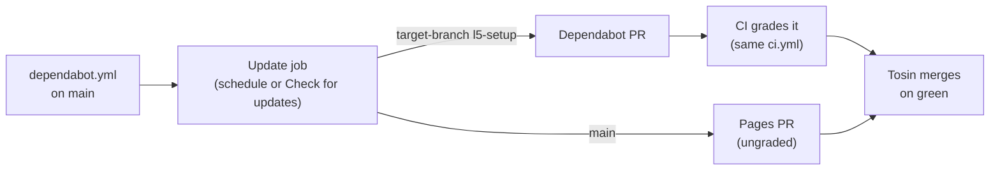

# L8: Dependabot, graded like everyone else

[← Home](index.md)

- **You are here if** you finished [L7](L7-ci-grader.md), CI grades every PR, and you want the **routine dependency bumps** to arrive as PRs on their own, graded by the same CI, without filling your inbox.
- **You should already have** the L7 CI workflow ([`ci.yml`](https://github.com/tosin2013/invoice-exception-desk/blob/l5-setup/.github/workflows/ci.yml), read-only, no secrets) on your code branch, a repo where you can push to the **default branch**, and a rule about who merges. You **don't** need the L6 container, a free model, or any repo setting changed.
- **You leave with** a three-block [`.github/dependabot.yml`](https://github.com/tosin2013/invoice-exception-desk/blob/main/.github/dependabot.yml) on `main` ([PR #26](https://github.com/tosin2013/invoice-exception-desk/pull/26)), a one-line pinned test dependency Dependabot can read ([PR #25](https://github.com/tosin2013/invoice-exception-desk/pull/25)), and the first two real Dependabot PRs: [PR #27](https://github.com/tosin2013/invoice-exception-desk/pull/27) (graded green by CI) and [PR #28](https://github.com/tosin2013/invoice-exception-desk/pull/28) (Pages, ungraded). You also get five short recipes for other kinds of repos.
- **Phases shown:** what Dependabot's three features are, making a dependency visible to it, the config file, the first PRs, CI grading a bot's PR, the human merge rule. **Left out:** auto-merge, `dependabot/fetch-metadata` and auto-approve workflows, private registries, multi-ecosystem groups, Docker (recipe only), branch protection, and Dependabot alerts and security updates (explained, but left off on purpose). Tuning the whole loop goes to [`PLAYBOOK`](PLAYBOOK.md), next.

> **Key idea:** Dependabot is just another author. Point it at the code branch, keep it quiet (grouped, one dependency, weekly), and let the L7 CI grade its PRs **exactly like an agent's**. A human still merges every one, on green.

> **Start the exercise**
>
> ```bash
> git clone https://github.com/tosin2013/invoice-exception-desk.git
> cd invoice-exception-desk
> git switch --detach 211a728          # l5-setup after L7 (ci.yml, 223 tests), before L8
> git switch -c my-l8                  # your own working branch for the code side
> # the config goes on main, which had no dependabot.yml before L8 (858f806)
> ```
>
> Dependabot only runs on a repo **you own**, from its default branch. On a **fork**, version updates aren't turned on just because `dependabot.yml` is there: you also click **Settings → Advanced Security → Dependabot version updates → Enable** ([docs](https://docs.github.com/en/code-security/how-tos/secure-your-supply-chain/secure-your-dependencies/configure-version-updates#enabling-version-updates-on-forks)).

> **Inspect our solution**
>
> - The code side: [PR #25](https://github.com/tosin2013/invoice-exception-desk/pull/25) into `l5-setup` (merge [`ce30c1f`](https://github.com/tosin2013/invoice-exception-desk/commit/ce30c1f)): [`requirements-dev.txt`](https://github.com/tosin2013/invoice-exception-desk/blob/l5-setup/requirements-dev.txt) and 3 lines of `ci.yml`, [CI run](https://github.com/tosin2013/invoice-exception-desk/actions/runs/40709086555).
> - The config: [PR #26](https://github.com/tosin2013/invoice-exception-desk/pull/26) into `main` (merge [`1526306`](https://github.com/tosin2013/invoice-exception-desk/commit/1526306)): [`.github/dependabot.yml`](https://github.com/tosin2013/invoice-exception-desk/blob/main/.github/dependabot.yml).
> - Dependabot's first PRs: [PR #27](https://github.com/tosin2013/invoice-exception-desk/pull/27) (`actions/checkout` 4 → 7 into `l5-setup`, [CI run](https://github.com/tosin2013/invoice-exception-desk/actions/runs/40711151352)) and [PR #28](https://github.com/tosin2013/invoice-exception-desk/pull/28) (the `pages` group, 4 updates, into `main`).
> - Dependabot's own job runs: the [Actions tab, "Dependabot Updates"](https://github.com/tosin2013/invoice-exception-desk/actions), for example the [pip job](https://github.com/tosin2013/invoice-exception-desk/actions/runs/40711027145) that explains why there's no pytest PR yet.
> - Compare: code [`211a728...ce30c1f`](https://github.com/tosin2013/invoice-exception-desk/compare/211a728...ce30c1f), config [`858f806...1526306`](https://github.com/tosin2013/invoice-exception-desk/compare/858f806...1526306).
>
> ```mermaid
> flowchart LR
>   subgraph main
>     m0["858f806"] --> m1["PR #26 merged<br/>1526306<br/>dependabot.yml"]
>   end
>   subgraph l5-setup
>     c0["211a728<br/>223 tests"] --> c1["PR #25 merged<br/>ce30c1f<br/>requirements-dev.txt"]
>   end
>   m1 --> d(["Dependabot"])
>   c1 -.->|reads| d
>   d --> p27["PR #27<br/>checkout 4 → 7<br/>into l5-setup"] --> ci(["CI green"])
>   d --> p28["PR #28<br/>pages group<br/>into main, ungraded"]
> ```

## Who did what in our run

| Role | Who | Did |
|---|---|---|
| **You** (the human) | Tosin | set the rules (low noise, no auto-merge, a human merges every Dependabot PR on green CI), picked the plan's options, merged PR #25 and PR #26; merges or closes each Dependabot PR |
| Planner and docs | Grok Bot | checked the repo read-only, wrote the plan with GitHub docs citations, wrote this page |
| Code and config PRs | the Spec Kit bot | wrote and opened PR #25 (pin) and PR #26 (config) |
| Dependency author | Dependabot | ran the update jobs, opened PR #27 and PR #28 |
| Grader | GitHub Actions, workflow `ci`, job `tests` | graded PR #25 and PR #27, exactly as it grades agent PRs |
| Free model (builder) | *(not used)* | nothing to build this time |

Compared with L7, the builder is gone and a new author arrives: Dependabot. The grader and the human merge rule don't change.

## 1. Dependabot is three features, and we use one

Dependabot is three separate things. People mix them up, so here's the plain version:

| Feature | What it does | How it's turned on | Here |
|---|---|---|---|
| **Alerts** | matches your dependency graph against GitHub's advisory database and flags vulnerable versions. No PRs. | a repo setting ([docs](https://docs.github.com/en/code-security/dependabot/dependabot-alerts/configuring-dependabot-alerts)) | **off**, on purpose |
| **Security updates** | when an alert fires, opens a PR to the smallest fixed version. Runs on advisories, not a schedule, and **always targets the default branch**. | a repo setting ([docs](https://docs.github.com/en/code-security/dependabot/dependabot-security-updates/configuring-dependabot-security-updates)) | **off**, on purpose |
| **Version updates** | on a schedule, opens PRs that move what you pinned to the latest release | **commit `.github/dependabot.yml`**, nothing else ([docs](https://docs.github.com/en/code-security/dependabot/dependabot-version-updates/configuring-dependabot-version-updates)) | **on** |

Why alerts and security updates stay off here: the app has **no runtime dependencies** (`pyproject.toml` lists none), and security updates only work on the default branch (`main`), while the code lives on `l5-setup`. They'd do almost nothing. On a real app you'd turn them on: **Settings → (Security and quality) Advanced Security → Dependabot alerts → Enable**, then **Dependabot security updates → Enable** on the same page ([alerts](https://docs.github.com/en/code-security/dependabot/dependabot-alerts/configuring-dependabot-alerts), [security updates](https://docs.github.com/en/code-security/dependabot/dependabot-security-updates/configuring-dependabot-security-updates)).

Two defaults worth knowing before you read any PR ([options reference](https://docs.github.com/en/code-security/dependabot/working-with-dependabot/dependabot-options-reference)):

- **Cooldown:** Dependabot applies "a **default cooldown period of 3 days** to version updates, even when `cooldown` is not configured. A new version is not considered for a version update until 3 days after its release." This matters below.
- **Open PR limit:** at most **5** open version-update PRs per ecosystem by default (`open-pull-requests-limit`). Security-update PRs have "a separate, fixed limit of 10".

## 2. Make the dependency visible (PR #25, into `l5-setup`)

Until L8, CI installed pytest with `uv run --no-project --with pytest`. That's unpinned, and it's a **command-line flag**. Dependabot reads manifest files, not CLI flags, so it would have found **zero** Python dependencies.

The cheapest fix: a one-line [`requirements-dev.txt`](https://github.com/tosin2013/invoice-exception-desk/blob/l5-setup/requirements-dev.txt). Dependabot's `pip` ecosystem "supports updates to any `.txt` file" ([supported ecosystems](https://docs.github.com/en/code-security/dependabot/ecosystems-supported-by-dependabot/supported-ecosystems-and-repositories)).

```text
# Dev/test-only pin (not a runtime dependency). ...
pytest==9.1.1
```

**`9.1.1` is one release behind on purpose.** pytest 9.2.0 came out on Oct 27, 2026 (5:30 PM EDT). Pinning the previous release means the lesson gets a real pytest PR to show. That's honest, and now it's said. It doesn't break the constitution's "no runtime dependencies" rule, because pytest is test-only.

In `ci.yml`, all three `--with pytest` became:

```bash
uv run --no-project --with-requirements "$GITHUB_WORKSPACE/requirements-dev.txt" python -m pytest -q
```

**Why the absolute path:** the "Base tests still present" step collects test IDs inside a worktree of the PR's **base** commit (`/tmp/base`). Old base commits don't have `requirements-dev.txt`, so a relative path would break there. `$GITHUB_WORKSPACE` always points at the PR's own checkout.

[CI on PR #25](https://github.com/tosin2013/invoice-exception-desk/actions/runs/40709086555): green in 10 seconds. Tosin merged it at **10:56 AM EDT** (merge `ce30c1f`).

## 3. The config (PR #26, into `main`)

**The file must live on the default branch.** GitHub: "You must store this file in the `.github` directory of your repository in the default branch" ([about the dependabot.yml file](https://docs.github.com/en/code-security/concepts/supply-chain-security/about-the-dependabot-yml-file)). Our code lives on `l5-setup`, so each block says `target-branch: "l5-setup"`. Then "only manifest files on the target branch are checked" and "all pull requests for version updates are opened targeting the specified branch" ([`target-branch`](https://docs.github.com/en/code-security/dependabot/working-with-dependabot/dependabot-options-reference#target-branch-)).

The whole file, as merged:

```yaml
# Dependabot version updates (L8). Low noise on purpose: Tosin merges every PR, no auto-merge.
# This file must live on the default branch (main); target-branch points updates at the code branch.
version: 2
updates:
  # 1. GitHub Actions used by CI on the code branch: weekly, all bumps grouped into one PR.
  - package-ecosystem: "github-actions"
    directory: "/"
    target-branch: "l5-setup"
    schedule:
      interval: "weekly"
    groups:
      actions:
        patterns: ["*"]

  # 2. One small Python dev dependency only (requirements-dev.txt on l5-setup). Graded by CI.
  - package-ecosystem: "pip"
    directory: "/"
    target-branch: "l5-setup"
    schedule:
      interval: "weekly"
    allow:
      - dependency-name: "pytest"

  # 3. The Pages workflow on main: monthly, grouped. main has no CI, so these PRs are ungraded.
  - package-ecosystem: "github-actions"
    directory: "/"
    schedule:
      interval: "monthly"
    groups:
      pages:
        patterns: ["*"]
```

Reading it:

- **`directory: "/"` for Actions** means `.github/workflows` (plus a root `action.yml`), per the [`directory`](https://docs.github.com/en/code-security/dependabot/working-with-dependabot/dependabot-options-reference#directories-or-directory--) docs.
- **Two `github-actions` blocks with the same directory are fine** because their target branches differ. The docs only forbid overlapping directories "for a single target branch of an ecosystem".
- **`groups` with `patterns: ["*"]`** puts every action bump into **one** PR per branch.
- **`allow`** limits the `pip` block to pytest alone. Anything else in that file would be ignored.
- **`main` is monthly** because its only workflow is Pages, and nothing grades it.

**Merging PR #26 was the only switch.** No repo setting was touched. Tosin merged it at **10:57 AM EDT** (merge `1526306`), and Dependabot's first update jobs started within seconds.

## 4. The first PRs

Within about a minute of the merge, Dependabot opened two PRs. Both carry its default `dependencies` and `github_actions` labels.

| PR | Into | What | Graded? | State (checked 11:44 AM EDT, Oct 28) |
|---|---|---|---|---|
| [#27](https://github.com/tosin2013/invoice-exception-desk/pull/27) | `l5-setup` | "bump actions/checkout from 4 to 7 in the actions group" (`ci.yml`, +1/-1). `astral-sh/setup-uv` was already current. | **Yes:** [CI green in 9s](https://github.com/tosin2013/invoice-exception-desk/actions/runs/40711151352) | merged by Tosin at 11:39 AM EDT (merge [`7c8876b`](https://github.com/tosin2013/invoice-exception-desk/commit/7c8876b)) |
| [#28](https://github.com/tosin2013/invoice-exception-desk/pull/28) | `main` | "bump the pages group with 4 updates": checkout 4 → 7, configure-pages 5 → 6, upload-pages-artifact 3 → 5, deploy-pages 4 → 5 (`pages.yml`, +4/-4) | **No:** `main` has no CI | merged by Tosin at 11:39 AM EDT (merge [`c982d2d`](https://github.com/tosin2013/invoice-exception-desk/commit/c982d2d)) |

**PR #27 also clears a warning we'd been living with.** Every CI run since [PR #21](https://github.com/tosin2013/invoice-exception-desk/actions/runs/40696301921) carried the annotation "Node.js 20 is deprecated … actions/checkout@v4". On PR #27's run it's gone. The checkout 5 to 7 changes (Node 24; credentials kept in a separate file; v7 blocks checking out fork PRs under `pull_request_target` and `workflow_run`) don't touch us: our CI uses plain `pull_request`.

**PR #28 is the ungraded one.** Merging it redeploys the guide site. If the new Pages actions break, the failure shows up in the "Deploy guide to GitHub Pages" run, not before the merge. That's the trade-off of grading only the code branch. It's acceptable for a docs site, and it's why `main` is monthly. This time the [Pages deploy after the merge](https://github.com/tosin2013/invoice-exception-desk/actions/runs/40718232607) went green with the new actions.

### Where's the pytest PR?

Not here yet, and that's expected. Both `pip` update jobs ran **successfully** and found the pin. The [job log](https://github.com/tosin2013/invoice-exception-desk/actions/runs/40711027145) says why there was no PR:

```text
Checking if pytest 9.1.1 needs updating
Filtered out 1 versions due to cooldown
Latest version is 9.1.1
No update needed for pytest 9.1.1
```

That's the **3-day default cooldown** from section 1: pytest 9.2.0 was released at 5:30 PM EDT on Oct 27, so Dependabot won't offer it until about **5:30 PM EDT on Oct 30**. We expect the pytest PR on the first `pip` run after that: the next weekly run (weekly runs default to Monday), or sooner if someone clicks **Check for updates** (below). It will target `l5-setup`, and CI will grade it like PR #27. **This page will be updated when it lands.**

The cooldown is a feature, not a bug: brand-new releases sometimes get yanked or patched within days. You can change it with the [`cooldown`](https://docs.github.com/en/code-security/dependabot/working-with-dependabot/dependabot-options-reference#cooldown-) option. It doesn't apply to security updates.

## 5. How it plugs into L7



- **Same grader, same rules.** `ci.yml` runs on every `pull_request` to `l5-setup` or `main`, whoever opened it: full suite, acceptance tests if present, base test IDs still present, diff size. A Dependabot PR gets no special treatment.
- **Read-only, no secrets.** Workflows triggered by Dependabot "receive a read-only `GITHUB_TOKEN` and do not have access to any secrets that are normally available"; only Dependabot secrets are available ([troubleshooting Dependabot on Actions](https://docs.github.com/en/code-security/dependabot/troubleshooting-dependabot/troubleshooting-dependabot-on-github-actions)). Our CI is already `contents: read` with no secrets, so nothing changes.
- **A human merges.** No auto-merge, no approve bot. Tosin merges each Dependabot PR on green, or closes it.
- **Don't ignore them.** If nobody touches Dependabot's PRs for a long time, it "temporarily pauses its updates and lets you know" ([about version updates](https://docs.github.com/en/code-security/dependabot/dependabot-version-updates/about-dependabot-version-updates)). Low noise is what makes "merge every one" realistic.

**Seeing and nudging it:** **Insights → Dependency graph → Dependabot** lists the monitored files ([docs](https://docs.github.com/en/code-security/dependabot/dependabot-version-updates/listing-dependencies-configured-for-version-updates)). Next to a manifest, **Recent update jobs → Check for updates** re-runs a job now ([docs](https://docs.github.com/en/code-security/how-tos/secure-your-supply-chain/manage-your-dependency-security/re-run-dependabot-jobs)). The job runs also show up in the Actions tab as "Dependabot Updates", with full logs.

## Real-world recipes

Short, commented snippets. Each goes under `updates:` in `.github/dependabot.yml`. Pick by the kind of repo you have.

**(a) GitHub Actions only, weekly, grouped.** Fits **almost every repo** that has workflows, including docs-only and library repos. One PR a week at most.

```yaml
  - package-ecosystem: "github-actions"
    directory: "/"                     # = .github/workflows (+ a root action.yml)
    schedule: { interval: "weekly" }
    groups:
      actions: { patterns: ["*"] }     # all action bumps in ONE PR
```

**(b) One dev dependency, via `allow`.** Fits a **small repo with no runtime deps** that still wants its test tool kept fresh (this repo). Needs a file Dependabot can read, such as `requirements-dev.txt`.

```yaml
  - package-ecosystem: "pip"
    directory: "/"                     # where requirements-dev.txt lives
    schedule: { interval: "weekly" }
    allow:
      - dependency-name: "pytest"      # only this; everything else is ignored
```

**(c) Grouped minor/patch, majors by hand, capped.** Fits an **app with many dependencies**, where one PR per package would bury you.

```yaml
  - package-ecosystem: "pip"           # or npm, gomod, maven, ...
    directory: "/"
    schedule: { interval: "weekly" }
    open-pull-requests-limit: 3        # default is 5
    groups:
      minor-and-patch:
        update-types: ["minor", "patch"]   # one PR for the safe stuff
    ignore:
      - dependency-name: "*"
        update-types: ["version-update:semver-major"]   # majors: a human plans them
```

**(d) Docker base image.** Fits a repo that **ships a Dockerfile**. Dependabot bumps the tag and the digest in `FROM python:3.12-slim@sha256:…`. Not used here: our L5 to L7 kit Dockerfile lives **outside** the repo on purpose, so there's nothing for Dependabot to read.

```yaml
  - package-ecosystem: "docker"
    directory: "/kit"                  # wherever the Dockerfile lives
    schedule: { interval: "monthly" }  # base images churn; monthly is plenty
```

**(e) Sidebar: security updates only, and the `uv` ecosystem.**

- **Security updates only** fits a **mature or frozen app** that wants fixes, not churn. Turn on alerts and security updates in Settings (section 1), then switch version updates off per ecosystem with `open-pull-requests-limit: 0`, the pattern [GitHub documents](https://docs.github.com/en/code-security/dependabot/dependabot-security-updates/configuring-dependabot-security-updates). Remember these PRs always target the default branch.

  ```yaml
  - package-ecosystem: "pip"
    directory: "/"
    schedule: { interval: "weekly" }
    open-pull-requests-limit: 0        # no version updates; security updates still come
  ```

- **`uv`** fits a repo that **already commits `uv.lock`**. Dependabot supports a `uv` ecosystem ([supported ecosystems](https://docs.github.com/en/code-security/dependabot/ecosystems-supported-by-dependabot/supported-ecosystems-and-repositories), [uv's guide](https://docs.astral.sh/uv/guides/integration/dependabot/)), built around the lockfile. We didn't use it: it would mean a dev group, a committed lockfile, and moving CI off `--no-project`, which is a bigger change than one pin. GitHub's table also lists uv **v0.11** support, while our kit uses 0.13.5.

  ```yaml
  - package-ecosystem: "uv"
    directory: "/"                     # where pyproject.toml and uv.lock live
    schedule: { interval: "weekly" }
  ```

**This repo uses (a) + (b)**, on the code branch, plus a monthly (a) on `main` for Pages. (c) is pointless with one dependency, (d) has no Dockerfile to read, and (e) would do almost nothing with no runtime dependencies.

## Our results

All times **Oct 28, 2026, EDT**.

| Time | Event |
|---|---|
| 10:45 AM | PR #25 opened (pin + `ci.yml`), [CI green in 10s](https://github.com/tosin2013/invoice-exception-desk/actions/runs/40709086555) |
| 10:54 AM | PR #26 opened (`dependabot.yml`), no CI on `main` |
| 10:56 AM | Tosin merged PR #25 (`ce30c1f`) |
| 10:57 AM | Tosin merged PR #26 (`1526306`); Dependabot's first update jobs started, all **successful** (4 `github_actions`, 2 `pip`) |
| 10:57 AM | Dependabot opened PR #27 (into `l5-setup`); [CI green in 9s](https://github.com/tosin2013/invoice-exception-desk/actions/runs/40711151352), Node 20 warning gone |
| 10:57 AM | Dependabot opened PR #28 (pages group, 4 updates, into `main`); ungraded |
| 11:39 AM | Tosin merged PR #27 (`7c8876b`) and PR #28 (`c982d2d`); [CI on `l5-setup`](https://github.com/tosin2013/invoice-exception-desk/actions/runs/40718201998) and the [Pages deploy](https://github.com/tosin2013/invoice-exception-desk/actions/runs/40718232607) both green |
| — | No pytest PR: 9.2.0 filtered by the 3-day default cooldown, expected after about 5:30 PM EDT Oct 30 |

| Item | Value |
|---|---|
| Config | [`.github/dependabot.yml`](https://github.com/tosin2013/invoice-exception-desk/blob/main/.github/dependabot.yml), 3 blocks, 31 lines, [PR #26](https://github.com/tosin2013/invoice-exception-desk/pull/26) |
| Pin | `pytest==9.1.1` in [`requirements-dev.txt`](https://github.com/tosin2013/invoice-exception-desk/blob/l5-setup/requirements-dev.txt), [PR #25](https://github.com/tosin2013/invoice-exception-desk/pull/25) |
| Repo settings changed | **none** |
| Dependabot PRs so far | 2 (#27 graded green, #28 ungraded), both merged by Tosin at 11:39 AM EDT; the pytest PR is still expected |
| Tests on `l5-setup` | 223, unchanged |

## What we learned

- **Dependabot can't see a CLI flag.** `--with pytest` was invisible to it. One pinned line in a file it reads fixed that.
- **The config lives on `main`; the PRs go wherever `target-branch` says.** Teaching repos with a separate code branch need both halves.
- **Merging one YAML file was the only switch.** No settings, and the first PRs came within a minute.
- **A bot's PR is graded like anyone's.** The L7 CI didn't need a single change to grade PR #27.
- **"No PR" can be correct.** The 3-day default cooldown held back a day-old pytest. Read the update job's log before you assume something's broken.
- **Ungraded branches are a choice.** Pages bumps on `main` aren't graded, so they're monthly, and a broken deploy shows up only after the merge.
- **Low noise makes "a human merges every one" sustainable.** Grouping, `allow` and a weekly schedule keep it at a few PRs a week at most.

## How to run it yourself

1. **List what you'd want bumped,** and check Dependabot can read each one: workflows (`.github/workflows`), a manifest (`requirements*.txt`, `pyproject.toml` + lockfile, `package.json`, …), a Dockerfile in the repo. If a dependency only exists as a CLI flag, pin it in a file first (PR #25), and point CI at that file.
2. **Pick recipes by repo type** (a to e above). Start small: (a) plus at most one more.
3. **Write `.github/dependabot.yml` on the default branch.** If your code lives on another branch, add `target-branch` to each block.
4. **Make sure CI runs on PRs to that branch,** read-only and with no secrets. Dependabot PRs get a read-only token anyway.
5. **Merge the config.** On a fork, also enable Dependabot version updates in Settings → Advanced Security.
6. **Watch the first jobs** in Insights → Dependency graph → Dependabot, or in Actions → "Dependabot Updates". No PR? Read the job log: cooldown, `allow`, or "already latest" are the usual reasons.
7. **Merge or close each PR on green,** yourself. Don't leave them sitting, or Dependabot pauses.
8. **Decide on alerts and security updates** separately. Turn them on for anything with runtime dependencies on the default branch.

## Checklist

- [ ] Every dependency you care about is in a file Dependabot can read
- [ ] `dependabot.yml` is on the default branch, with `target-branch` where the code lives elsewhere
- [ ] Bumps are grouped and limited (`groups`, `allow`, `ignore`, schedule) so the noise stays low
- [ ] CI grades Dependabot PRs exactly like other PRs, read-only, with no secrets
- [ ] You know which branches are ungraded, and you schedule those less often
- [ ] A human merges every Dependabot PR, on green; no auto-merge
- [ ] "No PR yet" is checked against the job log (cooldown is 3 days by default)
- [ ] Alerts and security updates are a deliberate on or off, not an accident

Compare the starting points with the merged results: code [`211a728...ce30c1f`](https://github.com/tosin2013/invoice-exception-desk/compare/211a728...ce30c1f), config [`858f806...1526306`](https://github.com/tosin2013/invoice-exception-desk/compare/858f806...1526306). Back: [L7: CI is the grader](L7-ci-grader.md). Next: [**PLAYBOOK**, the wrap-up](PLAYBOOK.md). Back to [Home](index.md).
