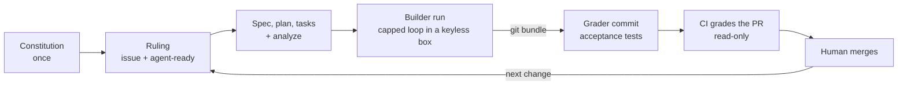

<!-- Pages copy of /PLAYBOOK.md at the repo root. Edit the root file and copy it here; the two bodies must match. -->

# PLAYBOOK: the Invoice Exception Desk pattern on one page

This is the wrap-up of the [Spec Kit Developer Guide](https://tosin2013.github.io/invoice-exception-desk/). It sums up the whole pattern and links every lesson, so a person or an AI can pull this one file and apply the pattern to its own project.

- Raw file, for agents: <https://raw.githubusercontent.com/tosin2013/invoice-exception-desk/main/PLAYBOOK.md>
- On the guide site: <https://tosin2013.github.io/invoice-exception-desk/PLAYBOOK.html>
- Guide index for agents: [`llms.txt`](https://tosin2013.github.io/invoice-exception-desk/llms.txt) (same content as [`llm.txt`](https://tosin2013.github.io/invoice-exception-desk/llm.txt))

Everything below comes from what the repo and its lessons actually show. Numbers are from our runs, not promises.

## 1. The pattern in a few sentences

Write down *what* to build and *why* before any code exists (a constitution once, then a spec per change), using [GitHub Spec Kit](https://github.com/github/spec-kit). A human (or a strong model) makes every decision **before** the run and writes it into one frozen ruling: a signed file in L5, a GitHub issue from L6 on. A cheap or free model then builds it unattended, inside a locked-down box with no keys, driven by a loop with hard caps. We used OpenCode with the Spec Kit **Ralph Loop** extension; any coding-agent harness that can run headless works (section 2). The result is graded by checks the builder never saw: a sealed answer key (L2 to L5), a hidden self-check (L6), then a read-only CI workflow (L7). A human merges every PR. Dependabot's PRs go through the same CI and the same human merge (L8).

> "Unattended" doesn't mean "unreviewed." Decide everything before the run, check everything after it. ([L5](https://tosin2013.github.io/invoice-exception-desk/L5-agent-loop.html))

**Should you use it at all?** Run the [decision gate on the Home page](https://tosin2013.github.io/invoice-exception-desk/) first. Short version: you need checkable "done" outcomes, work bigger than one sitting, someone other than the builder checking the result, quiet-wrongness risks, and one frozen example to specify against. Typos, config changes, dependency bumps and prototypes get a normal PR, not SDD.

## 2. Choose your harness

The pattern isn't tied to one coding agent. The builder step needs three things:

- **A coding agent that can run headless** (from a script, no prompts). Run unattended, it goes in a sandbox with no GitHub token, SSH keys or cloud credentials ([when you need one](#do-i-always-need-a-sandbox)). Spec Kit has integrations for 40-plus agents, for example Claude Code (`claude`), Codex CLI (`codex`), GitHub Copilot (`copilot`), Gemini CLI (`gemini`), Cursor (`cursor-agent`), Goose (`goose`), Qwen Code (`qwen`) and opencode (`opencode`). The full list and keys are on the [Spec Kit integrations page](https://github.github.io/spec-kit/integrations/index.html); `generic` covers agents that aren't listed.
- **A loop driver with an iteration cap and a time cap** that starts a fresh agent call per work unit and stops on repeated failures. The [Ralph Loop](https://github.com/Rubiss-Projects/spec-kit-ralph) extension (v1.5.0) does this for `copilot`, `codex`, `claude` and `opencode` only, and refuses any other CLI. For anything else, use a small wrapper script with the same caps and stops (section 7).
- **The written inputs:** the issue (the ruling), then the spec, plan and tasks files.

This guide used **OpenCode 1.19.3 with the free model `opencode/deepseek-v4.1-flash-free`, driven by Ralph**. It stays the worked example throughout; notes marked "If you use OpenCode" or "If you use Ralph" apply only to that setup. Our box held no keys at all, because the free model needed none. If your model needs an API key, see the key rule just below.

### Do I always need a sandbox?

No. A sandbox matters when an agent runs code **unattended**, with no person approving each step: the L5 to L7 builder loop, or any auto-approve ("yolo") mode. It limits the blast radius of a bad run: deleted files, a bad command, or the agent reading secrets.

| Situation | Sandbox? | Keys |
|---|---|---|
| A person approves each step (Claude Code, Cursor, Copilot and others in their normal ask-before-acting mode) | No; a normal dev machine is fine | your usual setup |
| Spec, plan and review work | No | your usual setup |
| The agent runs unattended (builder loop, auto-approve or "yolo" mode) | Yes: a container or VM with a copy of the repo; the work comes out as a `git bundle` ([L5](https://tosin2013.github.io/invoice-exception-desk/L5-agent-loop.html), [L6](https://tosin2013.github.io/invoice-exception-desk/L6-issue-to-pr.html)) | no GitHub token, SSH keys or cloud credentials; at most one model key (below) |
| CI grading | Nothing extra: [GitHub-hosted runners](https://docs.github.com/en/actions/concepts/runners/github-hosted-runners) are already isolated | none; the workflow stays read-only with no secrets (section 5) |

**If the model needs an API key:** passing one into the container is fine if it's a dedicated, spend-capped key used only for that work, never one that can push code or reach production. A free or local model (for example [Ollama](https://ollama.com/)) needs no key.

**Rule of thumb:** sandbox the agent when nobody is watching each step, and give it only the one key it needs.

## 3. Prerequisites

What our runs used (pin your own versions and trust your own `--help` over ours):

| Thing | What we used | First needed in |
|---|---|---|
| Git, Python 3.11+, [uv](https://github.github.io/spec-kit/install/uv.html), pytest | Python 3.12 in CI | L0 / L1 |
| Spec Kit CLI (`specify`) | 1.1.3 for L1 to L4, 1.2.3 from L4.5 on | L1 |
| An AI coding agent with a Spec Kit integration and a headless mode (section 2) | OpenCode 1.19.3 (`--integration opencode`), free model `opencode/deepseek-v4.1-flash-free` | L1 |
| A reviewer who isn't the builder | a separate model or a human | L2 |
| A loop driver with iteration and time caps | [Ralph Loop](https://github.com/Rubiss-Projects/spec-kit-ralph) v1.5.0 (`specify extension add ralph`) plus a wrapper for timeouts | L5 |
| For the unattended builder loop: Docker on a machine with **no keys, tokens or push access** ([when you need it](#do-i-always-need-a-sandbox)) | a separate Ubuntu host | L5 |
| GitHub Actions turned on | the [`ci.yml`](https://github.com/tosin2013/invoice-exception-desk/blob/l5-setup/.github/workflows/ci.yml) workflow on `l5-setup` | L7 |
| Push access to the default branch | for [`.github/dependabot.yml`](https://github.com/tosin2013/invoice-exception-desk/blob/main/.github/dependabot.yml) | L8 |

**If you use OpenCode:** the scripted `opencode run --command speckit.<command>` worked on 1.19.3; there is an open report that OpenCode v2 removed it ([spec-kit #4639](https://github.com/github/spec-kit/issues/4639)). When scripting OpenCode yourself, add `< /dev/null` or it can hang waiting for input ([L0](https://tosin2013.github.io/invoice-exception-desk/L0-existing-repo.html)). Ralph sends its prompt to `opencode run` on stdin and passes `--auto`, so check that your version's `opencode run --help` lists `--auto`. Other harnesses have their own headless quirks; dry-run one scripted call before you seal anything.

### Run Spec Kit step by step (no assumptions)

Use this when a person, or an AI working with one, runs Spec Kit in a chat session. Checked against Spec Kit v1.2.4 and its docs on 2026-10-28. If your `specify --help` says something different, trust it and tell the user. The unattended loop works differently; see the end of this subsection.

**A. Setup, exact commands.** Run these in a terminal, in this order. **If a command fails or a flag isn't in your `--help`, stop and show the user the exact error.** Don't try another installer, version or flag on your own.

1. **Ask** which harness (coding agent) the user runs, and whether this is a new project or an existing repo. Don't assume.
2. **Check the prerequisites.** If one is missing, tell the user and stop.
   ```bash
   git --version
   python3 --version        # 3.11 or newer
   uv --version             # https://docs.astral.sh/uv/
   command -v <harness>     # e.g. claude, codex, copilot, gemini, cursor-agent, opencode
   ```
3. **Install the CLI,** pinned to a [release tag](https://github.com/github/spec-kit/releases) the user agrees to (keep the `v`):
   ```bash
   uv tool install specify-cli --from git+https://github.com/github/spec-kit.git@vX.Y.Z
   specify version
   ```
   `uv tool install specify-cli` (from PyPI) is also official. For a one-off run with nothing installed, put `uvx --from git+https://github.com/github/spec-kit.git@vX.Y.Z` in front of each `specify` command instead.
4. **Initialize** with the user's integration key (`specify integration list`, or the [integrations page](https://github.github.io/spec-kit/integrations/index.html)):
   ```bash
   specify init my-project --integration <key>   # new project: creates ./my-project
   specify init --here --integration <key>       # existing repo: run from its root
   ```
   Use `--here` only in the repo the user named, with a clean `git status` ([L0](https://tosin2013.github.io/invoice-exception-desk/L0-existing-repo.html)). If it warns that the folder isn't empty, show the warning; add `--force` only if the user says so. `--script sh|ps|py` picks the script type (default `sh`; `ps` on Windows). An AI in a terminal that can't answer prompts adds `--non-interactive`, and must still pass `--integration`, or it silently gets Copilot. Old CLIs used `--ai`; v1.2.4 rejects it ("No such option"), so report the version rather than switching flags.
5. **Run `specify check`.** It lists the agent tools it finds.
6. **Confirm the commands show up** in the harness, opened in the project folder (type `/`, or look for the folder below). If they don't, stop.

The steps are the same everywhere; only the spelling changes ([command invocation](https://github.github.io/spec-kit/integrations/cli.html#command-invocation)). This playbook writes the dotted form.

| Harness | Type it as | Installed in |
|---|---|---|
| OpenCode, Gemini CLI | `/speckit.plan` | `.opencode/commands/`, `.gemini/commands/` |
| Claude Code, GitHub Copilot, Cursor | `/speckit-plan` | `.claude/skills/`, `.github/skills/`, `.cursor/skills/` |
| Codex CLI | `$speckit-plan` | `.agents/skills/` |
| Any other | see its page on the [integrations list](https://github.github.io/spec-kit/integrations/index.html) | |

**If you use Claude Code:** its Spec Kit skills are model-invocable by default, so the model can start one on its own. `--integration-options="--no-model-invocation"` at init makes the core ones run only when the user types them (trade-offs on the [Claude page](https://github.github.io/spec-kit/integrations/claude.html)).

**B. Fixed order.** Never skip or reorder. **One command per turn.** Never run implement until `tasks.md` exists and the user has approved it.

| Step | Command | What it produces | Who decides | Stop and wait for |
|---|---|---|---|---|
| 1 | `/speckit.constitution <principles>` (once per project) | `.specify/memory/constitution.md` (init leaves a template there) | the user: the rules | approval of the constitution |
| 2 | `/speckit.specify <what and why>` | `specs/<NNN-feature>/spec.md` and `checklists/requirements.md` | the user: what to build | approval of the spec |
| 3 | `/speckit.clarify` | answers written into `spec.md` under `## Clarifications` (up to 5 questions a run) | the user answers every question (C below) | each answer, then approval of the updated spec |
| 4 | `/speckit.plan <tech stack>` | `plan.md`, plus `research.md`, `data-model.md`, `contracts/`, `quickstart.md` as needed | the user: the tech stack | approval of the plan |
| 5 | `/speckit.tasks` | `tasks.md` | the AI drafts, the user approves | approval of `tasks.md` |
| 6 (optional) | `/speckit.analyze` | a report only; it edits nothing | the user picks the fixes; fix at the step that owns them, then rerun | the user says the findings are handled |
| 7 | `/speckit.implement` | code and tests; tasks ticked in `tasks.md` | the AI builds only what `tasks.md` says | the user reviews the diff and the test results |

Spec Kit calls clarify, checklist and analyze optional quality gates. In this playbook clarify runs whenever the spec has open questions, and analyze always runs before implement, with HIGH findings fixed. Two more optional commands: `/speckit.checklist` (after plan; writes `checklists/<name>.md`, and only the user ticks its boxes) and `/speckit.converge` (after implement; it adds any missing tasks to `tasks.md`, then you implement again until it says "Converged"). Each is its own turn with its own review. A big feature can run implement one phase at a time, each phase a turn.

**C. Clarify rule.** Put every `/speckit.clarify` question to the user, one at a time, and wait for the answer. Never answer for the user, and never take the "Recommended" option without saying so. If the user says "you pick", state your pick and why, and wait for an explicit OK before writing it into the spec.

**D. Review gates.** After each command, show what changed: each file path created or edited, with a two- or three-line summary (a `git diff --stat` helps). Then ask: "Approve, or what should change?" Wait. Only a clear yes ("approved", "go on") counts. Silence, "I'll look later" or an unrelated question isn't approval. If the user asks for edits, make them (or rerun the same command), show the change and ask again. Commit after each approval if the user wants a checkpoint.

**Unattended runs (L5 and up).** Nobody is there to answer mid-run, so the gates come before the loop starts. The approved ruling (the issue with `agent-ready`) answers every clarify question in advance. Anything it doesn't answer is a stop, not a guess. If a human or strong model writes the spec, plan and tasks first (as in L1 to L4), the user approves them before the loop starts. The loop keeps the same command order ([how the Ralph loop runs each spec](#how-the-ralph-loop-runs-each-spec)), and the result is checked after: bundle, grader commit, CI, human merge (section 4).

**E. Guardrail prompt.** Paste this at the start of a session, in any harness:

```text
Follow GitHub Spec Kit exactly, as in "Run Spec Kit step by step (no assumptions)":
https://tosin2013.github.io/invoice-exception-desk/PLAYBOOK.html#run-spec-kit-step-by-step-no-assumptions
Rules for this session:
1. Ask me which coding agent I use and whether this is a new project or an existing repo. Don't assume.
2. Setup: use only these commands: uv tool install specify-cli --from git+https://github.com/github/spec-kit.git@<tag I approve>, then specify init with --integration <my key> (add --here only for an existing repo), then specify check. If anything fails or a flag differs, stop and show me the exact error. Don't try another install method.
3. Order: constitution, specify, clarify, plan, tasks, analyze (if I want it), implement. Never skip or reorder. Never implement before I approve tasks.md.
4. One Spec Kit command per turn, spelled the way my agent shows it (/speckit.plan, /speckit-plan or $speckit-plan).
5. Clarify: ask me every question, one at a time, and wait. Never answer for me or quietly take the recommended option. If I say "you pick", tell me your pick and wait for my OK.
6. After each command: list the files changed (path and a short summary) and ask me to approve or request edits. Wait. Silence is not approval.
7. If anything is unclear or conflicts, stop and ask.
Start by asking your first question.
```

## 4. The end-to-end loop



1. **Constitution (once, then amended with a version bump).** Start with 3 to 5 plain rules your agents follow, each tied to the real code (ours grew to eight). Ours ([`.specify/memory/constitution.md`](https://github.com/tosin2013/invoice-exception-desk/blob/l5-setup/.specify/memory/constitution.md), v2.0.0) says, for example: money is integer cents; computation is pure and never reads the clock; standard library only; spec, tests and code land together; every behaviour change is graded against a key the builder never sees; builder-written tests alone never mean "done".
2. **Ruling.** Every choice the agent would otherwise guess goes in writing first: the rule, types, what other rows get, forbidden files, which existing test edits are allowed (exactly), given/when/then acceptance checks with exact inputs, the expected Spec Kit trail, a size limit, "stop and ask if anything conflicts", how it's graded, and any constitution exception for this change. From L6 on the ruling is a GitHub issue; a human adds the `agent-ready` label only when it's final. No label, no run.
3. **Spec, plan, tasks.** `/speckit.specify`, `/speckit.clarify`, `/speckit.plan`, `/speckit.tasks`, then `/speckit.analyze` **before** implement, fixing HIGH findings. Run them in that order, one at a time, with a review after each ([step by step](#run-spec-kit-step-by-step-no-assumptions)). A rule change edits the spec that owns the rule: a dated Clarification, the old requirement kept but marked superseded, a new ID ([L4](https://tosin2013.github.io/invoice-exception-desk/L4-maintenance.html)). In L1 to L4 a human or strong model wrote the spec and plan; in L5 to L7 the free-model builder wrote them inside the box from the frozen ruling (a phase-1 prompt), then the loop (Ralph) implemented.
4. **Builder run in a sandbox.** Your agent, driven by a capped loop (ours: OpenCode on a free model, driven by Ralph), in a locked-down container (non-root, read-only root, no capabilities, no credentials, no git remote) on a keyless host. Preflight probes must all pass first (18 in L5, 13 in L6). Scope is checked after every agent call. The work comes out as a [`git bundle`](https://git-scm.com/docs/git-bundle), with its SHA-256 in a receipt.
5. **Grader commit.** The acceptance tests were written from the issue and kept out of the builder's folder until the bundle was sealed. The bundle is pushed **unchanged**, and the acceptance tests are added as **one separate commit** under `acceptance/issue-<N>/` (example: [`f916383`](https://github.com/tosin2013/invoice-exception-desk/commit/f916383)). The PR then shows who wrote what.
6. **CI is the grader.** The read-only `ci` workflow runs on every PR: the full suite, the `acceptance/` tests when present, a check that every base test ID still exists, and a diff-size summary ([L7](https://tosin2013.github.io/invoice-exception-desk/L7-ci-grader.html)).
7. **Human merge.** A human merges on green, and closes the issue by hand when the PR targets a branch other than the default (`Closes #N` only auto-closes on the default branch).

Our L7 run, end to end: issue #22 → 3-minute run, 1 Ralph iteration → local self-check PASS → grader commit → CI green in 9 s (223 passed, acceptance 8/8, all 215 base tests present) → merged by [PR #23](https://github.com/tosin2013/invoice-exception-desk/pull/23).

## 5. Roles and trust boundaries

| Role | Does | Never does |
|---|---|---|
| **Human** | rules on every change, approves the issue, adds `agent-ready`, says go, merges every PR | lets anything merge without looking at the result |
| Operator / kit | builds the box, runs preflight and the run, verifies the bundle, adds the grader commit, opens the PR | edits the builder's commits |
| Builder (agent + loop driver; ours: free model + Ralph) | writes the spec trail and the code inside the box | sees sealed keys or acceptance tests, touches `.github/`, `acceptance/`, `.specify/`, its own agent folder (`.opencode/` for us), pushes, or reports sizes and counts |
| Grader (sealed key, self-check, or CI) | decides pass or fail with checks written outside the builder's reach | gets edited by the builder |
| Reviewer (optional from L7) | checks the PR against the issue, rerunning checks with the issue's exact inputs | reviews its own work |
| Dependabot | opens dependency PRs on a schedule | merges anything |

The boundaries that matter:

- **The builder never sees the answer.** Sealed keys live outside the repo and off the build machine; acceptance tests stay in the kit until the bundle is sealed. A builder that can edit its grader isn't being graded.
- **A human merges every PR.** No auto-merge, for agents or Dependabot.
- **CI is read-only with no secrets.** `permissions: contents: read`, no deploys. Dependabot-triggered workflows get a read-only token anyway.
- **Only what's committed crosses a handoff.** Agents don't share memory; a decision that isn't in the spec, plan, tasks or ruling doesn't exist for the next agent ([L3.5](https://tosin2013.github.io/invoice-exception-desk/L35-agent-handoff.html)).
- **Take numbers from the receipt or CI, not the agent.** In L6 the builder's notes said 167 diff lines; the real diff was 253.

## 6. The levels

Pages links are the published lesson; repo links are the Markdown source on `main`.

| Level | One-line lesson | Page | Source |
|---|---|---|---|
| Home | Decision gate, the Spec Kit loop, how much SDD to use, and a router by project stage | [Home](https://tosin2013.github.io/invoice-exception-desk/) | [`docs/index.md`](https://github.com/tosin2013/invoice-exception-desk/blob/main/docs/index.md) |
| L0 | Adopt Spec Kit in an existing repo: inventory first, constitution from the real code, record a test baseline, pilot one feature | [L0](https://tosin2013.github.io/invoice-exception-desk/L0-existing-repo.html) | [`docs/L0-existing-repo.md`](https://github.com/tosin2013/invoice-exception-desk/blob/main/docs/L0-existing-repo.md) |
| L1 | Install `specify`, `specify init --integration opencode`, write a constitution, build a tiny feature with the human / free-model split | [L1](https://tosin2013.github.io/invoice-exception-desk/L1-setup.html) | [`docs/L1-setup.md`](https://github.com/tosin2013/invoice-exception-desk/blob/main/docs/L1-setup.md) |
| L2 | One feature through specify, clarify, plan, tasks, analyze, implement; green tests aren't "correct" until a hidden answer key agrees | [L2](https://tosin2013.github.io/invoice-exception-desk/L2-first-feature.html) | [`docs/L2-first-feature.md`](https://github.com/tosin2013/invoice-exception-desk/blob/main/docs/L2-first-feature.md) |
| L3 | Same loop on a real project with frozen data and a sealed key, which caught a bug 119 green tests missed | [L3](https://tosin2013.github.io/invoice-exception-desk/L3-invoice-desk.html) | [`docs/L3-invoice-desk.md`](https://github.com/tosin2013/invoice-exception-desk/blob/main/docs/L3-invoice-desk.md) |
| L3.5 | Hand work between two agents: only what's committed (spec, plan, tasks, a frozen packet) crosses the handoff | [L3.5](https://tosin2013.github.io/invoice-exception-desk/L35-agent-handoff.html) | [`docs/L35-agent-handoff.md`](https://github.com/tosin2013/invoice-exception-desk/blob/main/docs/L35-agent-handoff.md) |
| L4 | Change a spec after code exists: dated Clarification, superseded-but-kept requirement, tests first, one commit, `drift.md` | [L4](https://tosin2013.github.io/invoice-exception-desk/L4-maintenance.html) | [`docs/L4-maintenance.md`](https://github.com/tosin2013/invoice-exception-desk/blob/main/docs/L4-maintenance.md) |
| L4.5 | Upgrade Spec Kit itself like a dependency bump: diff tags, dry run in a throwaway clone, no `--force`, own branch and PR | [L4.5](https://tosin2013.github.io/invoice-exception-desk/L45-speckit-upgrade.html) | [`docs/L45-speckit-upgrade.md`](https://github.com/tosin2013/invoice-exception-desk/blob/main/docs/L45-speckit-upgrade.md) |
| L5 | Let a free-model Ralph loop build a ruled change unattended in a keyless box, graded against a sealed key | [L5](https://tosin2013.github.io/invoice-exception-desk/L5-agent-loop.html) | [`docs/L5-agent-loop.md`](https://github.com/tosin2013/invoice-exception-desk/blob/main/docs/L5-agent-loop.md) |
| L6 | The issue is the ruling; a self-check the builder never sees grades it; a human merges | [L6](https://tosin2013.github.io/invoice-exception-desk/L6-issue-to-pr.html) | [`docs/L6-issue-to-pr.md`](https://github.com/tosin2013/invoice-exception-desk/blob/main/docs/L6-issue-to-pr.md) |
| L7 | CI is the grader: full suite, acceptance tests in a separate grader commit, base test IDs still present | [L7](https://tosin2013.github.io/invoice-exception-desk/L7-ci-grader.html) | [`docs/L7-ci-grader.md`](https://github.com/tosin2013/invoice-exception-desk/blob/main/docs/L7-ci-grader.md) |
| L8 | Dependabot is just another author: low-noise config, same CI, human merge | [L8](https://tosin2013.github.io/invoice-exception-desk/L8-dependabot.html) | [`docs/L8-dependabot.md`](https://github.com/tosin2013/invoice-exception-desk/blob/main/docs/L8-dependabot.md) |

Each level has real branches to check out; see the [README levels table](https://github.com/tosin2013/invoice-exception-desk/blob/main/README.md#the-levels). The latest code is on [`l5-setup`](https://github.com/tosin2013/invoice-exception-desk/tree/l5-setup).

## 7. Loop tuning (the builder loop)

Whatever the harness, the loop should start a **fresh agent call per work unit**, read `tasks.md` to see what's left, keep compact notes, and commit each finished unit. That keeps context from piling up. Ralph does exactly this, with memory in `ralph-memory.md` and an audit trail in `progress.md`. Tune it like this.

**Caps (write them in the ruling before the run).** Cap each of these, whatever enforces it in your harness. Our values are from L5 ([`request-v1.md`](https://github.com/tosin2013/invoice-exception-desk/blob/l5-setup/specs/003-desk-import/request-v1.md), section 5):

| Cap | Why | L5 value | Where it lived for us |
|---|---|---|---|
| Loop iterations | a loop that never finishes burns time and quota | 10 max | Ralph `max_iterations`, or `--max-iterations` / `SPECKIT_RALPH_MAX_ITERATIONS` |
| Consecutive failures | a stuck agent rarely unsticks itself | 3 | Ralph's circuit breaker |
| Fix tries | stops thrashing on one failing check | 3 | the ruling |
| Per agent call | one hung call shouldn't stall the run | 15 min | wrapper `timeout` |
| Per run | bounds the whole thing | 90 min, plus a hard wall-clock timeout | wrapper |
| Empty-output retries | a provider hiccup isn't a result | 5, 10 min apart (count against time, not fix tries) | wrapper |
| Diff size | keeps the change reviewable | 300 counted lines, tests included, the loop's notes and `run.log` excluded | scope check |
| Spend | no surprise bills | $0, free model only | the ruling |

The loop driver should also refuse to call itself complete unless every task is checked off and `git status --short --untracked-files=all` is empty, exit non-zero on every stop, and be safe to interrupt and rerun (skipping checked-off tasks). Ralph does all of this.

**Install the loop in its own commit,** before anything is sealed, and set the agent and model from outside the tree. **If you use Ralph:** the installed `ralph-config.yml` defaults to Copilot and a paid model. We left the file alone and set the agent and model with `--model` and `SPECKIT_RALPH_AGENT_CLI`, so the one setup commit stayed the only change under `.specify/`.

**Self-check and scope checks.**

- After **every** agent call: hard stop on forbidden files (the issue's list, `.specify/`, the agent's folder (`.opencode/` for us), `.github/`, `acceptance/`, `data/`, `pyproject.toml`, `uv.lock`, other test files) or a diff at or over the cap. Other unexpected files are flagged in the receipt, not stopped (L6).
- **Before** any agent call: run the baseline tests, then stop if the tree isn't clean. In L5 run r3, `uv run` quietly created a `uv.lock`, and a run that passed every sealed case was graded FAIL on scope. The fix was `UV_NO_PROJECT=1` plus this clean-tree check, not a looser rule. Neutralize lockfiles and caches before you seal.
- **After** the run: a self-check the builder never sees, in a throwaway container: verify the bundle, run the acceptance checks with the issue's exact inputs, the full suite, the base tests unchanged, and the base test IDs. When existing tests may change, compare the base tests byte by byte and allow only the approved edit (L7).
- Tell the builder to use the issue's exact rows in its tests and **not** to report sizes or counts. CI and the receipt do that.

**When to stop, retry or rerun.**

| Situation | Do |
|---|---|
| Empty output or a provider hiccup ("Connection reset", "Free usage limit reached") | retry after a wait; an empty run is not a clean result (L0, L4) |
| The agent hits a contract question or a conflict | stop and ask on the issue; don't let it guess. Answer by editing the ruling, then start again |
| Scope breach, even a harmless generated file | fail the run; fix the kit, not the rule; rerun from a fresh preflight (and a fresh seal if you use one) |
| Any config change after sealing | fresh preflight and a new seal; a seal never covers a different config |
| Iteration cap or failure cap hit | stop; a human reads the loop's notes (`progress.md` and `ralph-memory.md` with Ralph) and decides: split the task, tighten the ruling, or rerun |
| Builder asked nothing and finished in one iteration | that's the goal; it means the ruling settled everything (L6, L7 both ran ~3 minutes, 1 Ralph iteration) |

Record the container image's **config digest**, not just its ID; the ID changed on every rebuild even with identical layers (L5).

### How the Ralph loop runs each spec

Checked against [Ralph Loop](https://github.com/Rubiss-Projects/spec-kit-ralph) v1.5.0, the latest tag. Its README, `commands/iterate.md` and `scripts/bash/ralph-loop.sh` are the same files installed on [`l5-setup`](https://github.com/tosin2013/invoice-exception-desk/tree/l5-setup/.specify/extensions/ralph). A wrapper loop for another harness should behave the same way.

**Input: approved spec files only.** The loop works from `.specify/memory/constitution.md` and `specs/<NNN-feature>/spec.md`, `plan.md` and `tasks.md`. A human approves them before the loop starts. The loop never plans. **Our runs differed:** in L5 to L7 a phase-1 prompt wrote the spec change, plan and tasks inside the box from the approved ruling, and Ralph started right after. That made the ruling the only approval up front, and the human reviewed the spec trail in the PR. If you can, review the spec, plan and tasks before you start the loop.

**Order.** Ralph runs **one feature per run**: the one you pass with `--spec-dir` and `--tasks-path`, not every folder under `specs/`. With several features, run them one at a time in number order (001, 002, ...), each one finished before the next starts. Inside a feature, an iteration takes the first user story in `tasks.md` with unchecked tasks and works its tasks in order: dependencies first, then the `[P]` (parallel) tasks. Ralph lets one iteration finish one task or several from that story (L6 did 4 tasks in 1 iteration). It never starts a second story. The loop prompt below narrows that to one task per iteration, so set `max_iterations` to at least the number of tasks.

**One iteration.** Each one is a fresh agent process that knows only what's in the files.

1. Read `ralph-memory.md` first, then the constitution, `spec.md`, `plan.md`, `tasks.md`, and any `research.md`, `data-model.md` or `contracts/`. Ralph's own instructions don't name `spec.md` or the constitution; the loop prompt adds them.
2. Implement only the next unchecked task.
3. Run the tests (ours: `uv run --with pytest python -m pytest -q`).
4. Only if they pass: tick the task `[x]` in `tasks.md`, update the handoff in `ralph-memory.md`, and add an entry to `progress.md`.
5. Make one commit with the change, `tasks.md`, `ralph-memory.md` and `progress.md`.
6. End. Ralph starts the next iteration as a new process. If the tests fail, nothing is ticked and nothing is committed.

**What the loop never does.** It never runs `/speckit.specify`, `/speckit.clarify`, `/speckit.plan` or `/speckit.tasks`. It never edits `spec.md`, `plan.md`, the constitution, `.specify/` or its agent folder; its only spec-folder edits are `tasks.md` checkboxes, `ralph-memory.md` and `progress.md`. If a task is unclear, conflicts with the spec or is blocked, it writes the question down (`BLOCKED: <task ID>: <question>` in `progress.md`, and in the run's `questions.md` if there is one) and ends with no commit. Left alone, Ralph v1.5.0 would note it and try again or skip to another task. So your wrapper checks for the note after every call and stops the run. That's our "stop on a contract question" (`questions.md` stayed empty in L6 and L7). A human answers by editing the ruling or the spec, then reruns.

**Stop conditions.**

| Stop | Checked by | Exit |
|---|---|---|
| Every task `[x]`, tests green, `git status --short --untracked-files=all` empty, handoff reads `- Feature complete; no handoff required.`, and the agent prints `<promise>COMPLETE</promise>` on its own line | Ralph checks the tasks, handoff and clean tree itself; the agent runs the tests, and the self-check or CI reruns them | 0 |
| `max_iterations` reached (ours: 10) | Ralph | 1 |
| 3 failed agent calls in a row | Ralph | 1 |
| A `BLOCKED` note or a question | your wrapper | non-zero |
| Time cap, scope or size breach (section 7) | your wrapper | non-zero |
| Ctrl+C | Ralph | 130 |

**Start it.** Install Ralph in its own commit, then run the script from the repo root. The agent CLI must be `copilot`, `codex`, `claude` or `opencode`, or a path to one, such as our `opencode` wrapper.

```bash
specify extension add ralph --from https://github.com/Rubiss-Projects/spec-kit-ralph/archive/refs/tags/v1.5.0.zip
SPECKIT_RALPH_AGENT_CLI=<agent cli or wrapper path> \
bash .specify/extensions/ralph/scripts/bash/ralph-loop.sh \
  --feature-name 003-desk-import --tasks-path specs/003-desk-import/tasks.md \
  --spec-dir specs/003-desk-import --max-iterations 10 --model <model>
```

Inside an agent session, `/speckit.ralph.run --max-iterations 10` does the same in a new terminal window; on a headless box, use the script. The install also registers an optional `after_tasks` hook that offers to start Ralph. The operator decides when Ralph starts, not the hook.

**Loop prompt.** Ralph v1.5.0 has no setting for extra instructions. Each iteration it sends `.specify/extensions/ralph/commands/iterate.md` as installed, and the launcher ignores free text. Leave that file alone. Put the rules below where the agent reads them on every fresh call: commit them in the setup commit as the project instructions file your harness loads (for example `AGENTS.md`, or `CLAUDE.md` for Claude Code; check your harness), or have your wrapper add them in front of Ralph's prompt.

```text
Ralph loop rules. Follow them in every iteration. Where they are stricter than Ralph's iterate command, these win.
Inputs: .specify/memory/constitution.md and specs/<NNN-feature>/spec.md, plan.md and tasks.md. A human approved them. Read them and ralph-memory.md before you change anything.
1. Work only in the feature folder Ralph gave you.
2. Take the first unchecked task in tasks.md whose dependencies are done (non-[P] tasks before [P] ones). Implement only that task.
3. Run the tests: <test command>. If they fail, fix them within this task, at most 3 tries. Still failing: tick nothing, commit nothing, end your turn.
4. Tests green: tick that task [x] in tasks.md, update ralph-memory.md and progress.md, and make one commit with the change, tasks.md, ralph-memory.md and progress.md. Then end your turn. Don't start the next task.
5. Never run /speckit.specify, /speckit.clarify, /speckit.plan or /speckit.tasks. Never edit spec.md, plan.md, the constitution, .specify/ or your own agent folder. Don't add, reword or delete tasks.
6. If the task is unclear, conflicts with the spec or plan, or needs something that isn't done: don't guess and don't skip ahead. Append "BLOCKED: <task ID>: <question>" to progress.md (and to <questions file> if this run has one), commit nothing, and end your turn.
7. Print <promise>COMPLETE</promise> on its own line only when every task is [x], the tests pass and git status is clean.
8. Don't report sizes or counts; the receipt and CI do that.
```

## 8. Dependency hygiene (the L8 recipe)

1. **Make every dependency visible.** Dependabot reads manifest files, not CLI flags. We moved `--with pytest` into a one-line [`requirements-dev.txt`](https://github.com/tosin2013/invoice-exception-desk/blob/l5-setup/requirements-dev.txt) (`pytest==9.1.1`) and pointed CI at it with an absolute path (`--with-requirements "$GITHUB_WORKSPACE/requirements-dev.txt"`), because the base-test-ID step runs in a worktree of the older base commit.
2. **Put `.github/dependabot.yml` on the default branch.** If code lives elsewhere, set `target-branch` on each block. Ours: GitHub Actions weekly and grouped, plus `pip` with `allow: pytest` only, both targeting `l5-setup`; and a monthly grouped Actions block for the Pages workflow on `main`.
3. **Keep the noise low:** `groups` with `patterns: ["*"]`, `allow`, `ignore` majors, weekly or monthly. Start with Actions-only plus at most one more block.
4. **Grade bot PRs with the same CI.** Our L7 workflow graded Dependabot's PR #27 without a single change.
5. **A human merges every Dependabot PR on green.** No auto-merge. Don't leave them sitting, or Dependabot pauses.
6. **"No PR" can be correct.** Version updates have a 3-day default cooldown; read the update job's log before assuming something's broken.
7. **Alerts and security updates are a separate, deliberate choice.** Security updates always target the default branch. We left both off (no runtime dependencies); turn them on for real apps.

Branches without CI (our `main`) are ungraded; schedule their bumps less often. Recipes for other repo types (grouped minor/patch, Docker, security-only, `uv`) are in [L8](https://tosin2013.github.io/invoice-exception-desk/L8-dependabot.html#real-world-recipes).

## 9. Apply this to a new project: checklist for an AI

1. **Ask the user which harness they use:** the coding agent or CLI, the model, and the budget. Or check what's installed (for example `command -v claude codex copilot gemini cursor-agent opencode`) and confirm with them. Don't assume OpenCode. Also ask whether they'll run the builder unattended or approve each step; that decides whether they need a sandbox ([Do I always need a sandbox?](#do-i-always-need-a-sandbox)).
2. **Map the loop to that harness** (section 2). Find its Spec Kit integration key and its headless command. If Ralph supports it (`copilot`, `codex`, `claude`, `opencode`), use Ralph; otherwise use a small wrapper with the caps and stops in section 7. If it has no headless mode or no loop driver, run the builder step by step instead: a human drives the loop, one fresh session per task, approving each step (a normal dev machine is fine, see [Do I always need a sandbox?](#do-i-always-need-a-sandbox); acceptance tests and sealed keys still stay out of the builder's reach), counting the same caps and running the same scope checks after each step. Everything after the builder (bundle, grader commit, CI, human merge) stays the same.
3. **Run the decision gate** ([Home](https://tosin2013.github.io/invoice-exception-desk/)). If the answer is "no SDD" or "light SDD", stop here and use a normal PR or a short spec.
4. **Set up Spec Kit** with the harness's key, using the exact commands in [Run Spec Kit step by step](#run-spec-kit-step-by-step-no-assumptions); if one fails, stop and show the user the error. New repo: `specify init <project-name> --integration <key>` ([L1](https://tosin2013.github.io/invoice-exception-desk/L1-setup.html)). Existing repo: inventory first, change nothing, then `specify init --here --integration <key>` and record the test baseline ([L0](https://tosin2013.github.io/invoice-exception-desk/L0-existing-repo.html)). Pin the `specify` version.
5. **Have a human or strong model write the constitution,** 3 to 5 rules, each citing real code. Include "builder-written tests alone never mean done." The user approves it before any spec.
6. **Pick a small, already-decided first change,** ideally a known gap your specs already name, additive, and checkable by a script.
7. **Write the ruling as a GitHub issue** with everything in section 4, step 2. Have the human approve it and add `agent-ready`.
8. **Write the acceptance tests from the issue,** with its exact inputs, and keep them outside the builder's reach.
9. **Add a read-only CI workflow** (no secrets): full suite, `acceptance/` when present, base test IDs still present, diff-size summary. Merge it before the first run. Copy ours: [`ci.yml`](https://github.com/tosin2013/invoice-exception-desk/blob/l5-setup/.github/workflows/ci.yml).
10. **Build the box** (for an unattended run): a container on a host with no keys, no tokens, no push remote; the issue snapshot hash-checked; preflight probes; scope checks after every call; clean-tree check after the baseline tests; output as a `git bundle`.
11. **Install the loop driver in its own commit** (Ralph or your wrapper), set the agent and model from outside the tree, and set the caps in section 7.
12. **Run.** The builder writes the spec trail (dated Clarification, spec, plan, tasks, analyze) in the fixed order, then implements. Unattended, the approved ruling is the gate: it answers every clarify question in advance, and anything it doesn't answer is a stop. The loop takes one task per iteration and never edits the spec or plan ([how the Ralph loop runs each spec](#how-the-ralph-loop-runs-each-spec)). Step by step, use the review gates in [Run Spec Kit step by step](#run-spec-kit-step-by-step-no-assumptions).
13. **Verify the bundle** (hash and head), run the local self-check once, push the bundle unchanged, add the grader commit, open the PR.
14. **Let CI grade it.** If the PR touches existing tests, also keep a byte-level compare or a review.
15. **A human merges** on green, and closes the issue if it targets a non-default branch.
16. **Add Dependabot** (section 8) once CI exists.
17. **When a rule changes later,** follow [L4](https://tosin2013.github.io/invoice-exception-desk/L4-maintenance.html); when Spec Kit itself updates, follow [L4.5](https://tosin2013.github.io/invoice-exception-desk/L45-speckit-upgrade.html).

## 10. Known gaps

Honest limits of what's here today:

- **CI checks that base test IDs exist, not what they contain.** A builder could weaken a test and keep its name, and every CI step would pass. The local byte-level self-check of the base tests covers that; CI alone doesn't. Keep the self-check (in the kit or as a CI step) or a review for any PR that touches existing tests.
- **Branch protection and required checks are off.** Turning on the `tests` check as required is the real-world next step from L7; until then "CI is the grader" is a habit, not a rule.
- **No automatic pickup of `agent-ready` issues,** no `needs-human` label after repeated failures, and no several issues at once. A human starts each run.
- **The L7 review was skipped** (merged on green CI); that was a judgment call for an additive change with one approved test edit.
- **`main` has no CI,** so Pages and Dependabot PRs into `main` are ungraded.
- **The unattended builder loop only ran on OpenCode with Ralph.** (L3.5's handoff also used an OpenAI agent, but not in a loop.) Other harnesses should fit the same steps, but we haven't tried them; Ralph v1.5.0 drives only `copilot`, `codex`, `claude` and `opencode`.
- **The run kits (container, preflight, self-check) aren't in the repo.** The lessons describe them; you build your own.
- **Results are from our own free-model runs,** graded against our keys, self-checks and CI. They aren't independently certified, and the R0 phase shows how self-graded tests can mislead ([R0 Results and Lessons](https://github.com/tosin2013/invoice-exception-desk/wiki/R0-Results-and-Lessons)).

## 11. Links

- Guide site: <https://tosin2013.github.io/invoice-exception-desk/>
- For agents: [`llms.txt`](https://tosin2013.github.io/invoice-exception-desk/llms.txt) and its copy [`llm.txt`](https://tosin2013.github.io/invoice-exception-desk/llm.txt)
- Repository: <https://github.com/tosin2013/invoice-exception-desk> ([README](https://github.com/tosin2013/invoice-exception-desk/blob/main/README.md), [GUIDE_OUTLINE](https://github.com/tosin2013/invoice-exception-desk/blob/main/GUIDE_OUTLINE.md))
- Spec Kit: <https://github.com/github/spec-kit> ([agent integrations](https://github.github.io/spec-kit/integrations/index.html)); Ralph Loop: <https://github.com/Rubiss-Projects/spec-kit-ralph>
