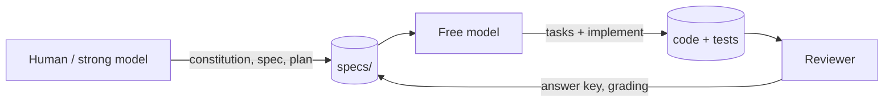
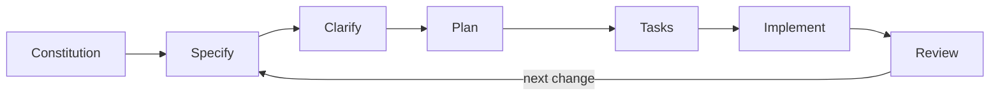
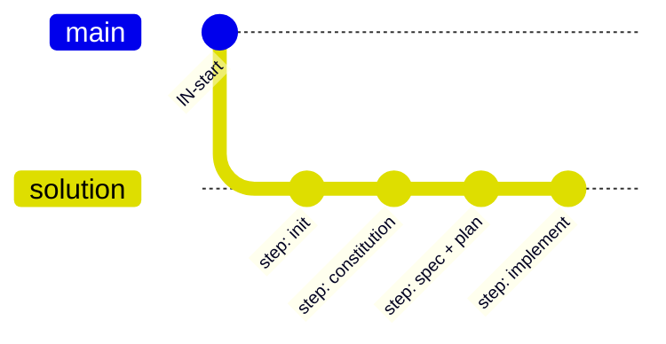
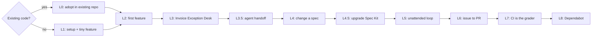

# Spec Kit Developer Guide

Welcome! This guide teaches [GitHub Spec Kit](https://github.com/github/spec-kit) from simple to complex. It starts with two small onboarding exercises (L0 adds a feature to the open-source `python-slugify` library, and L1 builds a tiny `split_bill` app), then moves to one real multi-feature project, the **Invoice Exception Desk**, from L3 on. It's written while learning, so it also records the places where things got confusing.

## Who this is for

- **Mainly:** senior engineers, tech leads and architects who already build with an AI coding agent (Copilot, Claude Code, OpenCode and so on), but are new to Spec Kit and **Spec-Driven Development (SDD)**. SDD means writing down *what* to build and *why* before deciding *how*. You want a flow you can trust on a real project.
- **Also:** mid-level developers who are adopting agents and want a guided first run. Read L1 and L2 in order.
- **Also:** leads deciding whether SDD fits their team. Start with the decision gate below.

### Who does the work

Every level uses the same split. A human or a strong model writes the constitution, the spec, and the plan. A separate reviewer holds the answer key and grades the result. A free model runs the tasks and the implementation.



## The Spec Kit loop

Every feature goes around the same loop. The constitution is written once; then each change starts again at Specify.



## The Decision Gate: should this project use Spec Kit at all?

Spec Kit is not free. Writing the spec, the plan, and the acceptance tests costs real time before a line of code exists, and that cost is only repaid when the cost of building the WRONG thing is higher. Run this gate before Level 0. Answer honestly — the gate has no prize for yes.

**1. Can you say, in advance, what "done" looks like as checkable outcomes?**
Not a vibe — outcomes a test or a reviewer could pass or fail. If the work is exploratory ("let's see what's possible"), a spec will slow you down and teach you nothing the prototype wouldn't. Prototype first; specify when the shape is known.

**2. Is the work bigger than one sitting?**
If one person, or one agent session, can hold the whole change in mind and verify it by reading it, the ceremony buys nothing. Spec Kit earns its keep when the work spans sessions, agents, or weeks — when no single reader holds the whole thing.

**3. Will someone other than the builder check the result?**
This is the gate most projects fail quietly. In our own first trial, the model wrote the code, the oracle, AND the tests — and unsurprisingly passed. That demonstrates scaffolding, not capability. If the same hands write the spec, the code, and the answer key, label the result self-graded and do not call it verified. Independent checking can be a second model, a frozen fixture written before the run, or a human with the acceptance list — but it must be independent.

**4. Are the expensive mistakes the quiet kind?**
Crashes announce themselves. A totals column that is plausibly wrong, a rule applied almost everywhere, behavior that drifts a little each iteration — those are the failures specs and acceptance tests exist to catch. If your project's real risk is quiet wrongness, specify. If its risk is loud failure, ordinary tests are cheaper.

**5. Do you have one frozen example to specify against?**
A worked case — real data, a prior implementation, a hand-checked fixture — anchors everything. Specs written without an anchor drift into describing the system you wish you had.

**Reading your answers**

- **Mostly yes:** proceed to Level 0. The levels ahead assume these conditions.
- **Yes except #3:** proceed, but add an independent check before anything is called done — and say "self-graded" out loud until you do.
- **No on #1 or #2:** don't adopt yet. That's a real answer, not a failure; the guide will still be here when the project grows into the shape where specifying pays.

*Spec Kit doesn't make a model honest. It makes dishonesty easier to catch — if someone else is holding the answer key.*

### If you proceed: how much SDD?

Pick a tier:

| Tier | When | What it looks like |
|---|---|---|
| **Full SDD** | Heavy, risky work: money paths, cross-service changes, public APIs | Constitution, spec, clarify, plan, tasks, and an independent answer key |
| **Light SDD** | Ordinary features | A short spec and a brief plan |
| **No SDD** | Typo, config change, dependency bump, one-line fix, prototype | A normal pull request |

**Honest costs:** SDD is slower on day one. The main failure is "spec theatre", meaning writing specs nobody uses. And a stale spec is worse than no spec, because it misleads the next agent that reads it.

## Use this pattern in your own project

[PLAYBOOK](PLAYBOOK.md) is the whole pattern on one page. You can hand it to any coding agent, such as Claude Code, Codex CLI, Copilot, Gemini CLI, Cursor, OpenCode or others; its [Choose your harness](PLAYBOOK.md#2-choose-your-harness) section covers what the builder step needs.

To try it, open your own repo and give your AI this prompt:

```text
Read https://raw.githubusercontent.com/tosin2013/invoice-exception-desk/main/PLAYBOOK.md
and apply its pattern to this repo. Follow section 9, "Apply this to a new project:
checklist for an AI", in order:

1. Ask me which coding agent, model and budget I use (or check what's installed and
   confirm with me). Don't assume OpenCode. Map the loop to it using section 2,
   "Choose your harness".
2. Run the decision gate with me. If the answer is light SDD or no SDD, stop and say so.
3. Set up Spec Kit with my agent's integration key (existing code: inventory first and
   change nothing, as in L0; new repo: as in L1).
4. Help me write a short constitution: 3 to 5 rules, each citing real code.
5. Turn my first small, already-decided change into a GitHub issue that is the ruling.
   I approve it and add the agent-ready label.
6. Write acceptance tests from the issue and keep them out of the builder's reach.
7. Add a read-only CI workflow with no secrets as the grader, before the first run.
8. Set up the builder: a capped loop (Ralph, or a wrapper with section 7's caps and
   stops) in a sandbox with no keys, tokens or push access. It writes the spec, plan
   and tasks, then implements, and its work comes out as a git bundle.
9. Add the acceptance tests as one separate grader commit, and add Dependabot
   (section 8) once CI exists.

Don't push, open a PR or merge without my OK.
```

Prefer to do it by hand? The short path:

1. Run the [decision gate above](#the-decision-gate-should-this-project-use-spec-kit-at-all) first.
2. Pick your harness ([PLAYBOOK section 2](PLAYBOOK.md#2-choose-your-harness)) and set up Spec Kit: [L0](L0-existing-repo.md) for a repo with code, [L1](L1-setup.md) for a new one.
3. Write a constitution and turn your first change into an approved issue ([L6](L6-issue-to-pr.md)).
4. Run the builder in a capped loop in a keyless box ([L5](L5-agent-loop.md)), then let read-only CI grade the PR, with the acceptance tests as a separate commit ([L7](L7-ci-grader.md)).
5. Add Dependabot, graded by the same CI ([L8](L8-dependabot.md)).

The full checklist is [PLAYBOOK section 9](PLAYBOOK.md#9-apply-this-to-a-new-project-checklist-for-an-ai). For agents, the guide also has an index at [llms.txt](llms.txt).

## How each level's branches work

A finished level is two branches. `lN-start` is the tree you begin from. `lN-solution` is the same work, one commit per step.



Check out `lN-start` and follow the page. Compare with `lN-solution` when you want the finished steps. `git log --oneline` on the solution branch lists them. L0 to L3 name the real branches in the table below. L3.5 has no start branch; it starts from `l3-solution` and its steps are on `l3h-handoff`. L4 starts from `l4-start`; its steps were merged into `l3h-handoff` by PR #8. L4.5 upgraded `l3h-handoff` to Spec Kit 1.2.3 on its own branch, merged into `l3h-handoff` by PR #12 (the branch was then deleted); older lesson branches stay on the Spec Kit version they were recorded with. L5 starts from the Ralph setup commit `d6c7d7b` on `l5-setup`; the builder's commits were merged into `l5-setup` by PR #14. L6 starts from `61c1403` on `l5-setup` (after PR #14); its builder commits were merged into `l5-setup` by PR #17. L7 starts from `ed1fa8e` on `l5-setup` (after the CI workflow, PR #21); its builder commits and a separate grader commit were merged into `l5-setup` by PR #23. L8 starts from `211a728` on `l5-setup` and `858f806` on `main`; the pytest pin was merged into `l5-setup` by PR #25 and `.github/dependabot.yml` into `main` by PR #26, after which Dependabot opened PR #27 (into `l5-setup`) and PR #28 (into `main`).

## Where are you in your project?

Start at L0 when the repo already has code, and at L1 when it does not.



| You are… | Go to | Branches |
|---|---|---|
| Adding Spec Kit to an existing repo | [L0: Start from an existing repo](L0-existing-repo.md) | [`l0-start`](https://github.com/tosin2013/invoice-exception-desk/tree/l0-start) → [`l0-solution`](https://github.com/tosin2013/invoice-exception-desk/tree/l0-solution) |
| Starting fresh and need to install | [L1: Setup](L1-setup.md) | [`l1-start`](https://github.com/tosin2013/invoice-exception-desk/tree/l1-start) → [`l1-solution`](https://github.com/tosin2013/invoice-exception-desk/tree/l1-solution) |
| Ready to build your first feature | [L2: First feature, end to end](L2-first-feature.md) | [`l2-start`](https://github.com/tosin2013/invoice-exception-desk/tree/l2-start) → [`l2-solution`](https://github.com/tosin2013/invoice-exception-desk/tree/l2-solution) |
| Working on a real multi-feature project | [L3: Invoice Exception Desk walkthrough](L3-invoice-desk.md) | [`l3-start`](https://github.com/tosin2013/invoice-exception-desk/tree/l3-start) → [`l3-solution`](https://github.com/tosin2013/invoice-exception-desk/tree/l3-solution) |
| Handing work from one coding agent to another | [L3.5: Handing work between coding agents](L35-agent-handoff.md) | [`l3-solution`](https://github.com/tosin2013/invoice-exception-desk/tree/l3-solution) → [`l3h-handoff`](https://github.com/tosin2013/invoice-exception-desk/tree/l3h-handoff) |
| Changing specs after code exists | [L4: Changing a spec after code exists](L4-maintenance.md) | [`l4-start`](https://github.com/tosin2013/invoice-exception-desk/tree/l4-start) → [`l3h-handoff`](https://github.com/tosin2013/invoice-exception-desk/tree/l3h-handoff) |
| Upgrading Spec Kit itself (any version, repeatable) | [L4.5: Upgrading Spec Kit itself](L45-speckit-upgrade.md) | [`8c302ee`](https://github.com/tosin2013/invoice-exception-desk/commit/8c302ee) → [`l3h-handoff`](https://github.com/tosin2013/invoice-exception-desk/tree/l3h-handoff) ([PR #12](https://github.com/tosin2013/invoice-exception-desk/pull/12)) |
| Ready to let an agent loop run unattended | [L5: Letting an agent loop run unattended](L5-agent-loop.md) | [`d6c7d7b`](https://github.com/tosin2013/invoice-exception-desk/commit/d6c7d7b) → [`l5-setup`](https://github.com/tosin2013/invoice-exception-desk/tree/l5-setup) ([PR #14](https://github.com/tosin2013/invoice-exception-desk/pull/14)) |
| Turning an approved issue into a PR you can trust | [L6: From an approved issue to a PR you can trust](L6-issue-to-pr.md) | [`61c1403`](https://github.com/tosin2013/invoice-exception-desk/commit/61c1403) → [`l5-setup`](https://github.com/tosin2013/invoice-exception-desk/tree/l5-setup) ([issue #16](https://github.com/tosin2013/invoice-exception-desk/issues/16), [PR #17](https://github.com/tosin2013/invoice-exception-desk/pull/17)) |
| Letting CI grade every PR | [L7: CI is the grader](L7-ci-grader.md) | [`ed1fa8e`](https://github.com/tosin2013/invoice-exception-desk/commit/ed1fa8e) → [`l5-setup`](https://github.com/tosin2013/invoice-exception-desk/tree/l5-setup) ([PR #21](https://github.com/tosin2013/invoice-exception-desk/pull/21), [issue #22](https://github.com/tosin2013/invoice-exception-desk/issues/22), [PR #23](https://github.com/tosin2013/invoice-exception-desk/pull/23)) |
| Letting Dependabot send dependency bumps, graded by CI | [L8: Dependabot, graded like everyone else](L8-dependabot.md) | [`211a728`](https://github.com/tosin2013/invoice-exception-desk/commit/211a728) → [`l5-setup`](https://github.com/tosin2013/invoice-exception-desk/tree/l5-setup) ([PR #25](https://github.com/tosin2013/invoice-exception-desk/pull/25), [PR #27](https://github.com/tosin2013/invoice-exception-desk/pull/27)); [`858f806`](https://github.com/tosin2013/invoice-exception-desk/commit/858f806) → [`main`](https://github.com/tosin2013/invoice-exception-desk/tree/main) ([PR #26](https://github.com/tosin2013/invoice-exception-desk/pull/26), [PR #28](https://github.com/tosin2013/invoice-exception-desk/pull/28)) |
| Wanting the whole pattern on one page (or handing it to an AI) | [PLAYBOOK: the wrap-up](PLAYBOOK.md) | [`main`](https://github.com/tosin2013/invoice-exception-desk/tree/main) |
| Mixing agents or using the Copilot coding agent | **Advanced** *(not planned yet; see the wiki's [Multi-Agent Workflow](https://github.com/tosin2013/invoice-exception-desk/wiki/Multi-Agent-Workflow) page)* | — |

The [project wiki](https://github.com/tosin2013/invoice-exception-desk/wiki) keeps older drafts, including R0 Results and Lessons and Multi-Agent Workflow.
